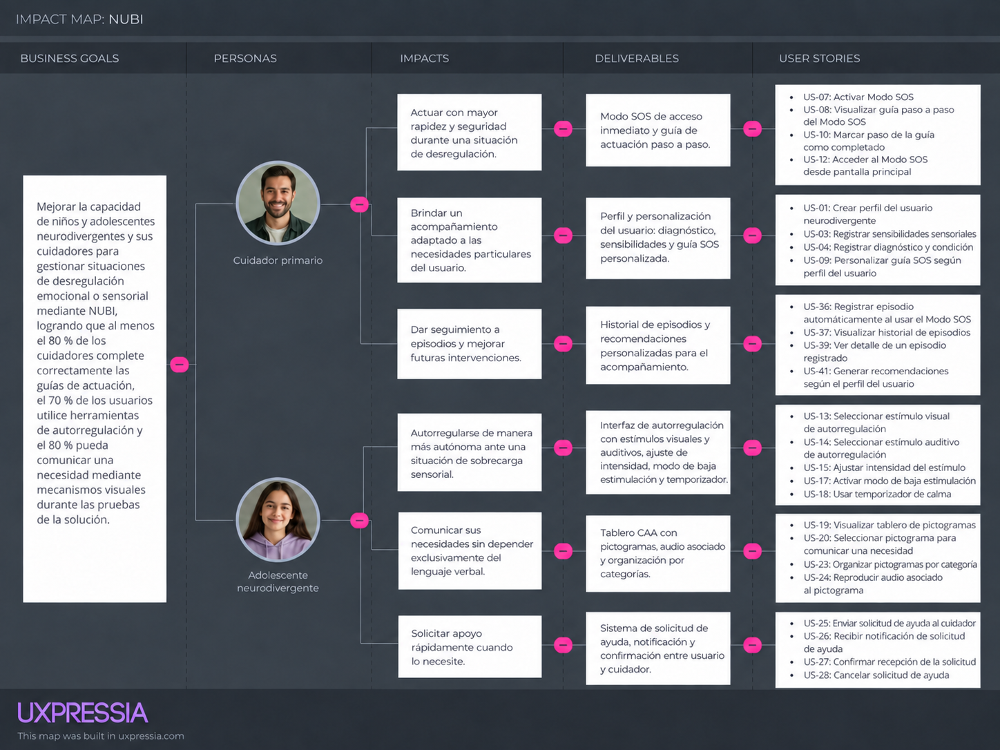

# Capítulo III: Requirements Specification

## 3.1. User Stories

En esta sección se especifican las épicas y las User Stories que definen el alcance funcional de Nubi. El alcance se ha delimitado a los 5 Bounded Contexts identificados en el Big Picture Event Storming: Perfil y Personalización, Gestión de Crisis (Modo SOS), Autorregulación, Comunicación Asistida (CAA) y Red de Apoyo y Seguimiento.

A partir de estas 5 épicas se desarrolla el conjunto de User Stories funcionales, Technical Stories orientadas al RESTful API y Landing Page Stories asociadas al sitio web estático de Nubi.

Los criterios de aceptación se redactan en tiempo presente, en tercera persona y siguen la estructura Gherkin: Dado - Cuando - Entonces / Given - When - Then.

### Épicas por Bounded Context

| Epic ID | Bounded Context | Descripción |
|---|---|---|
| EPIC-01 | Perfil y Personalización | Como cuidador quiero crear y gestionar el perfil del niño con autismo a mi cargo para personalizar las herramientas de apoyo según sus sensibilidades, detonantes, necesidades comunicativas y preferencias. |
| EPIC-02 | Gestión de Crisis (Modo SOS) | Como cuidador quiero contar con un Modo SOS de acceso rápido con guías paso a paso para actuar con mayor seguridad durante un episodio de desregulación emocional o sensorial. |
| EPIC-03 | Autorregulación | Como niño con autismo quiero disponer de recursos de calma de baja carga cognitiva para ayudarme a autorregularme durante una situación de sobrecarga emocional o sensorial. |
| EPIC-04 | Comunicación Asistida (CAA) | Como niño con autismo quiero utilizar herramientas de Comunicación Aumentativa y Alternativa para expresar mis necesidades cuando hablar resulte difícil. |
| EPIC-05 | Red de Apoyo y Seguimiento | Como cuidador quiero recibir solicitudes de ayuda, registrar episodios y consultar información relevante para brindar un acompañamiento más adecuado al niño con autismo a mi cargo. |

### 3.1.1. User Stories

Historias funcionales redactadas desde el rol del cuidador o del niño con autismo según corresponda.

| Epic / Story ID | Título | Descripción | Criterios de Aceptación | Relacionado con (Epic ID) |
|---|---|---|---|---|
| US-01 | Crear perfil del niño con autismo | Como cuidador, quiero crear el perfil del niño con autismo a mi cargo, para personalizar las herramientas de apoyo de Nubi según sus necesidades. | **Scenario 1: Creación exitosa del perfil** Dado que el cuidador registra los datos obligatorios del niño, cuando la información ingresada es válida, entonces el sistema crea el perfil y lo incorpora a la lista de perfiles asociados al cuidador.  **Scenario 2: Datos obligatorios incompletos** Dado que el cuidador intenta registrar el perfil sin completar un dato obligatorio, cuando el sistema valida la información, entonces rechaza la creación e indica cuál dato debe completarse. | EPIC-01 |
| US-02 | Editar perfil del niño | Como cuidador, quiero editar el perfil del niño a mi cargo, para mantener actualizada la información utilizada por Nubi. | **Scenario 1: Edición exitosa** Dado que el cuidador modifica información del perfil, cuando los datos ingresados son válidos, entonces el sistema actualiza el perfil.  **Scenario 2: Edición sin modificaciones** Dado que el cuidador confirma la edición sin modificar ningún dato, cuando el sistema procesa la solicitud, entonces mantiene la información existente sin cambios. | EPIC-01 |
| US-03 | Registrar perfil sensorial | Como cuidador, quiero registrar los detonantes, sensibilidades y preferencias sensoriales del niño, para que Nubi adapte los recursos y recomendaciones a sus necesidades. | **Scenario 1: Registro exitoso** Dado que el cuidador registra sensibilidades, detonantes y preferencias sensoriales, cuando confirma la información, entonces el sistema la almacena y la asocia al perfil del niño.  **Scenario 2: Información sensorial incompleta** Dado que el cuidador registra solo parte de la información sensorial, cuando guarda el perfil, entonces el sistema conserva los datos ingresados y permite completarlos posteriormente. | EPIC-01 |
| US-04 | Registrar necesidades comunicativas | Como cuidador, quiero registrar las formas de comunicación que resultan más adecuadas para el niño, para que Nubi adapte sus herramientas de comunicación asistida. | **Scenario 1: Registro exitoso** Dado que el cuidador selecciona una o más preferencias comunicativas, cuando confirma la información, entonces el sistema las asocia al perfil del niño.  **Scenario 2: Sin preferencias registradas** Dado que todavía no se han registrado preferencias comunicativas, cuando el cuidador guarda el perfil, entonces el sistema mantiene disponibles las opciones básicas de comunicación. | EPIC-01 |
| US-05 | Gestionar contactos de confianza | Como cuidador, quiero registrar contactos de confianza vinculados al perfil del niño, para que puedan recibir solicitudes de ayuda cuando sea necesario. | **Scenario 1: Contacto agregado correctamente** Dado que el cuidador registra los datos válidos de un contacto, cuando confirma el registro, entonces el sistema lo incorpora a la red de apoyo del niño.  **Scenario 2: Contacto duplicado** Dado que el contacto ya se encuentra asociado al perfil, cuando el cuidador intenta registrarlo nuevamente, entonces el sistema evita la duplicación e informa que el contacto ya existe. | EPIC-01 |
| US-06 | Gestionar múltiples perfiles | Como cuidador, quiero gestionar más de un perfil desde mi cuenta, para acompañar a distintos niños cuando sea necesario. | **Scenario 1: Nuevo perfil asociado** Dado que el cuidador tiene permisos para gestionar más de un perfil, cuando crea un nuevo perfil válido, entonces el sistema lo asocia a su cuenta.  **Scenario 2: Límite de perfiles alcanzado** Dado que la cuenta alcanza el límite de perfiles permitido por el plan, cuando intenta agregar uno adicional, entonces el sistema informa la restricción correspondiente. | EPIC-01 |
| US-07 | Activar Modo SOS | Como cuidador, quiero activar el Modo SOS con una acción rápida, para recibir orientación inmediata durante un episodio de desregulación. | **Scenario 1: Activación exitosa** Dado que existe un perfil activo, cuando el cuidador activa el Modo SOS, entonces el sistema inicia el flujo de actuación correspondiente al perfil.  **Scenario 2: Sin perfil activo** Dado que no existe un perfil seleccionado, cuando el cuidador intenta activar el Modo SOS, entonces el sistema solicita seleccionar un perfil antes de continuar. | EPIC-02 |
| US-08 | Registrar detonante del episodio | Como cuidador, quiero identificar el detonante asociado al episodio, para que las indicaciones y el registro reflejen mejor la situación ocurrida. | **Scenario 1: Detonante seleccionado** Dado que el Modo SOS está activo, cuando el cuidador identifica un detonante registrado en el perfil, entonces el sistema lo asocia al episodio actual.  **Scenario 2: Detonante desconocido** Dado que el cuidador no logra identificar el detonante, cuando continúa con el Modo SOS, entonces el sistema permite registrar el episodio sin un detonante definido. | EPIC-02 |
| US-09 | Visualizar guía de actuación personalizada | Como cuidador, quiero visualizar una guía breve adaptada al perfil sensorial del niño, para saber qué acciones realizar durante el episodio. | **Scenario 1: Guía personalizada disponible** Dado que el perfil cuenta con información sensorial registrada, cuando se inicia la guía, entonces el sistema presenta pasos relacionados con las necesidades del niño.  **Scenario 2: Perfil con información insuficiente** Dado que el perfil no cuenta con suficiente información de personalización, cuando se inicia la guía, entonces el sistema muestra una guía general de actuación. | EPIC-02 |
| US-10 | Utilizar temporizador visual durante el Modo SOS | Como cuidador, quiero utilizar un temporizador visual durante una estrategia de contención, para controlar el tiempo sin aumentar la carga cognitiva. | **Scenario 1: Temporizador iniciado** Dado que una estrategia de la guía requiere controlar el tiempo, cuando el cuidador inicia el temporizador, entonces el sistema muestra el progreso temporal correspondiente.  **Scenario 2: Temporizador finalizado** Dado que el tiempo configurado termina, cuando el sistema detecta la finalización, entonces informa que puede continuar con el siguiente paso. | EPIC-02 |
| US-11 | Consultar técnica alternativa | Como cuidador, quiero consultar una técnica alternativa cuando una estrategia no funciona, para disponer de otra opción de acompañamiento. | **Scenario 1: Técnica alternativa disponible** Dado que el cuidador indica que una estrategia no está funcionando, cuando solicita una alternativa, entonces el sistema presenta otra estrategia compatible con el perfil del niño.  **Scenario 2: Sin alternativa personalizada** Dado que no existe una técnica alternativa específica para el perfil, cuando el cuidador solicita otra opción, entonces el sistema presenta una recomendación general disponible. | EPIC-02 |
| US-12 | Finalizar episodio desde el Modo SOS | Como cuidador, quiero finalizar el episodio cuando la situación se estabiliza, para que quede registrado y pueda revisarse posteriormente. | **Scenario 1: Finalización exitosa** Dado que el cuidador finaliza el Modo SOS, cuando confirma el cierre, entonces el sistema registra la fecha, duración, detonante y estrategias utilizadas durante el episodio.  **Scenario 2: Finalización anticipada** Dado que el cuidador finaliza el Modo SOS antes de completar la guía, cuando confirma el cierre, entonces el sistema guarda la información disponible y registra que el flujo terminó anticipadamente. | EPIC-02 |
| US-13 | Iniciar respiración guiada | Como niño con autismo, quiero seguir un ejercicio de respiración guiada, para ayudarme a recuperar la calma cuando me siento abrumado. | **Scenario 1: Inicio de ejercicio** Dado que el niño selecciona la respiración guiada, cuando el sistema inicia la actividad, entonces presenta una secuencia visual sencilla que marca el ritmo de respiración.  **Scenario 2: Finalización de ejercicio** Dado que la secuencia termina, cuando el sistema completa el ejercicio, entonces permite repetirlo o regresar a los recursos de calma. | EPIC-03 |
| US-14 | Reproducir sonidos relajantes | Como niño con autismo, quiero escuchar sonidos relajantes, para reducir el impacto de los estímulos externos y facilitar mi autorregulación. | **Scenario 1: Reproducción exitosa** Dado que el niño selecciona un recurso auditivo disponible, cuando el sistema procesa la selección, entonces inicia su reproducción.  **Scenario 2: Recurso disponible sin conexión** Dado que no existe conexión a internet y el recurso se encuentra almacenado localmente, cuando el niño lo selecciona, entonces el sistema permite reproducirlo sin conexión. | EPIC-03 |
| US-15 | Utilizar lienzo de dibujo libre | Como niño con autismo, quiero disponer de un espacio de dibujo libre, para expresar o canalizar mi tensión mediante trazos sin reglas. | **Scenario 1: Inicio del lienzo** Dado que el niño selecciona el lienzo de dibujo libre, cuando el sistema abre el recurso, entonces permite realizar trazos de forma inmediata.  **Scenario 2: Limpiar lienzo** Dado que existen trazos en el lienzo, cuando el niño solicita limpiar el espacio, entonces el sistema elimina los trazos y mantiene disponible el recurso. | EPIC-03 |
| US-16 | Guardar recursos de calma favoritos | Como niño con autismo, quiero guardar mis recursos de calma preferidos, para acceder a ellos rápidamente cuando los necesite. | **Scenario 1: Recurso marcado como favorito** Dado que el niño selecciona un recurso disponible, cuando lo marca como favorito, entonces el sistema lo incorpora a la lista de acceso rápido.  **Scenario 2: Recurso eliminado de favoritos** Dado que un recurso se encuentra marcado como favorito, cuando se desmarca, entonces el sistema lo retira de la lista de favoritos. | EPIC-03 |
| US-17 | Activar modo de baja estimulación | Como niño con autismo, quiero utilizar una interfaz con menos estímulos visuales y auditivos, para evitar aumentar la sobrecarga cuando me siento abrumado. | **Scenario 1: Activación exitosa** Dado que el niño activa el modo de baja estimulación, cuando el sistema procesa la acción, entonces reduce elementos visuales, animaciones y sonidos no esenciales.  **Scenario 2: Desactivación del modo** Dado que el modo de baja estimulación está activo, cuando se desactiva, entonces el sistema restaura la configuración habitual de la interfaz. | EPIC-03 |
| US-18 | Utilizar temporizador de calma | Como niño con autismo, quiero utilizar un temporizador durante una sesión de calma, para contar con una referencia visual del tiempo sin sentir presión. | **Scenario 1: Temporizador iniciado** Dado que el niño comienza una sesión de calma, cuando activa el temporizador, entonces el sistema muestra el progreso temporal de forma visual.  **Scenario 2: Tiempo finalizado** Dado que el temporizador llega al final, cuando el sistema detecta la finalización, entonces permite continuar la actividad o terminar la sesión. | EPIC-03 |
| US-19 | Visualizar tablero CAA | Como niño con autismo, quiero visualizar un tablero de pictogramas organizado, para comunicar mis necesidades cuando hablar resulte difícil. | **Scenario 1: Visualización correcta** Dado que el niño ingresa a la sección de comunicación, cuando el sistema carga el tablero, entonces presenta los pictogramas disponibles organizados por categorías.  **Scenario 2: Sin configuración personalizada** Dado que el perfil no cuenta con una configuración personalizada del tablero, cuando el niño accede, entonces el sistema presenta un conjunto básico de pictogramas. | EPIC-04 |
| US-20 | Seleccionar pictograma para comunicar una necesidad | Como niño con autismo, quiero seleccionar un pictograma, para expresar rápidamente una necesidad sin depender de la comunicación verbal. | **Scenario 1: Selección exitosa** Dado que el niño selecciona un pictograma, cuando el sistema procesa la selección, entonces incorpora el pictograma al mensaje actual.  **Scenario 2: Selección modificada** Dado que existe un pictograma seleccionado, cuando el niño decide retirarlo, entonces el sistema actualiza el mensaje sin ese elemento. | EPIC-04 |
| US-21 | Acceder rápidamente a pictogramas frecuentes | Como niño con autismo, quiero tener acceso rápido a los pictogramas que utilizo con mayor frecuencia, para comunicarme con menos interacciones. | **Scenario 1: Acceso rápido disponible** Dado que existen pictogramas frecuentes o favoritos, cuando el niño abre el tablero, entonces el sistema los presenta en una sección de acceso rápido.  **Scenario 2: Sin pictogramas frecuentes** Dado que aún no existen pictogramas frecuentes, cuando el niño accede al tablero, entonces el sistema mantiene disponibles las categorías generales. | EPIC-04 |
| US-22 | Registrar estado emocional mediante check-in | Como niño con autismo, quiero indicar de forma visual cómo me siento, para comunicar mi estado sin tener que redactar un mensaje extenso. | **Scenario 1: Estado registrado** Dado que el niño selecciona un nivel de intensidad emocional disponible, cuando confirma la selección, entonces el sistema registra el estado asociado al perfil.  **Scenario 2: Actualización de estado** Dado que existe un estado previamente registrado, cuando el niño selecciona uno diferente, entonces el sistema actualiza el estado actual. | EPIC-04 |
| US-23 | Personalizar pictogramas del tablero | Como cuidador, quiero configurar pictogramas relevantes para el niño, para adaptar el tablero a sus necesidades cotidianas de comunicación. | **Scenario 1: Pictograma personalizado registrado** Dado que el cuidador registra un pictograma válido y una etiqueta, cuando confirma la información, entonces el sistema lo agrega al tablero del perfil.  **Scenario 2: Información inválida** Dado que el pictograma no cuenta con la información requerida, cuando el sistema valida el registro, entonces rechaza la creación e indica los datos faltantes. | EPIC-04 |
| US-24 | Reproducir salida de voz del mensaje | Como niño con autismo, quiero que Nubi reproduzca en voz alta el mensaje formado con pictogramas, para facilitar que otra persona comprenda lo que necesito. | **Scenario 1: Reproducción correcta** Dado que existe un mensaje formado con pictogramas, cuando el niño solicita reproducirlo, entonces el sistema genera la salida de voz correspondiente.  **Scenario 2: Mensaje vacío** Dado que todavía no existe un mensaje formado, cuando el niño solicita reproducirlo, entonces el sistema indica que debe seleccionar al menos un pictograma. | EPIC-04 |
| US-25 | Enviar solicitud de ayuda | Como niño con autismo, quiero enviar una solicitud de ayuda a un contacto de confianza, para recibir apoyo cuando lo necesite. | **Scenario 1: Solicitud enviada** Dado que existe al menos un contacto de confianza vinculado, cuando el niño activa una solicitud de ayuda, entonces el sistema registra la solicitud y notifica al contacto disponible.  **Scenario 2: Sin contactos vinculados** Dado que no existe ningún contacto de confianza asociado al perfil, cuando el niño intenta solicitar ayuda, entonces el sistema informa que no existe un destinatario disponible. | EPIC-05 |
| US-26 | Recibir notificación de solicitud de ayuda | Como cuidador, quiero recibir una notificación cuando el niño solicita ayuda, para responder de manera oportuna. | **Scenario 1: Notificación recibida** Dado que el niño envía una solicitud de ayuda, cuando el sistema procesa la solicitud, entonces notifica al cuidador vinculado.  **Scenario 2: Cuidador temporalmente sin conexión** Dado que el cuidador no tiene conexión en el momento del envío, cuando recupera la conexión, entonces el sistema muestra la solicitud pendiente. | EPIC-05 |
| US-27 | Confirmar recepción de una solicitud de ayuda | Como cuidador, quiero confirmar que he recibido una solicitud, para que el niño sepa que alguien de su red de apoyo responderá. | **Scenario 1: Confirmación exitosa** Dado que existe una solicitud pendiente, cuando el cuidador confirma su recepción, entonces el sistema cambia el estado de la solicitud y notifica al niño.  **Scenario 2: Solicitud ya confirmada** Dado que otro contacto ya confirmó la solicitud, cuando el cuidador intenta confirmarla nuevamente, entonces el sistema informa que ya fue atendida. | EPIC-05 |
| US-28 | Cancelar solicitud de ayuda | Como niño con autismo, quiero cancelar una solicitud de ayuda pendiente, para evitar una alerta innecesaria si ya no requiero asistencia. | **Scenario 1: Cancelación exitosa** Dado que existe una solicitud pendiente, cuando el niño decide cancelarla, entonces el sistema actualiza su estado a cancelada.  **Scenario 2: Solicitud ya atendida** Dado que la solicitud ya fue confirmada, cuando el niño intenta cancelarla, entonces el sistema informa que la solicitud ya está siendo atendida. | EPIC-05 |
| US-29 | Consultar historial de solicitudes de ayuda | Como cuidador, quiero consultar las solicitudes de ayuda anteriores, para identificar con qué frecuencia el niño ha requerido asistencia. | **Scenario 1: Historial disponible** Dado que existen solicitudes registradas, cuando el cuidador consulta el historial, entonces el sistema presenta la fecha y estado de cada solicitud.  **Scenario 2: Sin solicitudes registradas** Dado que no existen solicitudes previas, cuando el cuidador consulta el historial, entonces el sistema informa que no existen registros. | EPIC-05 |
| US-30 | Visualizar resumen de episodios recientes | Como cuidador, quiero visualizar un resumen de los episodios recientes, para conocer rápidamente la situación del niño. | **Scenario 1: Episodios recientes disponibles** Dado que existen episodios registrados recientemente, cuando el cuidador ingresa al panel, entonces el sistema muestra un resumen de los principales datos.  **Scenario 2: Sin episodios recientes** Dado que no existen episodios dentro del periodo reciente, cuando se consulta el resumen, entonces el sistema informa que no existen registros recientes. | EPIC-05 |
| US-31 | Visualizar estado emocional actual | Como cuidador, quiero visualizar el estado emocional registrado actualmente por el niño, para adaptar mi acompañamiento a la situación. | **Scenario 1: Estado disponible** Dado que existe un check-in emocional reciente, cuando el cuidador consulta el panel, entonces el sistema presenta el estado actual registrado.  **Scenario 2: Estado desactualizado** Dado que no existe un registro reciente, cuando el cuidador consulta el estado, entonces el sistema informa que la información puede estar desactualizada. | EPIC-05 |
| US-32 | Acceder a módulos mediante accesos directos | Como cuidador, quiero acceder rápidamente a los módulos principales, para reducir las interacciones necesarias durante situaciones de tensión. | **Scenario 1: Acceso exitoso** Dado que el cuidador selecciona un acceso directo disponible, cuando el sistema procesa la acción, entonces abre el módulo correspondiente.  **Scenario 2: Módulo restringido** Dado que una función no está disponible para el plan actual, cuando el cuidador intenta acceder, entonces el sistema informa la restricción. | EPIC-05 |
| US-33 | Visualizar alertas recientes | Como cuidador, quiero visualizar las alertas recientes relacionadas con el niño, para identificar eventos que requieren mi atención. | **Scenario 1: Alertas disponibles** Dado que existen alertas recientes, cuando el cuidador ingresa al panel, entonces el sistema las presenta ordenadas por fecha.  **Scenario 2: Sin alertas pendientes** Dado que no existen alertas pendientes, cuando el cuidador consulta la sección, entonces el sistema informa que no existen eventos por atender. | EPIC-05 |
| US-34 | Visualizar recomendaciones personalizadas | Como cuidador, quiero visualizar recomendaciones asociadas al perfil y al historial del niño, para contar con sugerencias de acompañamiento relevantes. | **Scenario 1: Recomendaciones disponibles** Dado que el perfil cuenta con información suficiente, cuando el cuidador consulta las recomendaciones, entonces el sistema muestra las sugerencias asociadas.  **Scenario 2: Información insuficiente** Dado que el perfil todavía no cuenta con información suficiente, cuando el cuidador consulta las recomendaciones, entonces el sistema solicita completar los datos necesarios. | EPIC-05 |
| US-35 | Cambiar entre perfiles a cargo | Como cuidador, quiero cambiar entre los perfiles asociados a mi cuenta, para gestionar a más de un niño desde el mismo acceso. | **Scenario 1: Cambio exitoso** Dado que existen varios perfiles asociados, cuando el cuidador selecciona uno distinto, entonces el sistema actualiza el contexto al perfil seleccionado.  **Scenario 2: Un solo perfil asociado** Dado que solo existe un perfil asociado, cuando el cuidador intenta cambiarlo, entonces el sistema informa que no existen otros perfiles disponibles. | EPIC-05 |
| US-36 | Registrar episodio automáticamente al finalizar el Modo SOS | Como cuidador, quiero que Nubi registre automáticamente el episodio al finalizar el Modo SOS, para evitar documentar nuevamente lo ocurrido. | **Scenario 1: Registro automático exitoso** Dado que finaliza un flujo del Modo SOS, cuando el cuidador confirma el cierre, entonces el sistema genera el registro del episodio con la información recopilada.  **Scenario 2: Información parcial** Dado que algunos datos no fueron registrados durante el episodio, cuando el sistema genera el registro, entonces conserva la información disponible y permite completarla posteriormente. | EPIC-05 |
| US-37 | Visualizar historial de episodios | Como cuidador, quiero visualizar el historial de episodios del niño, para identificar patrones y revisar situaciones anteriores. | **Scenario 1: Historial disponible** Dado que existen episodios registrados, cuando el cuidador consulta el historial, entonces el sistema los presenta ordenados cronológicamente.  **Scenario 2: Sin episodios registrados** Dado que no existen episodios previos, cuando el cuidador consulta el historial, entonces el sistema informa que todavía no existen registros. | EPIC-05 |
| US-38 | Filtrar historial de episodios por fecha | Como cuidador, quiero filtrar el historial por un rango de fechas, para revisar los episodios ocurridos durante un periodo específico. | **Scenario 1: Filtro aplicado** Dado que el cuidador selecciona un rango válido, cuando aplica el filtro, entonces el sistema muestra únicamente los episodios correspondientes.  **Scenario 2: Sin resultados** Dado que no existen episodios en el rango seleccionado, cuando se aplica el filtro, entonces el sistema informa que no existen resultados. | EPIC-05 |
| US-39 | Visualizar detalle de un episodio | Como cuidador, quiero revisar el detalle de un episodio registrado, para conocer los detonantes, duración y estrategias utilizadas. | **Scenario 1: Detalle disponible** Dado que el cuidador selecciona un episodio existente, cuando el sistema carga la información, entonces presenta los datos registrados del episodio.  **Scenario 2: Episodio no disponible** Dado que el episodio ya no se encuentra disponible, cuando el cuidador intenta consultarlo, entonces el sistema informa que no puede mostrarse. | EPIC-05 |
| US-40 | Agregar notas a un episodio | Como cuidador, quiero agregar observaciones manuales a un episodio, para complementar la información registrada automáticamente. | **Scenario 1: Nota registrada** Dado que el cuidador ingresa una observación válida, cuando confirma el guardado, entonces el sistema la asocia al episodio.  **Scenario 2: Nota vacía** Dado que el cuidador intenta guardar una nota sin contenido, cuando el sistema valida la información, entonces rechaza el registro. | EPIC-05 |
| US-41 | Generar recomendaciones según perfil e historial | Como cuidador, quiero recibir recomendaciones basadas en el perfil sensorial y episodios anteriores del niño, para adaptar mejor las estrategias de acompañamiento. | **Scenario 1: Generación exitosa** Dado que existen datos suficientes del perfil y del historial, cuando el sistema procesa la información, entonces genera recomendaciones relacionadas con el niño.  **Scenario 2: Información insuficiente** Dado que no existen datos suficientes, cuando se intenta generar recomendaciones, entonces el sistema informa que se requiere más información. | EPIC-05 |
| US-42 | Visualizar guía de actuación recomendada | Como cuidador, quiero consultar el detalle de una recomendación, para conocer las acciones sugeridas y aplicarlas cuando corresponda. | **Scenario 1: Guía disponible** Dado que el cuidador selecciona una recomendación, cuando el sistema carga la información, entonces presenta la guía asociada.  **Scenario 2: Recomendación actualizada** Dado que existe una versión más reciente de la recomendación, cuando el cuidador consulta la anterior, entonces el sistema informa que existe una actualización. | EPIC-05 |
| US-43 | Marcar estrategia como efectiva | Como cuidador, quiero registrar qué estrategia resultó útil durante un episodio, para identificar las técnicas que funcionan mejor para el niño. | **Scenario 1: Estrategia marcada** Dado que el episodio cuenta con estrategias utilizadas, cuando el cuidador marca una como efectiva, entonces el sistema registra esa valoración.  **Scenario 2: Actualización de valoración** Dado que una estrategia ya fue valorada, cuando el cuidador modifica la selección, entonces el sistema actualiza el registro. | EPIC-05 |
| US-44 | Generar reporte de episodios | Como cuidador, quiero generar un reporte con información relevante de los episodios, para disponer de un resumen estructurado del seguimiento del niño. | **Scenario 1: Reporte generado** Dado que existen episodios registrados, cuando el cuidador solicita generar un reporte, entonces el sistema consolida la información disponible.  **Scenario 2: Sin información suficiente** Dado que no existen episodios dentro del periodo seleccionado, cuando se intenta generar el reporte, entonces el sistema informa que no existen datos suficientes. | EPIC-05 |
| US-45 | Compartir reporte con un profesional de salud | Como cuidador, quiero compartir un reporte de episodios con un profesional de salud vinculado, para facilitar la comunicación sobre las situaciones observadas. | **Scenario 1: Reporte compartido** Dado que existe un reporte generado y un profesional vinculado, cuando el cuidador confirma el envío, entonces el sistema registra que el reporte fue compartido.  **Scenario 2: Sin profesional vinculado** Dado que no existe un profesional asociado, cuando el cuidador intenta compartir el reporte, entonces el sistema informa que primero debe registrar un destinatario válido. | EPIC-05 |

### 3.1.2. Technical Stories

Historias técnicas del RESTful API, una por Bounded Context, redactadas desde el rol Developer. Los criterios de aceptación describen escenarios request/response en formato Gherkin.

| Epic / Story ID | Título | Descripción | Criterios de Aceptación | Relacionado con (Epic ID) |
|---|---|---|---|---|
| TS-01 | Exponer API RESTful de gestión de perfiles | Como Developer, quiero exponer un servicio RESTful para gestionar perfiles, información sensorial, necesidades comunicativas y contactos de confianza, para que las aplicaciones cliente puedan administrar la personalización de forma segura. | **Scenario 1: Creación de perfil vía API** Dado que el cliente envía una petición POST válida al recurso de perfiles, cuando el servidor procesa la solicitud, entonces persiste el perfil y responde con código de estado 201.  **Scenario 2: Datos inválidos** Dado que la petición contiene campos obligatorios inválidos, cuando el servidor la valida, entonces responde con código de estado 400 y el detalle correspondiente. | EPIC-01 |
| TS-02 | Exponer API RESTful del Modo SOS y episodios | Como Developer, quiero exponer un servicio RESTful para gestionar el Modo SOS, detonantes, guías y episodios, para que las aplicaciones cliente puedan iniciar, actualizar y finalizar los flujos de actuación. | **Scenario 1: Inicio de episodio** Dado que el cliente envía una petición válida para iniciar un episodio, cuando el servidor la procesa, entonces crea el episodio y responde con código de estado 201.  **Scenario 2: Episodio inexistente** Dado que el cliente intenta actualizar un episodio inexistente, cuando el servidor procesa la petición, entonces responde con código de estado 404. | EPIC-02 |
| TS-03 | Exponer API RESTful de recursos de autorregulación | Como Developer, quiero exponer un servicio RESTful para gestionar recursos de calma y preferencias, para que las aplicaciones cliente puedan consultar respiración guiada, sonidos, recursos favoritos y configuraciones de autorregulación. | **Scenario 1: Consulta exitosa** Dado que el cliente solicita los recursos asociados a un perfil válido, cuando el servidor procesa la petición, entonces responde con código de estado 200 y los recursos disponibles.  **Scenario 2: Perfil inexistente** Dado que el identificador de perfil no existe, cuando se consulta el recurso, entonces el servidor responde con código de estado 404. | EPIC-03 |
| TS-04 | Exponer API RESTful del tablero CAA | Como Developer, quiero exponer un servicio RESTful para gestionar pictogramas, check-ins emocionales y mensajes CAA, para que las aplicaciones cliente puedan consultar y registrar información de comunicación asistida. | **Scenario 1: Consulta del tablero** Dado que el cliente solicita el tablero de un perfil válido, cuando el servidor procesa la petición, entonces responde con código de estado 200 y los pictogramas correspondientes.  **Scenario 2: Datos inválidos** Dado que el cliente intenta registrar un pictograma sin información obligatoria, cuando el servidor valida la petición, entonces responde con código de estado 400. | EPIC-04 |
| TS-05 | Exponer API RESTful de red de apoyo y seguimiento | Como Developer, quiero exponer un servicio RESTful para solicitudes de ayuda, historial, recomendaciones y reportes de episodios, para que las aplicaciones cliente puedan gestionar el seguimiento del niño. | **Scenario 1: Solicitud de ayuda creada** Dado que el cliente envía una petición válida con el identificador del perfil, cuando el servidor la procesa, entonces crea la solicitud y responde con código de estado 201.  **Scenario 2: Recurso protegido sin autenticación** Dado que el cliente intenta acceder a información protegida sin un token válido, cuando el servidor procesa la petición, entonces responde con código de estado 401. | EPIC-05 |

### 3.1.3. Landing Page Stories

Historias del sitio web estático, una por Bounded Context, redactadas desde el rol Visitante.

| Epic / Story ID | Título | Descripción | Criterios de Aceptación | Relacionado con (Epic ID) |
|---|---|---|---|---|
| LS-01 | Conocer la personalización de perfiles | Como visitante, quiero conocer cómo Nubi adapta sus herramientas al perfil sensorial y comunicativo del niño, para evaluar si la solución responde a sus necesidades. | **Scenario 1: Visualización de información** Dado que el visitante accede a la sección de personalización, cuando la página carga, entonces presenta los principales beneficios del perfil.  **Scenario 2: Visualización móvil** Dado que el visitante accede desde un dispositivo móvil, cuando visualiza la sección, entonces el contenido se adapta al tamaño de pantalla. | EPIC-01 |
| LS-02 | Conocer el Modo SOS | Como visitante, quiero conocer cómo funciona el Modo SOS, para comprender cómo Nubi orienta al cuidador durante un episodio de desregulación. | **Scenario 1: Información disponible** Dado que el visitante accede a la sección del Modo SOS, cuando la página carga, entonces presenta una explicación de su funcionamiento.  **Scenario 2: Acceso al registro** Dado que el visitante selecciona el llamado a la acción, cuando el sistema procesa la interacción, entonces lo dirige al registro correspondiente. | EPIC-02 |
| LS-03 | Conocer las herramientas de autorregulación | Como visitante, quiero conocer los recursos de calma disponibles en Nubi, para comprender cómo pueden apoyar a un niño con autismo durante una sobrecarga sensorial o emocional. | **Scenario 1: Recursos presentados** Dado que el visitante accede a la sección de autorregulación, cuando la página carga, entonces presenta ejemplos de respiración guiada, sonidos relajantes, dibujo libre y modo de baja estimulación.  **Scenario 2: Contenido accesible** Dado que el visitante navega por la sección, cuando interactúa con el contenido informativo, entonces puede comprender las funciones sin autenticarse. | EPIC-03 |
| LS-04 | Conocer el tablero CAA | Como visitante, quiero conocer las herramientas de Comunicación Aumentativa y Alternativa de Nubi, para entender cómo facilitan la expresión de necesidades cuando hablar resulta difícil. | **Scenario 1: Información disponible** Dado que el visitante accede a la sección CAA, cuando la página carga, entonces presenta ejemplos de pictogramas y salida de voz.  **Scenario 2: Preguntas frecuentes** Dado que el visitante selecciona una pregunta relacionada con CAA, cuando el sistema procesa la selección, entonces muestra la respuesta correspondiente. | EPIC-04 |
| LS-05 | Conocer la red de apoyo y seguimiento | Como visitante, quiero conocer cómo Nubi permite solicitar ayuda, registrar episodios y generar reportes, para evaluar el soporte disponible para cuidadores y familias. | **Scenario 1: Información disponible** Dado que el visitante accede a la sección de red de apoyo, cuando la página carga, entonces presenta las funciones de solicitudes, historial y reportes.  **Scenario 2: Consulta de planes** Dado que el visitante selecciona el llamado a la acción correspondiente, cuando el sistema procesa la interacción, entonces lo dirige a la sección de planes disponibles. | EPIC-05 |

## 3.2. Impact Mapping

En el Impact Mapping de NUBI se representa la relación entre el objetivo principal del producto, los actores involucrados, los impactos esperados y las funcionalidades requeridas para alcanzarlos.

El mapa se estructura mediante la secuencia **Goal → Actor → Impact → Deliverable**.

El **Business Goal** busca mejorar el acompañamiento durante situaciones de desregulación emocional o sensorial en niños con autismo mediante herramientas digitales de baja carga cognitiva que faciliten la autorregulación, la comunicación y la solicitud de ayuda, proporcionando al mismo tiempo orientación y herramientas de seguimiento para sus cuidadores.

Los principales Actors considerados son el **Cuidador Primario** y el **Niño con Autismo**.

Para el **Cuidador Primario**, los impactos se orientan a actuar con mayor rapidez y seguridad durante una situación de desregulación, personalizar el acompañamiento de acuerdo con las características y necesidades del niño, y dar seguimiento a los episodios para identificar estrategias que resulten efectivas.

Para el **Niño con Autismo**, los impactos se orientan a facilitar la autorregulación ante situaciones de sobrecarga sensorial o emocional, permitir la comunicación de necesidades cuando hablar resulta difícil y posibilitar la solicitud rápida de ayuda a una persona de confianza.

  

Nota. Impact Map de la solución NUBI, estructurado mediante la secuencia Goal → Actor → Impact → Deliverable para mantener la trazabilidad entre el objetivo del producto, las necesidades de los actores y las User Stories definidas.

## 3.3. Product Backlog

A continuación se presenta el Product Backlog de Nubi. Para su elaboración y gestión se utiliza **Trello**, organizando las User Stories, Technical Stories y Landing Page Stories definidas en la sección 3.1 dentro de una única lista priorizada denominada "Product Backlog".

Cada tarjeta corresponde a una historia e incluye su identificador, título, descripción y los Story Points asignados.

Para estimar el esfuerzo de cada historia se utiliza la técnica de Planning Poker con la escala de Fibonacci (1, 2, 3, 5, 8), expresada mediante Story Points.

- **1:** Historia de esfuerzo mínimo y sin dependencias relevantes.
- **2:** Historia simple de visualización, configuración o una operación principal.
- **3:** Historia de complejidad media con validaciones o manejo de estados.
- **5:** Historia compleja que requiere personalización, integración entre módulos, notificaciones o múltiples estados.
- **8:** Historia de alta complejidad relacionada con procesamiento de información histórica o generación dinámica de resultados.

La priorización considera primero las funcionalidades necesarias para establecer el perfil y la personalización del niño, seguidas por las herramientas de gestión inmediata de la desregulación, autorregulación y comunicación asistida. Posteriormente se priorizan las funciones de red de apoyo, historial, recomendaciones y generación de reportes.

<table>
<thead>
<tr>
<th># Orden</th>
<th>User Story Id</th>
<th>Título</th>
<th>Descripción</th>
<th>Story Points</th>
</tr>
</thead>
<tbody>
<tr><td>1</td><td>LS-01</td><td>Conocer la personalización de perfiles</td><td>Como visitante, quiero conocer cómo Nubi adapta sus herramientas al perfil sensorial y comunicativo del niño, para evaluar si la solución responde a sus necesidades.</td><td>2</td></tr>
<tr><td>2</td><td>LS-02</td><td>Conocer el Modo SOS</td><td>Como visitante, quiero conocer cómo funciona el Modo SOS, para comprender cómo Nubi orienta al cuidador durante un episodio de desregulación.</td><td>2</td></tr>
<tr><td>3</td><td>LS-03</td><td>Conocer las herramientas de autorregulación</td><td>Como visitante, quiero conocer los recursos de calma disponibles en Nubi, para comprender cómo pueden apoyar a un niño con autismo durante una sobrecarga sensorial o emocional.</td><td>2</td></tr>
<tr><td>4</td><td>LS-04</td><td>Conocer el tablero CAA</td><td>Como visitante, quiero conocer las herramientas de Comunicación Aumentativa y Alternativa de Nubi, para entender cómo facilitan la expresión de necesidades cuando hablar resulta difícil.</td><td>2</td></tr>
<tr><td>5</td><td>LS-05</td><td>Conocer la red de apoyo y seguimiento</td><td>Como visitante, quiero conocer cómo Nubi permite solicitar ayuda, registrar episodios y generar reportes, para evaluar el soporte disponible para cuidadores y familias.</td><td>2</td></tr>
<tr><td>6</td><td>US-01</td><td>Crear perfil del niño con autismo</td><td>Como cuidador, quiero crear el perfil del niño con autismo a mi cargo, para personalizar las herramientas de apoyo de Nubi según sus necesidades.</td><td>3</td></tr>
<tr><td>7</td><td>US-02</td><td>Editar perfil del niño</td><td>Como cuidador, quiero editar el perfil del niño a mi cargo, para mantener actualizada la información utilizada por Nubi.</td><td>2</td></tr>
<tr><td>8</td><td>US-03</td><td>Registrar perfil sensorial</td><td>Como cuidador, quiero registrar los detonantes, sensibilidades y preferencias sensoriales del niño, para que Nubi adapte los recursos y recomendaciones a sus necesidades.</td><td>3</td></tr>
<tr><td>9</td><td>US-04</td><td>Registrar necesidades comunicativas</td><td>Como cuidador, quiero registrar las formas de comunicación que resultan más adecuadas para el niño, para que Nubi adapte sus herramientas de comunicación asistida.</td><td>2</td></tr>
<tr><td>10</td><td>US-05</td><td>Gestionar contactos de confianza</td><td>Como cuidador, quiero registrar contactos de confianza vinculados al perfil del niño, para que puedan recibir solicitudes de ayuda cuando sea necesario.</td><td>3</td></tr>
<tr><td>11</td><td>US-06</td><td>Gestionar múltiples perfiles</td><td>Como cuidador, quiero gestionar más de un perfil desde mi cuenta, para acompañar a distintos niños cuando sea necesario.</td><td>3</td></tr>
<tr><td>12</td><td>US-07</td><td>Activar Modo SOS</td><td>Como cuidador, quiero activar el Modo SOS con una acción rápida, para recibir orientación inmediata durante un episodio de desregulación.</td><td>2</td></tr>
<tr><td>13</td><td>US-08</td><td>Registrar detonante del episodio</td><td>Como cuidador, quiero identificar el detonante asociado al episodio, para que las indicaciones y el registro reflejen mejor la situación ocurrida.</td><td>2</td></tr>
<tr><td>14</td><td>US-09</td><td>Visualizar guía de actuación personalizada</td><td>Como cuidador, quiero visualizar una guía breve adaptada al perfil sensorial del niño, para saber qué acciones realizar durante el episodio.</td><td>5</td></tr>
<tr><td>15</td><td>US-10</td><td>Utilizar temporizador visual durante el Modo SOS</td><td>Como cuidador, quiero utilizar un temporizador visual durante una estrategia de contención, para controlar el tiempo sin aumentar la carga cognitiva.</td><td>2</td></tr>
<tr><td>16</td><td>US-11</td><td>Consultar técnica alternativa</td><td>Como cuidador, quiero consultar una técnica alternativa cuando una estrategia no funciona, para disponer de otra opción de acompañamiento.</td><td>3</td></tr>
<tr><td>17</td><td>US-12</td><td>Finalizar episodio desde el Modo SOS</td><td>Como cuidador, quiero finalizar el episodio cuando la situación se estabiliza, para que quede registrado y pueda revisarse posteriormente.</td><td>3</td></tr>
<tr><td>18</td><td>US-13</td><td>Iniciar respiración guiada</td><td>Como niño con autismo, quiero seguir un ejercicio de respiración guiada, para ayudarme a recuperar la calma cuando me siento abrumado.</td><td>3</td></tr>
<tr><td>19</td><td>US-14</td><td>Reproducir sonidos relajantes</td><td>Como niño con autismo, quiero escuchar sonidos relajantes, para reducir el impacto de los estímulos externos y facilitar mi autorregulación.</td><td>3</td></tr>
<tr><td>20</td><td>US-15</td><td>Utilizar lienzo de dibujo libre</td><td>Como niño con autismo, quiero disponer de un espacio de dibujo libre, para expresar o canalizar mi tensión mediante trazos sin reglas.</td><td>3</td></tr>
<tr><td>21</td><td>US-16</td><td>Guardar recursos de calma favoritos</td><td>Como niño con autismo, quiero guardar mis recursos de calma preferidos, para acceder a ellos rápidamente cuando los necesite.</td><td>2</td></tr>
<tr><td>22</td><td>US-17</td><td>Activar modo de baja estimulación</td><td>Como niño con autismo, quiero utilizar una interfaz con menos estímulos visuales y auditivos, para evitar aumentar la sobrecarga cuando me siento abrumado.</td><td>3</td></tr>
<tr><td>23</td><td>US-18</td><td>Utilizar temporizador de calma</td><td>Como niño con autismo, quiero utilizar un temporizador durante una sesión de calma, para contar con una referencia visual del tiempo sin sentir presión.</td><td>2</td></tr>
<tr><td>24</td><td>US-19</td><td>Visualizar tablero CAA</td><td>Como niño con autismo, quiero visualizar un tablero de pictogramas organizado, para comunicar mis necesidades cuando hablar resulte difícil.</td><td>3</td></tr>
<tr><td>25</td><td>US-20</td><td>Seleccionar pictograma para comunicar una necesidad</td><td>Como niño con autismo, quiero seleccionar un pictograma, para expresar rápidamente una necesidad sin depender de la comunicación verbal.</td><td>5</td></tr>
<tr><td>26</td><td>US-21</td><td>Acceder rápidamente a pictogramas frecuentes</td><td>Como niño con autismo, quiero tener acceso rápido a los pictogramas que utilizo con mayor frecuencia, para comunicarme con menos interacciones.</td><td>2</td></tr>
<tr><td>27</td><td>US-22</td><td>Registrar estado emocional mediante check-in</td><td>Como niño con autismo, quiero indicar de forma visual cómo me siento, para comunicar mi estado sin tener que redactar un mensaje extenso.</td><td>2</td></tr>
<tr><td>28</td><td>US-23</td><td>Personalizar pictogramas del tablero</td><td>Como cuidador, quiero configurar pictogramas relevantes para el niño, para adaptar el tablero a sus necesidades cotidianas de comunicación.</td><td>3</td></tr>
<tr><td>29</td><td>US-24</td><td>Reproducir salida de voz del mensaje</td><td>Como niño con autismo, quiero que Nubi reproduzca en voz alta el mensaje formado con pictogramas, para facilitar que otra persona comprenda lo que necesito.</td><td>3</td></tr>
<tr><td>30</td><td>US-25</td><td>Enviar solicitud de ayuda</td><td>Como niño con autismo, quiero enviar una solicitud de ayuda a un contacto de confianza, para recibir apoyo cuando lo necesite.</td><td>3</td></tr>
<tr><td>31</td><td>US-26</td><td>Recibir notificación de solicitud de ayuda</td><td>Como cuidador, quiero recibir una notificación cuando el niño solicita ayuda, para responder de manera oportuna.</td><td>3</td></tr>
<tr><td>32</td><td>US-27</td><td>Confirmar recepción de una solicitud de ayuda</td><td>Como cuidador, quiero confirmar que he recibido una solicitud, para que el niño sepa que alguien de su red de apoyo responderá.</td><td>2</td></tr>
<tr><td>33</td><td>US-28</td><td>Cancelar solicitud de ayuda</td><td>Como niño con autismo, quiero cancelar una solicitud de ayuda pendiente, para evitar una alerta innecesaria si ya no requiero asistencia.</td><td>2</td></tr>
<tr><td>34</td><td>US-29</td><td>Consultar historial de solicitudes de ayuda</td><td>Como cuidador, quiero consultar las solicitudes de ayuda anteriores, para identificar con qué frecuencia el niño ha requerido asistencia.</td><td>2</td></tr>
<tr><td>35</td><td>US-30</td><td>Visualizar resumen de episodios recientes</td><td>Como cuidador, quiero visualizar un resumen de los episodios recientes, para conocer rápidamente la situación del niño.</td><td>3</td></tr>
<tr><td>36</td><td>US-31</td><td>Visualizar estado emocional actual</td><td>Como cuidador, quiero visualizar el estado emocional registrado actualmente por el niño, para adaptar mi acompañamiento a la situación.</td><td>2</td></tr>
<tr><td>37</td><td>US-32</td><td>Acceder a módulos mediante accesos directos</td><td>Como cuidador, quiero acceder rápidamente a los módulos principales, para reducir las interacciones necesarias durante situaciones de tensión.</td><td>1</td></tr>
<tr><td>38</td><td>US-33</td><td>Visualizar alertas recientes</td><td>Como cuidador, quiero visualizar las alertas recientes relacionadas con el niño, para identificar eventos que requieren mi atención.</td><td>2</td></tr>
<tr><td>39</td><td>US-34</td><td>Visualizar recomendaciones personalizadas</td><td>Como cuidador, quiero visualizar recomendaciones asociadas al perfil y al historial del niño, para contar con sugerencias de acompañamiento relevantes.</td><td>2</td></tr>
<tr><td>40</td><td>US-35</td><td>Cambiar entre perfiles a cargo</td><td>Como cuidador, quiero cambiar entre los perfiles asociados a mi cuenta, para gestionar a más de un niño desde el mismo acceso.</td><td>2</td></tr>
<tr><td>41</td><td>US-36</td><td>Registrar episodio automáticamente al finalizar el Modo SOS</td><td>Como cuidador, quiero que Nubi registre automáticamente el episodio al finalizar el Modo SOS, para evitar documentar nuevamente lo ocurrido.</td><td>3</td></tr>
<tr><td>42</td><td>US-37</td><td>Visualizar historial de episodios</td><td>Como cuidador, quiero visualizar el historial de episodios del niño, para identificar patrones y revisar situaciones anteriores.</td><td>2</td></tr>
<tr><td>43</td><td>US-38</td><td>Filtrar historial de episodios por fecha</td><td>Como cuidador, quiero filtrar el historial por un rango de fechas, para revisar los episodios ocurridos durante un periodo específico.</td><td>3</td></tr>
<tr><td>44</td><td>US-39</td><td>Visualizar detalle de un episodio</td><td>Como cuidador, quiero revisar el detalle de un episodio registrado, para conocer los detonantes, duración y estrategias utilizadas.</td><td>2</td></tr>
<tr><td>45</td><td>US-40</td><td>Agregar notas a un episodio</td><td>Como cuidador, quiero agregar observaciones manuales a un episodio, para complementar la información registrada automáticamente.</td><td>2</td></tr>
<tr><td>46</td><td>US-41</td><td>Generar recomendaciones según perfil e historial</td><td>Como cuidador, quiero recibir recomendaciones basadas en el perfil sensorial y episodios anteriores del niño, para adaptar mejor las estrategias de acompañamiento.</td><td>8</td></tr>
<tr><td>47</td><td>US-42</td><td>Visualizar guía de actuación recomendada</td><td>Como cuidador, quiero consultar el detalle de una recomendación, para conocer las acciones sugeridas y aplicarlas cuando corresponda.</td><td>2</td></tr>
<tr><td>48</td><td>US-43</td><td>Marcar estrategia como efectiva</td><td>Como cuidador, quiero registrar qué estrategia resultó útil durante un episodio, para identificar las técnicas que funcionan mejor para el niño.</td><td>2</td></tr>
<tr><td>49</td><td>US-44</td><td>Generar reporte de episodios</td><td>Como cuidador, quiero generar un reporte con información relevante de los episodios, para disponer de un resumen estructurado del seguimiento del niño.</td><td>3</td></tr>
<tr><td>50</td><td>US-45</td><td>Compartir reporte con un profesional de salud</td><td>Como cuidador, quiero compartir un reporte de episodios con un profesional de salud vinculado, para facilitar la comunicación sobre las situaciones observadas.</td><td>3</td></tr>
<tr><td>51</td><td>TS-01</td><td>Exponer API RESTful de gestión de perfiles</td><td>Como Developer, quiero exponer un servicio RESTful para gestionar perfiles, información sensorial, necesidades comunicativas y contactos de confianza.</td><td>5</td></tr>
<tr><td>52</td><td>TS-02</td><td>Exponer API RESTful del Modo SOS y episodios</td><td>Como Developer, quiero exponer un servicio RESTful para gestionar el Modo SOS, detonantes, guías y episodios.</td><td>5</td></tr>
<tr><td>53</td><td>TS-03</td><td>Exponer API RESTful de recursos de autorregulación</td><td>Como Developer, quiero exponer un servicio RESTful para gestionar recursos de calma y preferencias de autorregulación.</td><td>5</td></tr>
<tr><td>54</td><td>TS-04</td><td>Exponer API RESTful del tablero CAA</td><td>Como Developer, quiero exponer un servicio RESTful para gestionar pictogramas, check-ins emocionales y mensajes CAA.</td><td>5</td></tr>
<tr><td>55</td><td>TS-05</td><td>Exponer API RESTful de red de apoyo y seguimiento</td><td>Como Developer, quiero exponer un servicio RESTful para solicitudes de ayuda, historial, recomendaciones y reportes de episodios.</td><td>5</td></tr>
</tbody>
</table>
