# Capítulo V: Product Implementation, Validation & Deployment

## 5.1. Software Configuration Management

En esta sección se establecen las decisiones, herramientas y convenciones utilizadas por el equipo de NUBI para gestionar de manera consistente los diferentes productos de software que conforman la solución durante su ciclo de vida.

La gestión de configuración comprende la definición del entorno de desarrollo, la administración y control de versiones del código fuente, las convenciones de programación adoptadas por el equipo y la configuración necesaria para el despliegue de los productos digitales.

Para el desarrollo colaborativo de NUBI se emplean herramientas de gestión de proyectos, diseño UX/UI, desarrollo de software, documentación y control de versiones. Asimismo, se utiliza Git y GitHub para mantener la trazabilidad de los cambios realizados por los integrantes del equipo y facilitar la integración progresiva del Landing Page, la Frontend Web Application y los RESTful Web Services.

### 5.1.1. Software Development Environment Configuration

Para el desarrollo de NUBI se utiliza un conjunto de herramientas que permiten cubrir las diferentes actividades del ciclo de vida del producto de software, incluyendo la gestión del proyecto, gestión de requisitos, diseño UX/UI, desarrollo del Landing Page, Frontend Web Application, RESTful Web Services, documentación y control de versiones.

Las herramientas seleccionadas permiten que los integrantes del equipo trabajen de manera colaborativa y mantengan consistencia entre los diferentes productos que conforman la solución.

| Área | Producto / Herramienta | Propósito de uso en NUBI                                                                                                                          | Referencia |
|---|------------------------|---------------------------------------------------------------------------------------------------------------------------------------------------|---|
| Project Management | Trello                 | Gestionar y priorizar el Product Backlog, organizar las User Stories y dar seguimiento a las actividades del equipo.                              | https://tinyurl.com/67v8umj |
| Requirements Management | GitHub                 | Mantener de forma colaborativa la documentación del proyecto, User Stories, Product Backlog y demás artefactos desarrollados en formato Markdown. | https://tinyurl.com/2cu3vhdy |
| UX Research | UXPressia              | Elaborar y documentar artefactos UX como User Personas, User Journey Maps, Empathy Maps e Impact Mapping.                                         | https://tinyurl.com/msh5wht |
| UX/UI Design | Figma                  | Diseñar Wireframes, Mock-ups y Prototypes correspondientes al Landing Page y la Web Application de NUBI.                                          | https://tinyurl.com/gmabjuv |
| Software Development | WebStorm |  Editar y desarrollar el código fuente correspondiente a los diferentes productos de software de NUBI.                                            | https://tinyurl.com/2ld4q5re |
| Landing Page Development | HTML5                  | Definir la estructura semántica del Landing Page.                                                                                                 | https://tinyurl.com/m8qyg6l |
| Landing Page Development | CSS3                   | Implementar los estilos visuales y el Responsive Web Design del Landing Page.                                                                     | https://tinyurl.com/kja33aj |
| Landing Page Development | JavaScript             | Implementar las interacciones y comportamiento dinámico del Landing Page.                                                                         | https://tinyurl.com/m9lqjhu |
| Frontend Web Application | Angular                | Framework utilizado para desarrollar la Frontend Web Application de NUBI.                                                                         | https://tinyurl.com/2ytawroy |
| Frontend Web Application | TypeScript             | Lenguaje de programación utilizado para desarrollar la lógica de la aplicación Angular.                                                           | https://tinyurl.com/j6laat4 |
| Frontend Web Application | Angular Material       | Biblioteca de componentes UI basada en Material Design utilizada para mantener consistencia visual en la Web Application.                         | https://tinyurl.com/2yn53adk |
| RESTful Web Services | Java                   | Lenguaje de programación utilizado para desarrollar la lógica del lado servidor.                                                                  | https://tinyurl.com/mqdmvce |
| RESTful Web Services | Spring Boot            | Framework utilizado para desarrollar los RESTful Web Services de NUBI.                                                                            | https://tinyurl.com/y5b5fo8d |
| Data Persistence | Spring Data JPA        | Facilitar el acceso y persistencia de información desde los RESTful Web Services.                                                                 | https://tinyurl.com/224lz3hm |
| API Documentation | OpenAPI / Swagger      | Documentar y visualizar los endpoints expuestos por el RESTful API.                                                                               | https://tinyurl.com/yah8y7dn |
| Source Code Management | Git                    | Gestionar el historial de cambios realizado sobre el código fuente de los diferentes productos.                                                   | https://tinyurl.com/pgkw6f7 |
| Source Code Management | GitHub                 | Alojar los repositorios del Landing Page, Frontend Web Application y RESTful Web Services, facilitando la colaboración del equipo.                | https://tinyurl.com/4dyt6b |
| Software Architecture | Mermaid                | Elaborar como código los diagramas de Event Storming y de arquitectura de software (C4 Model).                                                    | https://tinyurl.com/2yz5mw6k |
| Software Deployment | GitHub Pages           | Publicar el Landing Page como sitio web estático a partir del repositorio.                                                                        | https://tinyurl.com/ktgj8xw |
| Communication & Video | Microsoft Stream       | Publicar los videos de entrevistas, prototipos y exposiciones del proyecto.                                                                       | https://tinyurl.com/29w46hsb |
| Frontend Web Application | PrimeNG | Biblioteca de componentes UI complementaria a Angular Material en la Web Application. | https://primeng.org |
| Frontend Web Application | ngx-translate | Internacionalización de la Web Application en English y Latin American Spanish. | https://github.com/ngx-translate/core |
| Mock API | json-server | API simulada que consume la Frontend Web Application mientras se implementan los RESTful Web Services. | https://github.com/typicode/json-server |
| Software Deployment | Firebase Hosting | Publicar la Frontend Web Application como sitio estático. | https://firebase.google.com/docs/hosting |
| Software Deployment | Render | Publicar la API simulada (json-server) como servicio web de Node.js. | https://render.com |
| Data Persistence (Mock API) | Cloud Firestore | Guardar el estado de json-server para que los datos no se pierdan al reiniciar el servicio en Render. | https://firebase.google.com/docs/firestore |

La selección de estas herramientas responde a los lineamientos tecnológicos establecidos para el proyecto y permite mantener un entorno de trabajo común entre los integrantes del equipo. Git y GitHub permiten gestionar los cambios realizados durante el desarrollo, mientras que Trello facilita la organización del Product Backlog. UXPressia y Figma son utilizados para la elaboración de los artefactos UX/UI, y WebStorm constituye el entorno principal para la edición del código fuente.

En cuanto a la implementación, el Landing Page se desarrolla utilizando HTML5, CSS3 y JavaScript; la Frontend Web Application utiliza Angular, TypeScript y Angular Material; mientras que los RESTful Web Services se implementan con Java, Spring Boot y Spring Data JPA. Finalmente, la documentación de los servicios se realiza mediante OpenAPI y Swagger.

### 5.1.2. Source Code Management

Para la gestión del código fuente de NUBI se utiliza **Git** como sistema de control de versiones distribuido y **GitHub** como plataforma para alojar los repositorios del proyecto y facilitar el trabajo colaborativo entre los integrantes del equipo. Mediante estas herramientas se mantiene la trazabilidad de los cambios realizados durante el desarrollo del Landing Page, la Frontend Web Application y los RESTful Web Services.

Los repositorios correspondientes a los productos de software de NUBI son los siguientes:

| Producto                 | Repositorio                |
|--------------------------|----------------------------|
| Landing Page             | https://tinyurl.com/28o2kj4u |
| Frontend Web Application | https://tinyurl.com/2cxsdvov (Nubi---Frontend) |
| RESTful Web Services     | `no aplica`     |
| Project Report (documentación) | https://tinyurl.com/2cu3vhdy |

En el caso de los RESTful Web Services, el repositorio contendrá tanto el código fuente de los servicios como los archivos correspondientes a las pruebas unitarias y de integración.

#### GitFlow Workflow

El equipo adopta **GitFlow** como flujo de trabajo para organizar las diferentes etapas de desarrollo del proyecto. Esta estrategia permite separar las versiones estables de las funcionalidades que se encuentran en desarrollo y facilita la integración progresiva de los cambios realizados por los integrantes del equipo.

La estructura de ramas utilizada es la siguiente:

| Rama | Propósito |
|---|---|
| `main` | Contiene las versiones estables del producto preparadas para producción. |
| `develop` | Rama principal de integración de las funcionalidades desarrolladas por el equipo. |
| `feature/*` | Ramas utilizadas para desarrollar nuevas funcionalidades o cambios específicos. |
| `release/*` | Ramas utilizadas para preparar una nueva versión antes de integrarla a `main`. |
| `hotfix/*` | Ramas utilizadas para corregir errores críticos encontrados en una versión publicada. |

Las ramas de tipo `feature` se crean a partir de `develop`. Sus nombres deben ser descriptivos, estar escritos en inglés y utilizar la convención `kebab-case`.

Algunos ejemplos de ramas aplicadas a NUBI son: `feature/user-profile`, `feature/sos-mode`, `feature/self-regulation`, `feature/caa-board`, `feature/support-network` y `feature/landing-page`.

Para la elaboración y actualización de la documentación del proyecto también se utilizan ramas específicas como `feature/chapter-3`, `feature/chapter-4` y `feature/chapter-5`.

Una vez finalizado el trabajo realizado en una rama `feature/*`, los cambios son revisados antes de integrarse nuevamente a la rama `develop`.

Para preparar una nueva versión estable del producto se utilizan ramas `release/*`. La convención utilizada es `release/v<MAJOR>.<MINOR>.<PATCH>`. Por ejemplo: `release/v1.0.0` o `release/v1.1.0`.

Cuando se identifica un error crítico en una versión ya publicada se utiliza una rama `hotfix/*`. Por ejemplo: `hotfix/v1.0.1`.

Una vez realizada la corrección, los cambios de la rama `hotfix/*` son integrados tanto en `main` como en `develop`, con el objetivo de mantener consistencia entre las versiones del proyecto.

#### Semantic Versioning

Para identificar las diferentes versiones de los productos de NUBI se utiliza **Semantic Versioning**, siguiendo la estructura `MAJOR.MINOR.PATCH`.

Cada componente representa lo siguiente:

- **MAJOR:** se incrementa cuando se introducen cambios que no son compatibles con versiones anteriores.
- **MINOR:** se incrementa cuando se incorporan nuevas funcionalidades compatibles con la versión existente.
- **PATCH:** se incrementa cuando se realizan correcciones de errores compatibles con la versión actual.

Algunos ejemplos de versiones son `v1.0.0`, `v1.1.0` y `v1.1.1`.

De esta manera, la numeración de versiones permite identificar con mayor facilidad el alcance de los cambios realizados en cada publicación del producto.

#### Conventional Commits

Para mantener un historial de modificaciones claro, consistente y fácil de comprender, el equipo utiliza la especificación **Conventional Commits** para la redacción de los mensajes de commit.

La estructura utilizada es `<type>(<scope>): <description>`.

Los principales tipos de commit utilizados en el proyecto son:

| Tipo | Propósito |
|---|---|
| `feat` | Incorporación de una nueva funcionalidad. |
| `fix` | Corrección de un error. |
| `docs` | Cambios realizados en la documentación. |
| `style` | Cambios relacionados con formato o presentación que no modifican la lógica del sistema. |
| `refactor` | Reorganización del código sin modificar su comportamiento. |
| `test` | Incorporación o modificación de pruebas. |
| `chore` | Tareas relacionadas con configuración o mantenimiento del proyecto. |

Algunos ejemplos de mensajes de commit aplicados a NUBI son:

- `feat(profile): add user profile creation`
- `feat(sos): add SOS mode activation`
- `feat(regulation): add self-regulation stimuli`
- `feat(caa): add pictogram board`
- `feat(support): add support request`
- `style(landing): improve responsive layout`
- `fix(caa): correct pictogram selection`
- `docs(chapter5): add source code management`

El uso conjunto de Git, GitHub, GitFlow, Semantic Versioning y Conventional Commits permite mantener una organización consistente del código fuente, facilitar la colaboración entre los integrantes del equipo y conservar la trazabilidad de la evolución de los diferentes productos de software que conforman NUBI.

### 5.1.3. Source Code Style Guide & Conventions

Con el objetivo de mantener un código consistente, legible y fácil de mantener, el equipo de NUBI establece un conjunto de convenciones para los lenguajes y tecnologías utilizados durante el desarrollo del Landing Page, la Frontend Web Application y los RESTful Web Services.

Todos los nombres utilizados dentro del código fuente, incluyendo variables, funciones, métodos, clases, componentes, servicios, interfaces, archivos y carpetas, se escriben en **inglés**. De esta manera se mantiene una nomenclatura uniforme entre todos los integrantes del equipo.

Las convenciones adoptadas toman como referencia estándares reconocidos como Google HTML/CSS Style Guide, Angular Coding Style Guide, Google TypeScript Style Guide y Google Java Style Guide.

#### HTML5 Conventions

Para el desarrollo del Landing Page y de los templates de la Frontend Web Application se utilizan las siguientes convenciones:

- Se utilizan elementos semánticos de HTML5 como `header`, `nav`, `main`, `section`, `article` y `footer`.
- Las etiquetas y atributos se escriben en minúsculas.
- Los valores de los atributos utilizan comillas dobles.
- Se mantiene una indentación consistente de dos espacios.
- Las imágenes incluyen un atributo `alt` descriptivo.
- Los elementos interactivos deben incluir etiquetas descriptivas y atributos ARIA cuando corresponda.
- Se evita utilizar elementos HTML únicamente con fines de presentación cuando existe una alternativa semántica.

Ejemplos de nombres utilizados:

- `sos-mode`
- `user-profile`
- `communication-board`
- `self-regulation`
- `support-network`

#### CSS3 Conventions

Para los estilos del Landing Page y de la Frontend Web Application se utilizan las siguientes convenciones:

- Los nombres de clases CSS se escriben en inglés.
- Se utiliza `kebab-case` para los nombres de las clases.
- Se utilizan nombres que describan la función del componente y no únicamente su apariencia visual.
- Se mantiene una indentación consistente.
- Se evita duplicar estilos cuando estos pueden reutilizarse.
- Los colores, tipografías y espaciados deben mantener consistencia con el Design System definido para NUBI.

Ejemplos correctos:

- `.sos-section`
- `.profile-card`
- `.primary-button`
- `.communication-board`
- `.regulation-card`

Se evitan nombres poco descriptivos como `.box1`, `.red-button` o `.section2`.

#### JavaScript Conventions

Para el código JavaScript utilizado en el Landing Page se establecen las siguientes convenciones:

- Las variables y funciones utilizan `camelCase`.
- Las constantes utilizan `UPPER_SNAKE_CASE`.
- Los nombres deben indicar claramente su propósito.
- Se utiliza `const` por defecto cuando el valor no será reasignado.
- Se utiliza `let` cuando el valor de la variable pueda cambiar.
- Se evita el uso de `var`.
- Las funciones deben realizar una responsabilidad claramente definida.

Ejemplos:

- `selectedProfile`
- `activateSosMode()`
- `loadUserPreferences()`
- `DEFAULT_LANGUAGE`
- `MAX_RETRY_ATTEMPTS`


#### Gherkin Conventions

Para la especificación de escenarios y criterios de aceptación se utiliza la estructura Gherkin, manteniendo escenarios claros, comprobables y orientados al comportamiento esperado del sistema.

La estructura utilizada considera:

- `Given`: estado o condición inicial.
- `When`: acción realizada.
- `Then`: resultado esperado.

Los escenarios deben describir comportamiento y no detalles específicos de implementación.

#### Internationalization (i18n) and Accessibility Conventions

NUBI considera criterios de internacionalización y accesibilidad durante el desarrollo de sus productos digitales.

Para internacionalización se consideran los siguientes locales:

- `en.json`: English.
- `es.json`: Latin American Spanish.

El idioma predeterminado de la interfaz, mensajes y documentación técnica será inglés.

En cuanto a accesibilidad, el Landing Page y la Frontend Web Application deben considerar:

- Uso adecuado de HTML semántico.
- Atributos `alt` para imágenes.
- Atributos ARIA en elementos interactivos cuando corresponda.
- Etiquetas descriptivas en botones y controles.
- Navegación mediante teclado.
- Contraste adecuado entre texto y fondo.
- Retroalimentación visual comprensible para los diferentes estados del sistema.

La aplicación de estas convenciones permite que el código fuente de NUBI mantenga una estructura uniforme entre los integrantes del equipo, facilite el mantenimiento de los productos y reduzca inconsistencias durante el desarrollo colaborativo.

#### Ética y responsabilidad

Los términos y condiciones de servicio de NUBI se publican en la página `terms.html` del Landing Page y se enlazan desde su footer, en inglés y en español, con tres vínculos: Terms of use, Privacy policy y Accessibility statement. Los términos establecen el propósito y el alcance (NUBI ofrece herramientas operativas de apoyo y no diagnostica, no trata ni reemplaza la atención de profesionales de la salud), la conducta ante emergencias (llamar de inmediato a los servicios de emergencia), el uso responsable (el cuidador responde por la exactitud de la información del perfil) y los compromisos éticos del equipo, basados en el código de ética de Ingeniería de Software de ACM/IEEE-CS y en el código de ética del Colegio de Ingenieros del Perú (CIP). La política de privacidad se rige por la Ley 29733, de Protección de Datos Personales.

El equipo evidencia la transparencia y la responsabilidad profesional del proceso con el control de versiones en GitHub (GitFlow, Conventional Commits y los analíticos de colaboración de las secciones 5.2.X.8), con las capturas de cada Sprint y con los videos de exposición. **[POR COMPLETAR]** Enlazar los mismos términos desde el footer de la Frontend Web Application, porque el enunciado exige el enlace en el footer del Landing Page y de las Aplicaciones.

### 5.1.4. Software Deployment Configuration

La configuración de despliegue de NUBI tiene como objetivo establecer el proceso mediante el cual los diferentes productos de software desarrollados por el equipo pasan desde sus respectivos repositorios de código fuente hasta un entorno accesible para los usuarios.

La solución está conformada por tres productos principales: el **Landing Page**, la **Frontend Web Application** y los **RESTful Web Services**. Cada producto mantiene un proceso de despliegue independiente debido a las diferentes tecnologías y requisitos de ejecución que posee.

| Producto | Tecnologías principales | Rama de despliegue | Plataforma       |
|---|---|---|------------------|
| Landing Page | HTML5, CSS3 y JavaScript | `master` | GitHub Pages |
| Frontend Web Application | Angular y TypeScript | `main` (releases `v1.0.0` a `v1.2.0`) | Firebase Hosting |
| API simulada (Sprint 2) | json-server (Node.js) y Cloud Firestore | `develop` (Sprint 2) | Render (reemplazada en el Sprint 3 por los RESTful Web Services) |
| RESTful Web Services | Java 25, Spring Boot 4 y Spring Data JPA | `main` (releases `v1.0.0` a `v1.2.0`) | Render (Docker, plan gratuito) |

En el repositorio del Landing Page la rama estable de GitFlow se llama `master`; en los de la Frontend Web Application, los RESTful Web Services y el informe se llama `main`. En los procesos de despliegue de las secciones siguientes, «la rama estable» se refiere a esa rama.

#### Landing Page Deployment

El Landing Page de NUBI está desarrollado utilizando HTML5, CSS3 y JavaScript. Debido a que se trata de un sitio web estático, su proceso de despliegue parte desde el repositorio correspondiente en GitHub.

El proceso considerado es el siguiente:

1. Los cambios son desarrollados y probados inicialmente en una rama `feature/*`.
2. Una vez revisados, los cambios son integrados en la rama `develop`.
3. Después de validar la versión correspondiente, los cambios son integrados en `main`.
4. La plataforma de despliegue obtiene la versión disponible en la rama `main`.
5. Los archivos HTML, CSS, JavaScript e imágenes son publicados en el servicio de hosting.
6. Finalmente, el Landing Page queda disponible mediante una URL pública.

La configuración debe garantizar que los recursos utilizados por el Landing Page se carguen correctamente y que la interfaz conserve el Responsive Web Design definido para NUBI tanto en Desktop como en Mobile Web Browser.

El Landing Page se publica con **GitHub Pages**, configurado para servir la carpeta `/docs` de la rama de despliegue del repositorio. Cada cambio integrado en esa rama actualiza el sitio publicado sin pasos adicionales de compilación.

La URL correspondiente al Landing Page desplegado es:

**Landing Page URL:** https://tinyurl.com/27e6ugke

#### Frontend Web Application Deployment

La Frontend Web Application de NUBI se desarrolla mediante Angular y TypeScript. Su despliegue se realiza a partir del código almacenado en el repositorio correspondiente de GitHub.

El proceso considerado es el siguiente:

1. Las nuevas funcionalidades son desarrolladas mediante ramas `feature/*`.
2. Después de su revisión, los cambios son integrados en la rama `develop`.
3. La versión estable es integrada posteriormente en `main`.
4. Se instalan las dependencias necesarias del proyecto.
5. Se genera la versión de producción de la aplicación Angular.
6. Los archivos generados son publicados en la plataforma seleccionada para el Frontend Web Application.
7. Se verifica que la aplicación pueda comunicarse correctamente con los RESTful Web Services desplegados.

La dirección de los RESTful Web Services debe mantenerse como una configuración dependiente del entorno, evitando almacenar directamente direcciones específicas de desarrollo o producción dentro de los componentes de la aplicación.

**Frontend Web Application URL:** https://nubi-frontend-7793.web.app (enlace corto anterior: https://tinyurl.com/2xu8w6kb)

En producción la aplicación lee la dirección de los Web Services de `environment.ts` (`apiBaseUrl`), mientras que en desarrollo (`environment.development.ts`) un proxy (`proxy.conf.cjs`) reenvía `/api` a `http://localhost:8080`.

#### RESTful Web Services Deployment

Los RESTful Web Services de NUBI se desarrollan utilizando Java, Spring Boot y Spring Data JPA. Estos servicios proporcionan los endpoints necesarios para que la Frontend Web Application pueda acceder a las funcionalidades correspondientes a los diferentes Bounded Contexts definidos para NUBI.

El proceso de despliegue considerado es el siguiente:

1. El código fuente de los servicios es administrado mediante Git y GitHub.
2. Las funcionalidades son desarrolladas en ramas `feature/*` e integradas posteriormente en `develop`.
3. Antes de integrar una versión en `main`, se verifican las pruebas correspondientes.
4. Se genera la versión ejecutable del proyecto Spring Boot.
5. La aplicación es publicada en la plataforma seleccionada para los Web Services.
6. Se configuran las variables y parámetros necesarios para el entorno de producción.
7. Se establece la conexión con el mecanismo de persistencia utilizado por la solución.
8. Se verifica el correcto funcionamiento de los endpoints desplegados.
9. La documentación del RESTful API se mantiene disponible mediante OpenAPI y Swagger.

Los Web Services desplegados deben proporcionar soporte a los principales dominios funcionales de NUBI:

- Perfil y Personalización.
- Gestión de Crisis (Modo SOS).
- Autorregulación.
- Comunicación Asistida (CAA).
- Red de Apoyo y Seguimiento.

La URL base correspondiente a los RESTful Web Services será:

Los Web Services se publican en **Render** como un servicio Docker del plan gratuito, a partir de un espejo del repositorio (`LeonardoLopez138/nubi-platform-backend`, remoto `render`). Se activa el perfil de Spring `render` (`SPRING_PROFILES_ACTIVE=render`), que usa una base de datos **H2 en memoria en modo MySQL**: los datos de demostración se reinician cuando el servicio se reinicia y el plan gratuito tarda cerca de un minuto en despertar tras un periodo sin uso. Para una base de datos persistente el repositorio incluye el script `docs/deploy/azure-mysql-setup.sql` y las variables `DB_URL`, `DB_USERNAME` y `DB_PASSWORD`.

**RESTful Web Services URL:** https://nubi-platform-backend.onrender.com

**Swagger UI:** https://nubi-platform-backend.onrender.com/swagger-ui/index.html

#### Deployment Environments

Para mantener separados los cambios en desarrollo de las versiones utilizadas por los usuarios, NUBI considera diferentes entornos durante el ciclo de desarrollo.

| Entorno | Propósito |
|---|---|
| Development | Entorno utilizado por los integrantes del equipo para desarrollar y probar nuevas funcionalidades. |
| Production | Entorno que contiene las versiones estables de los productos y que se encuentra disponible para los usuarios finales. |

Las configuraciones que puedan variar entre estos entornos, como la URL de los RESTful Web Services, credenciales y parámetros de conexión, deben mantenerse separadas del código fuente y gestionarse mediante la configuración correspondiente de cada entorno.

#### Deployment Workflow

De manera general, el flujo de despliegue utilizado por NUBI sigue la siguiente secuencia:

**Desarrollo en `feature/*` → Integración en `develop` → Validación → Integración en `main` → Construcción de la versión de producción → Despliegue → Verificación del producto publicado.**

Esta configuración permite mantener separados los procesos de desarrollo y producción, conservar la trazabilidad de las versiones desplegadas y asegurar que el Landing Page, la Frontend Web Application y los RESTful Web Services puedan evolucionar de manera controlada durante el ciclo de vida de NUBI.

## 5.2. Landing Page, Services & Applications Implementation

En esta sección se documenta, Sprint a Sprint, la implementación del Landing Page, de los RESTful Web Services y de la Frontend Web Application de NUBI. Se documentan el **Sprint 1**, cuyo producto es la primera versión desplegada del Landing Page, el **Sprint 2**, cuyo producto es la primera versión de la Frontend Web Application, y el **Sprint 3**, cuyo producto es la primera versión de los RESTful Web Services y su conexión con la Frontend Web Application. Hasta el Sprint 2 la Frontend Web Application usa una API simulada.

### 5.2.1. Sprint 1

#### 5.2.1.1. Sprint Planning 1

El Sprint Planning 1 definió el alcance de la primera versión del Landing Page a partir de las Landing Page Stories LS-01 a LS-05 del Product Backlog, que encabezan la lista por ser el primer punto de contacto del visitante con la propuesta de valor de Nubi.

| Campo | Detalle |
|---|---|
| Sprint # | Sprint 1 |
| **Sprint Planning Background** | |
| Date | 2026-09-12 |
| Time | 10:00 AM |
| Location | Virtual (Google Meet) |
| Prepared By | Lopez Torres, Leonardo Gabriel |
| Attendees (to planning meeting) | Lopez Torres, Leonardo Gabriel / Diaz Yurivilca, Sofia / Payano Puchuri, Joan Fabricio / Ruiz Villegas, Yngrid Nahir / Diaz Caruzo, Edgard Daniel |
| Sprint 0 Review Summary | No aplica: es el primer Sprint del proyecto. |
| Sprint 0 Retrospective Summary | No aplica: es el primer Sprint del proyecto. |
| **Sprint Goal & User Stories** | |
| Sprint 1 Goal | *Our focus is on presenting the value proposition of Nubi through a first responsive version of the Landing Page. We believe it delivers a clear understanding of SOS Mode, self-regulation, the AAC board and the support network to caregivers, educators and therapists who visit the site. This will be confirmed when a visitor can reach each of the five feature sections (LS-01 to LS-05) and the plans section from the navigation, in Desktop and Mobile web browsers, in English or Spanish.* |
| Sprint 1 Velocity | 10 Story Points (igual a la suma de las Landing Page Stories del Sprint 1) |
| Sum of Story Points | 10 (LS-01: 2, LS-02: 2, LS-03: 2, LS-04: 2, LS-05: 2) |

#### 5.2.1.2. Aspect Leaders and Collaborators

Los aspectos considerados en el Sprint 1 corresponden a las secciones del Landing Page y a los aspectos transversales de la implementación. La Leadership-and-Collaboration Matrix indica quién lidera (L) y quién colabora (C) en cada aspecto; esta organización se refleja en la asignación de tareas del Sprint Backlog 1.

| Team Member (Last Name, First Name) | GitHub Username | Header, Hero & Navigation | Feature sections (LS-01 a LS-05) | Plans, FAQ & Testimonials | Team & Contact | i18n, Accessibility & Legal | Deployment |
|---|---|---|---|---|---|---|---|
| Lopez Torres, Leonardo Gabriel | [Deiko-138](https://tinyurl.com/2dnjhzhw) | L | L | L | L | L | L |
| Diaz Yurivilca, Sofia | [u20241a195-cmd](https://tinyurl.com/299rz9v4) | C | C | C | C | C | C |
| Payano Puchuri, Joan Fabricio | [joanfpp2-ai](https://tinyurl.com/2ykyhlc3) | C | C | C | C | C | C |
| Ruiz Villegas, Yngrid Nahir | [nahiryn8](https://tinyurl.com/28m8gfas) | C | C | C | C | C | C |
| Diaz Caruzo, Edgard Daniel | [Dan-trax](https://tinyurl.com/24dl9dkr) | C | C | C | C | C | C |

#### 5.2.1.3. Sprint Backlog 1

El objetivo del Sprint 1 es entregar y desplegar la primera versión del Landing Page, con las cinco secciones de valor (LS-01 a LS-05), los planes, las preguntas frecuentes, la presentación del equipo, el formulario de contacto y los enlaces legales, en versión responsive y en dos idiomas.

**URL del Sprint Backlog 1 en Trello:** https://tinyurl.com/25y7b883


| Sprint # | Sprint 1 | | | | | | |
|---|---|---|---|---|---|---|---|
| **Story Id** | **Story Title** | **Task Id** | **Task Title** | **Task Description** | **Estimation (Hours)** | **Assigned To** | **Status** |
| LS-01 | Conocer la personalización de perfiles en la landing page | T-01 / T-02 | Sección Perfil y Personalización (desktop y móvil) | Implementar la sección con la tarjeta de ejemplo de perfil (diagnóstico, sensibilidades y cuidadores vinculados) y ajustarla a pantallas pequeñas mediante Responsive Web Design. | 7 | Lopez Torres, Leonardo Gabriel | Done |
| LS-02 | Conocer el Modo SOS en la landing page | T-03 | Sección Modo SOS | Implementar la sección con la guía de cuatro pasos del Modo SOS. | 4 | Lopez Torres, Leonardo Gabriel | Done |
| LS-02 | Conocer el Modo SOS en la landing page | T-04 | Call-to-action hacia la Web Application | Preparar los botones del Landing Page (registro, inicio de sesión y «Crear cuenta y activarlo») para redirigir a las vistas correspondientes de la Web Application cuando esta se despliegue, y verificar la redirección en ambos idiomas. | 4 | Lopez Torres, Leonardo Gabriel | In-Process |
| LS-03 | Conocer las herramientas de autorregulación en la landing page | T-05 | Sección Autorregulación | Implementar el panel de ejemplo con estímulos visuales y auditivos, intensidad y temporizador de calma. | 5 | Lopez Torres, Leonardo Gabriel | Done |
| LS-04 | Conocer el tablero CAA en la landing page | T-06 / T-07 | Sección Comunicación CAA y preguntas frecuentes | Implementar la cuadrícula de pictogramas de ejemplo y las preguntas frecuentes como acordeón accesible con respuestas. | 6 | Lopez Torres, Leonardo Gabriel | Done |
| LS-05 | Conocer la red de apoyo y seguimiento en la landing page | T-08 | Sección Seguimiento y recomendaciones | Implementar la sección, su adaptación a móvil y su llamado a la acción hacia los planes. | 4 | Lopez Torres, Leonardo Gabriel | Done |
| — | Tarea general | T-09 | Header, Hero y Cómo funciona | Implementar la navegación, el menú móvil, el Hero, el problema y los cuatro pasos de uso. | 6 | Lopez Torres, Leonardo Gabriel | Done |
| — | Tarea general | T-10 | Planes, testimonios, beneficios, equipo y contacto | Implementar las secciones de conversión y confianza, y el footer. | 8 | Lopez Torres, Leonardo Gabriel | Done |
| — | Tarea general | T-11 | Internacionalización | Implementar los idiomas English (en_US, predeterminado) y Latin American Spanish (es_419) con selector de idioma. | 6 | Lopez Torres, Leonardo Gabriel | Done |
| — | Tarea general | T-12 | Accesibilidad | Agregar atributos ARIA, enlace para saltar al contenido, foco visible, navegación por teclado y respeto a `prefers-reduced-motion`. | 4 | Lopez Torres, Leonardo Gabriel | Done |
| — | Tarea general | T-13 | Términos de uso | Redactar y publicar los términos de uso, la política de privacidad y el aviso de accesibilidad, y enlazarlos desde el footer en ambos idiomas. | 4 | Lopez Torres, Leonardo Gabriel | Done |
| — | Tarea general | T-14 | Despliegue | Crear el repositorio, configurar GitHub Pages sobre la carpeta `/docs` y verificar que el sitio cargue sus recursos en Desktop y Mobile web browsers. | 4 | Lopez Torres, Leonardo Gabriel | Done |

El Sprint Backlog 1 contiene 12 tareas: 11 en Done y 1 en In-Process (T-04). Como mejora a partir de la retroalimentación del docente, todas las tareas se estiman entre 4 y 8 horas: las tareas pequeñas se fusionaron con otras de la misma User Story (T-01 / T-02 y T-06 / T-07) y las que quedaban por debajo de 4 horas se reestimaron con su alcance completo (T-04, T-08, T-13 y T-14). Las User Stories LS-01 a LS-05 se descomponen en Engineering Tasks de implementación; las tareas generales (T-09 a T-14) cubren los componentes transversales del Landing Page que no dependen de una User Story en particular.

#### 5.2.1.4. Development Evidence for Sprint Review

En el Sprint 1 se implementó la primera versión del Landing Page como sitio estático con HTML5, CSS3 y JavaScript, aplicando el Design System de la sección 4.1 (paleta de colores y tipografía Bricolage Grotesque) y las decisiones de Arquitectura de Información de la sección 4.2. La tabla registra los commits del repositorio, incluida la internacionalización (i18n) del Landing Page en inglés y español, desarrollada en la rama `feature/I18n`, integrada en `develop` con GitFlow y publicada en `master`. Los mensajes se transcriben tal como se registraron en Git, incluidas sus erratas.

| Repository | Branch        | Commit Id | Commit Message | Commit Message Body | Committed on (Date) |
|---|---------------|---|---|---|---|
| ASI0729-2620-7793-Open-Source/landing-page | `master` | [8da4692](https://tinyurl.com/23sl3mff) | chore: initial commit | — | 19/09/2026 |
| ASI0729-2620-7793-Open-Source/landing-page | `master` | [e2de4c4](https://tinyurl.com/2yqyjzdt) | docs: add readme | — | 19/09/2026 |
| ASI0729-2620-7793-Open-Source/landing-page | `master` | [c9a4df7](https://tinyurl.com/26zqml4a) | docs: add docs to all the codes. | — | 19/09/2026 |
| ASI0729-2620-7793-Open-Source/landing-page | `feature/I18n` | [2b47acf](https://tinyurl.com/26fcgrhe) | feat: add i18n lenguage spanish and inglish | — | 19/09/2026 |
| ASI0729-2620-7793-Open-Source/landing-page | `develop` | [4dfbb36](https://tinyurl.com/25xcyz34) | Merge branch 'feature/I18n' into develop | — | 19/09/2026 |
| ASI0729-2620-7793-Open-Source/landing-page | `master` | [5119b9e](https://tinyurl.com/2yeyfoaa) | feat: add intercionalizacion lenguague | — | 19/09/2026 |

#### 5.2.1.5. Execution Evidence for Sprint Review

El Landing Page desplegado presenta, en una sola página, la propuesta de valor de Nubi (Hero, problema y cómo funciona), las cinco secciones de valor asociadas a los Bounded Contexts (Perfil y Personalización, Modo SOS, Autorregulación, Comunicación CAA y Red de Apoyo y Seguimiento), los planes Free, Premium e Instituciones, las preguntas frecuentes, la presentación del equipo, el formulario de contacto y el footer con los enlaces legales. La navegación superior usa las mismas etiquetas del Labeling System (sección 4.2.2) y, en pantallas pequeñas, se reemplaza por un menú desplegable. El sitio está disponible en English (predeterminado) y Latin American Spanish.

**Landing Page URL:** https://tinyurl.com/27e6ugke

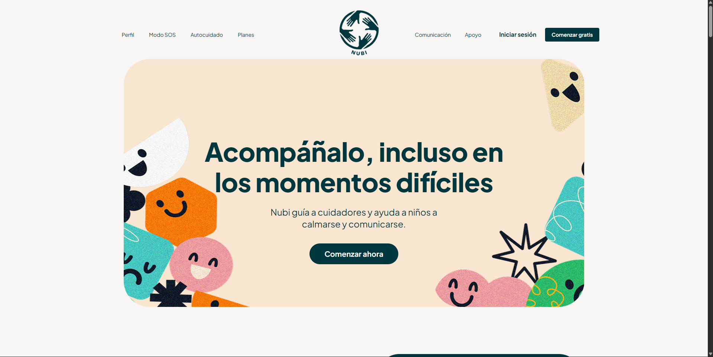

**Video de navegación del Sprint 1:** https://tinyurl.com/2dfst868

#### 5.2.1.6. Services Documentation Evidence for Sprint Review

En el Sprint 1 no se implementan RESTful Web Services: el alcance se limita al Landing Page. La documentación de endpoints con OpenAPI (Swagger) se presentará a partir del Sprint en que se implementen los servicios, según las Technical Stories TS-01 a TS-05 del Product Backlog.

#### 5.2.1.7. Software Deployment Evidence for Sprint Review

En el Sprint 1 se desplegó el Landing Page. Los pasos realizados fueron: (1) crear el repositorio `landing-page` en la organización de GitHub del equipo; (2) subir el código del sitio en la carpeta `/docs`; (3) activar GitHub Pages sobre esa carpeta; y (4) verificar que el sitio sea accesible mediante la URL pública y que sus imágenes y estilos se carguen correctamente.

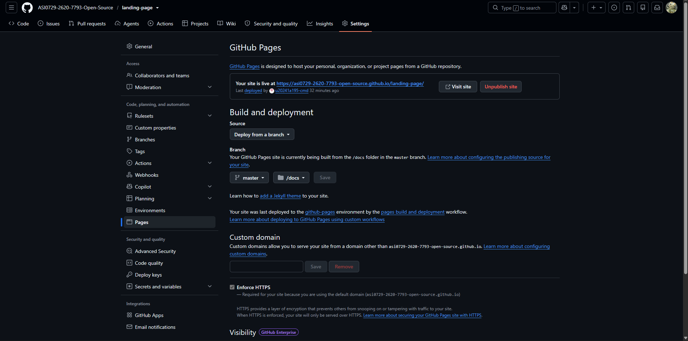

#### 5.2.1.8. Team Collaboration Insights during Sprint

La colaboración del equipo en el Sprint 1 se evidencia con los analíticos de GitHub Insights de los dos repositorios del proyecto: el del informe, donde el equipo documenta el proceso de ingeniería, y el del Landing Page, donde se implementa el producto.

##### Repositorio del informe (Macally)

La colaboración del equipo durante el Sprint 1 se evidencia con los analíticos de GitHub Insights del repositorio del informe [ASI0729-2620-7793-Open-Source/Macally](https://tinyurl.com/2cu3vhdy), donde el equipo documenta el proceso de ingeniería (capítulos I a V) siguiendo GitFlow y Conventional Commits. Los cinco integrantes registran commits en la rama `main`, cada uno con su cuenta de GitHub: Dan-trax (Diaz Caruzo, Edgard Daniel), nahiryn8 (Ruiz Villegas, Yngrid Nahir), u20241a195-cmd (Diaz Yurivilca, Sofia), Deiko-138 (Lopez Torres, Leonardo Gabriel) y joanfpp2-ai (Payano Puchuri, Joan Fabricio).


*Figura 1. Code frequency del repositorio del informe.* Muestra las líneas agregadas (verde) y eliminadas (rojo) por semana desde fines de agosto de 2026. La actividad se concentra en las semanas del 31 de agosto y del 14 de septiembre: la primera con unas 3,5 mil líneas agregadas y la segunda con cerca de 4 mil agregadas y 4,6 mil eliminadas, lo que refleja la redacción de los capítulos y su posterior revisión y corrección.


*Figura 2. Commits por semana del repositorio del informe.* Muestra el número de commits semanales durante el último año. El repositorio no tiene actividad hasta fines de agosto de 2026 y, a partir de entonces, crece semana a semana: aproximadamente 4, 20, 21 y 51 commits en las últimas cuatro semanas, con el pico en la semana previa a la entrega AV1.


*Figura 3. Pulse del 12 al 19 de septiembre de 2026.* Resume la última semana antes de la entrega: 5 autores enviaron 52 commits a `main` y a todas las ramas, se modificaron 148 archivos en `main` con 2978 líneas agregadas y 440 eliminadas, y el gráfico Top committers muestra que los cinco integrantes aportaron en la semana. No hay pull requests ni issues abiertos o cerrados en el período, porque el equipo integra el trabajo de las ramas `feature/*` mediante merges a `develop` y `main`.


*Figura 4. Contributors (últimos 3 meses, commits a `main` sin contar merges).* Muestra la evolución semanal del repositorio y una gráfica por contribuidor:

| Puesto | Cuenta de GitHub | Integrante | Commits | Líneas      |
|---|---|---|---------|-------------|
| #1 | Dan-trax | Diaz Caruzo, Edgard Daniel | 34      | +649 / −84     |
| #2 | nahiryn8 | Ruiz Villegas, Yngrid Nahir | 21      | +3828 / −389   |
| #3 | u20241a195-cmd | Diaz Yurivilca, Sofia | 19      | +1832 / −944   |
| #4 | Deiko-138 | Lopez Torres, Leonardo Gabriel | 17      | +1376 / −3387  |
| #5 | joanfpp2-ai | Payano Puchuri, Joan Fabricio | 5       | +666 / −70     |

Los cinco integrantes tienen commits en `main`, con distinto volumen y en distintas semanas según los capítulos y aspectos que lideró cada uno.

##### Repositorio del Landing Page (landing-page)

El repositorio [ASI0729-2620-7793-Open-Source/landing-page](https://tinyurl.com/28o2kj4u) se creó el 19 de septiembre de 2026 y contiene la primera versión del Landing Page. Sus analíticos de GitHub Insights se muestran a continuación.


*Figura 5. Contributors del repositorio del Landing Page (últimos 3 meses, commits a `master` sin contar merges).* Muestra que el repositorio registra 3 commits, todos en la semana del 14 de septiembre de 2026: Deiko-138 con 2 commits (+984 líneas, sin eliminaciones) y u20241a195-cmd con 1 commit (+407 / −404 líneas).


*Figura 6. Commits por semana del repositorio del Landing Page.* Muestra que los 3 commits del repositorio se concentran en la última semana, que corresponde al Sprint 1, sin actividad previa.

| Commit | Cuenta de GitHub | Integrante | Mensaje |
|---|---|---|---|
| [8da4692](https://tinyurl.com/23sl3mff) | Deiko-138 | Lopez Torres, Leonardo Gabriel | chore: initial commit |
| [e2de4c4](https://tinyurl.com/2yqyjzdt) | Deiko-138 | Lopez Torres, Leonardo Gabriel | docs: add readme |
| [c9a4df7](https://tinyurl.com/26zqml4a) | u20241a195-cmd | Diaz Yurivilca, Sofia | docs: add docs to all the codes. |
| [2b47acf](https://tinyurl.com/26fcgrhe) | Deiko-138 | Lopez Torres, Leonardo Gabriel | feat: add i18n lenguage spanish and inglish |
| [4dfbb36](https://tinyurl.com/25xcyz34) | Deiko-138 | Lopez Torres, Leonardo Gabriel | Merge branch 'feature/I18n' into develop |
| [5119b9e](https://tinyurl.com/2yeyfoaa) | Deiko-138 | Lopez Torres, Leonardo Gabriel | feat: add intercionalizacion lenguague |

En este Sprint, Leonardo Gabriel Lopez Torres creó el repositorio y su README y desarrolló la internacionalización (i18n) del Landing Page en inglés y español (rama `feature/I18n`, integrada en `develop` y publicada en `master`), y Sofia Diaz Yurivilca documentó el código del Landing Page. Las Figuras 5 y 6 se capturaron antes de subir la internacionalización (i18n); la tabla incluye todos los commits del Sprint. Los cinco integrantes registran aportes en el repositorio del informe (Figuras 1 a 4), donde se documentaron el diseño y el contenido que se implementan en el Landing Page. Como oportunidad de mejora, el Landing Page solo tuvo dos autores en este Sprint; por ello, en el Sprint 2 se incorporaron al repositorio los aportes de Yngrid Nahir Ruiz Villegas y Joan Fabricio Payano Puchuri (sección 5.2.2.4).


### 5.2.2. Sprint 2

#### 5.2.2.1. Sprint Planning 2

El Sprint Planning 2 definió el alcance de la primera versión de la Frontend Web Application a partir de las User Stories US-01 a US-29 del Product Backlog, que corresponden a las épicas EPIC-01 a EPIC-05: Perfil y Personalización, Gestión de Crisis (Modo SOS), Autorregulación, Comunicación Asistida (CAA) y Red de Apoyo y Seguimiento. Cada Bounded Context se desarrolla en su propia rama `feature/*` del repositorio [Nubi---Frontend](https://tinyurl.com/2cxsdvov) y se integra en `develop` siguiendo GitFlow (sección 5.1.2). En este Sprint la aplicación consume una API simulada con json-server, porque los RESTful Web Services se implementarán en un Sprint posterior.

| Campo | Detalle |
|---|---|
| Sprint # | Sprint 2 |
| **Sprint Planning Background** | |
| Date | 2026-10-03 |
| Time | 01:04 PM |
| Location | Virtual (Google Meet y WhatsApp) |
| Prepared By | Diaz Yurivilca, Sofia |
| Attendees (to planning meeting) | Lopez Torres, Leonardo Gabriel / Diaz Yurivilca, Sofia / Payano Puchuri, Joan Fabricio / Ruiz Villegas, Yngrid Nahir / Diaz Caruzo, Edgard Daniel |
| Sprint 1 Review Summary | El Landing Page se desplegó en GitHub Pages con las historias LS-01 a LS-05 completas (10 de 10 Story Points), además de los planes, las preguntas frecuentes, la presentación del equipo y el formulario de contacto, en English y Latin American Spanish y con criterios de accesibilidad. De las 12 tareas del Sprint Backlog 1, 11 quedaron en Done y la tarea T-04 (botón «Crear cuenta y activarlo» hacia la Web Application) quedó en In-Process, porque la aplicación todavía no estaba desplegada; se completa en este Sprint. |
| Sprint 1 Retrospective Summary | A partir de la evidencia del Sprint 1 se identifican como aciertos la entrega completa del alcance planificado del Landing Page, la incorporación temprana de internacionalización y accesibilidad, y el uso de GitFlow y Conventional Commits. Como oportunidades de mejora se identifican que las 14 tareas se asignaron a un solo integrante y que los 3 commits del repositorio del Landing Page se concentraron en la última semana (Figura 6). Para el Sprint 2 el trabajo se reparte por Bounded Context, cada uno en su propia rama `feature/*`, con commits pequeños y frecuentes. |
| **Sprint Goal & User Stories** | |
| Sprint 2 Goal | *Our focus is on delivering a first deployed version of the Nubi Frontend Web Application with the main flows of its five Bounded Contexts. We believe it delivers to caregivers a way to personalize the profile of the child or teenager, activate SOS Mode with a step-by-step guide, choose calming stimuli, communicate with the AAC board and request help from the support network, instead of only reading about these features in the Landing Page. This will be confirmed when a caregiver can complete each of these flows (US-01 to US-29) from the deployed application, in Desktop and Mobile web browsers, in English or Spanish.* |
| Sprint 2 Velocity | 77 Story Points|
| Sum of Story Points | 77 |

La distribución del alcance por épica es la siguiente:

| Épica | User Stories | Story Points |
|---|---|---|
| EPIC-01 Perfil y Personalización | US-01 a US-06 | 15 |
| EPIC-02 Gestión de Crisis (Modo SOS) | US-07 a US-12 | 17 |
| EPIC-03 Autorregulación | US-13 a US-18 | 16 |
| EPIC-04 Comunicación Asistida (CAA) | US-19 a US-24 | 17 |
| EPIC-05 Red de Apoyo y Seguimiento | US-25 a US-29 | 12 |
| **Total** | **29 User Stories** | **77** |

No forman parte del compromiso del Sprint 2 las historias de seguimiento y recomendaciones de Red de Apoyo y Seguimiento (US-30 a US-45), la cuenta y la suscripción (US-46 a US-48) ni las Technical Stories TS-01 a TS-05, que permanecen en el Product Backlog.

#### 5.2.2.2. Aspect Leaders and Collaborators

Los aspectos considerados en el Sprint 2 corresponden a los cinco Bounded Contexts de la Frontend Web Application y a los aspectos transversales que todos comparten. A diferencia del Sprint 1, cada Bounded Context tiene un líder distinto, que lo desarrolla en su propia rama `feature/*` del repositorio Nubi---Frontend; el resto del equipo colabora revisando e integrando ese trabajo en `develop`. La Leadership-and-Collaboration Matrix indica quién lidera (L) y quién colabora (C) en cada aspecto; esta organización se refleja en la asignación de tareas del Sprint Backlog 2.

| Team Member (Last Name, First Name) | GitHub Username | Perfil y Personalización | Gestión de Crisis (Modo SOS) | Autorregulación | Comunicación Asistida (CAA) | Red de Apoyo y Seguimiento | Shared (layout, navegación, i18n y API simulada) | Integración en `develop` | Deployment |
|---|---|---|---|---|---|---|---|---|---|
| Lopez Torres, Leonardo Gabriel | [LeonardoLopez138](https://tinyurl.com/2a8ze8hx) | C | C | C | L | C | C | C | C |
| Diaz Yurivilca, Sofia | [u20241a195-cmd](https://tinyurl.com/299rz9v4) | C | L | C | C | C | C | L | C |
| Payano Puchuri, Joan Fabricio | [joanfpp2-ai](https://tinyurl.com/2ykyhlc3) | C | C | L | C | C | L | C | C |
| Ruiz Villegas, Yngrid Nahir | [nahiryn8](https://tinyurl.com/28m8gfas) | L | C | C | C | C | C | C | C |
| Diaz Caruzo, Edgard Daniel | [Dan-trax](https://tinyurl.com/24dl9dkr) | C | C | C | C | L | C | C | L |

Cada aspecto agrupa el siguiente trabajo:

- **Perfil y Personalización:** perfiles del niño o adolescente, perfil sensorial, cuidadores asociados y cuenta (rama `feature/profile-personalization`).
- **Gestión de Crisis (Modo SOS):** activación del Modo SOS, guía paso a paso y resumen del episodio (rama `feature/crisis-management`).
- **Autorregulación:** galería de estímulos visuales y auditivos, estímulo en uso con intensidad y modo de baja estimulación, y temporizador de calma (rama `feature/self-regulation`).
- **Comunicación Asistida (CAA):** tablero de pictogramas y necesidades básicas (rama `feature/assistive-comunication`).
- **Red de Apoyo y Seguimiento:** panel del cuidador con solicitudes de ayuda y seguimiento (rama `feature/support-network`).
- **Shared:** layout responsive con barra lateral y barra superior, navegación entre módulos, internacionalización en English y Latin American Spanish, y la API simulada con json-server que usan todos los Bounded Contexts.
- **Integración en `develop`:** unión de las ramas `feature/*` en `develop` siguiendo GitFlow (sección 5.1.2).
- **Deployment:** publicación de la Frontend Web Application para la revisión del Sprint (sección 5.2.2.7).


#### 5.2.2.3. Sprint Backlog 2

El objetivo del Sprint 2 es entregar y desplegar la primera versión de la Frontend Web Application de Nubi, con los flujos principales de sus cinco Bounded Contexts (Perfil y Personalización, Gestión de Crisis, Autorregulación, Comunicación Asistida y Red de Apoyo y Seguimiento), en versión responsive, en English y Latin American Spanish, y consumiendo una API simulada con json-server. El Sprint Backlog 2 descompone las User Stories US-01 a US-29 en tareas asignadas según la Leadership-and-Collaboration Matrix de la sección 5.2.2.2, y agrega las tareas generales que no dependen de una User Story en particular.


**URL del Sprint Backlog 2 en Trello:** https://tinyurl.com/2afdpsnp


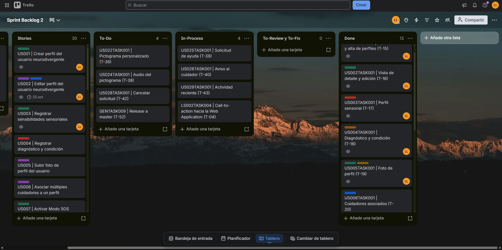

*Sprint Backlog 2 en Trello.* Tablero del Sprint 2 con las listas Stories, To-Do, In-Process, To-Review y To-Fix, y Done. La lista Stories reúne las User Stories comprometidas (US-01 en adelante) y las demás listas muestran sus tareas según su estado: en To-Do están las de pictograma personalizado (US-22), audio del pictograma (US-24), cancelar solicitud (US-28) y el release a `master`; en In-Process, las de solicitud de ayuda (US-25), aviso al cuidador (US-26), actividad reciente (US-29) y el call-to-action del Landing Page hacia la Web Application; y en Done, las tareas ya terminadas, como las de Perfil y Personalización (US-01 a US-06).

| Sprint # | Sprint 2 | | | | | | |
|---|---|---|---|---|---|---|---|
| **Story Id** | **Story Title** | **Task Id** | **Task Title** | **Task Description** | **Estimation (Hours)** | **Assigned To** | **Status** |
| US-01 | Crear perfil del usuario autista | T-15 | Dominio y alta de perfiles | Implementar el modelo de dominio del perfil, su endpoint en la API simulada y el formulario de creación en la lista de perfiles. | 5 | Ruiz Villegas, Yngrid Nahir | Done |
| US-02 / US-05 | Editar perfil / Subir foto de perfil del usuario | T-16 / T-19 | Detalle, edición y foto de perfil | Implementar la vista de detalle del perfil con edición de sus datos, y permitir asociar una fotografía al perfil y mostrarla en la lista y en el detalle. | 6 | Ruiz Villegas, Yngrid Nahir | Done |
| US-03 / US-04 | Registrar sensibilidades sensoriales / diagnóstico y condición | T-17 / T-18 | Perfil sensorial y diagnóstico | Registrar las sensibilidades sensoriales del perfil y su nivel, para que las usen Autorregulación y el Modo SOS, y agregar los campos de diagnóstico y condición con sus validaciones. | 5 | Ruiz Villegas, Yngrid Nahir | Done |
| US-06 | Asociar múltiples cuidadores a un perfil | T-20 | Cuidadores asociados | Implementar la vista del cuidador y la asociación de cuidadores a un perfil, respetando los límites del plan. | 4 | Ruiz Villegas, Yngrid Nahir | Done |
| US-07 | Activar Modo SOS | T-21 | Vista de activación del Modo SOS | Implementar la vista de activación y el `SosModeStore` que inicia la sesión SOS del perfil a cargo. | 4 | Diaz Yurivilca, Sofia | Done |
| US-08 | Visualizar guía paso a paso del Modo SOS | T-22 | Guía paso a paso | Implementar la vista de foco único que muestra los pasos de actuación de forma secuencial. | 5 | Diaz Yurivilca, Sofia | Done |
| US-09 | Personalizar guía SOS según perfil del usuario | T-23 | Guía según sensibilidades | Adaptar los pasos de la guía a las sensibilidades registradas en el perfil, mediante una fachada hacia Perfil y Personalización. | 5 | Diaz Yurivilca, Sofia | Done |
| US-10 / US-12 | Marcar paso como completado / Acceder al Modo SOS desde pantalla principal | T-24 / T-26 | Completar pasos y acceso global al Modo SOS | Permitir marcar cada paso como completado y avanzar al siguiente, y registrar las rutas de Gestión de Crisis y el botón SOS de la barra superior, visible en toda la aplicación. | 4 | Diaz Yurivilca, Sofia | Done |
| US-11 | Finalizar episodio desde el Modo SOS | T-25 | Resumen del episodio | Finalizar la sesión SOS y mostrar la vista de resumen del episodio. | 4 | Diaz Yurivilca, Sofia | Done |
| US-13 | Seleccionar estímulo visual de autorregulación | T-27 | Galería de estímulos | Implementar la galería de estímulos y las escenas visuales del estímulo en uso. | 5 | Payano Puchuri, Joan Fabricio | Done |
| US-14 | Seleccionar estímulo auditivo de autorregulación | T-28 | Sonidos relajantes | Agregar los estímulos auditivos y su reproducción durante la sesión. | 4 | Payano Puchuri, Joan Fabricio | Done |
| US-15 / US-16 / US-17 | Ajustar intensidad / Guardar favoritos / Activar baja estimulación | T-29 / T-30 / T-31 | Intensidad, favoritos y baja estimulación | Permitir ajustar la intensidad del estímulo, guardar y filtrar los estímulos favoritos del perfil, y reducir los elementos visuales y sonoros de la sesión cuando el modo de baja estimulación está activo. | 8 | Payano Puchuri, Joan Fabricio | Done |
| US-18 | Usar temporizador de calma | T-32 | Temporizador de calma | Implementar la vista de foco único del temporizador de calma. | 4 | Payano Puchuri, Joan Fabricio | Done |
| US-19 | Visualizar tablero de pictogramas | T-33 | Tablero de pictogramas | Implementar el dominio de pictogramas y la vista del tablero CAA. | 5 | Lopez Torres, Leonardo Gabriel | Done |
| US-20 / US-27 | Seleccionar pictograma para comunicar una necesidad / Confirmar recepción de la solicitud | T-34 / T-41 | Comunicar necesidad y confirmar recepción | Registrar la necesidad comunicada en la API simulada, confirmar el envío con un snackbar, mostrarla al cuidador en Inicio y permitirle confirmar que recibió la última necesidad comunicada. | 8 | Lopez Torres, Leonardo Gabriel | Done |
| US-21 / US-23 | Personalizar pictogramas favoritos / Organizar pictogramas por categoría | T-35 / T-37 | Favoritos y categorías del tablero | Permitir marcar pictogramas como favoritos y destacarlos en el tablero, filtrar el tablero por categoría y permitir reordenar los pictogramas. | 5 | Lopez Torres, Leonardo Gabriel | Done |
| US-22 / US-24 | Agregar pictograma personalizado / Reproducir audio asociado al pictograma | T-36 / T-38 | Pictograma personalizado y audio | Agregar al tablero un pictograma con una imagen propia y reproducir un audio al seleccionar un pictograma. | 7 | Lopez Torres, Leonardo Gabriel | To-do |
| US-25 | Enviar solicitud de ayuda al cuidador | T-39 | Solicitud de ayuda | Enviar la solicitud de ayuda desde el panel de Red de Apoyo; en este Sprint el panel usa datos de muestra. | 4 | Diaz Caruzo, Edgard Daniel | In-Process |
| US-26 | Recibir notificación de solicitud de ayuda | T-40 | Aviso al cuidador | Mostrar al cuidador el estado del usuario y su última comunicación en el panel de Red de Apoyo. | 4 | Diaz Caruzo, Edgard Daniel | In-Process |
| US-28 / US-29 | Cancelar solicitud de ayuda / Consultar historial de solicitudes | T-42 / T-43 | Cancelar solicitud y actividad reciente | Permitir cancelar una solicitud de ayuda enviada, y mostrar la actividad reciente y el gráfico de bienestar de los últimos siete días; falta conectar la actividad reciente con la API simulada. | 5 | Diaz Caruzo, Edgard Daniel | To-do |
| — | Tarea general | T-44 | Proyecto base, i18n y API simulada | Crear el proyecto Angular y configurar ngx-translate (English y Latin American Spanish) y json-server con sus datos iniciales. | 4 | Payano Puchuri, Joan Fabricio | Done |
| — | Tarea general | T-45 | Layout responsive | Implementar el layout con barra lateral, barra superior, selector de idioma y navegación entre módulos. | 5 | Payano Puchuri, Joan Fabricio | Done |
| — | Tarea general | T-46 | Clases base compartidas | Implementar en `shared` las clases base de entidad, respuesta, assembler y endpoint, y el manejo de errores. | 4 | Lopez Torres, Leonardo Gabriel | Done |
| — | Tarea general | T-47 / T-48 | Pruebas del dominio SOS e integración en `develop` | Escribir las pruebas unitarias de `SosSession` y `ActionGuide`, y unir las ramas `feature/*` en `develop` resolviendo los conflictos de rutas, entornos y traducciones. | 5 | Diaz Yurivilca, Sofia | Done |
| — | Tarea general | T-49 | Documentación de Red de Apoyo y licencia | Documentar la arquitectura y las notas de implementación del Bounded Context Red de Apoyo y Seguimiento en un README, comentar el código del panel y agregar la licencia MIT al repositorio. | 4 | Diaz Caruzo, Edgard Daniel | Done |
| — | Tarea general | T-50 / T-51 | Despliegue de la Web Application y de la API simulada | Configurar Firebase Hosting y publicar la versión de producción de la aplicación Angular, y publicar json-server en Render guardando sus datos en Firestore para que no se pierdan al reiniciar el servicio. | 7 | Lopez Torres, Leonardo Gabriel | Done |
| — | Tarea general | T-52 | Release a `master` | Crear la rama `release/v1.0.0`, integrar `develop` en `master` según GitFlow, etiquetar la versión `v1.0.0` y verificar que los productos desplegados correspondan a esa versión. | 4 | Diaz Caruzo, Edgard Daniel | Done |
| LS-02 | Conocer el Modo SOS en la landing page | T-04 | Call-to-action hacia la Web Application | Tarea pendiente del Sprint 1: enlazar los botones del Landing Page (registro, inicio de sesión y «Crear cuenta y activarlo») con las vistas correspondientes de la Web Application desplegada y verificar la redirección en ambos idiomas. | 4 | Lopez Torres, Leonardo Gabriel | In-Process |

De las 28 tareas del Sprint Backlog 2, 22 están en Done, 3 en In-Process y 3 en To-do. Las tareas que no llegaron a Done regresan al Product Backlog para el Sprint 3. Como mejora a partir de la retroalimentación del docente, todas las tareas se estiman entre 4 y 8 horas: las tareas pequeñas relacionadas con una misma historia se agrupan en una sola (por ejemplo, T-16 / T-19 o T-34 / T-41) y las que quedaban por debajo de 4 horas se reestimaron con su alcance completo (T-04, T-49 y T-52). Las tareas se registran en el tablero de Trello con los estados To-do, In-Process, To-Review y Done; las que están en revisión se mueven a la lista To-Review y las que requieren correcciones, a To-Fix.

#### 5.2.2.4. Development Evidence for Sprint Review

En el Sprint 2 se implementó la primera versión de la Frontend Web Application con Angular, TypeScript, Angular Material y PrimeNG en el repositorio [Nubi---Frontend](https://tinyurl.com/2cxsdvov). Cada Bounded Context sigue la misma estructura de cuatro capas (`domain`, `application`, `infrastructure` y `presentation`) definida en el capítulo IV, y se desarrolló en su propia rama `feature/*`, integrada después en `develop` con GitFlow. Los principales avances son:

- **Shared:** proyecto base, layout responsive con barra lateral y barra superior, internacionalización con ngx-translate, clases base de las capas y API simulada con json-server.
- **Perfil y Personalización:** lista, detalle y edición de perfiles, perfil sensorial, foto y cuidadores asociados. Como adelanto, fuera del compromiso del Sprint, se agregaron las vistas de inicio de sesión, registro y cuenta (US-46 y US-47).
- **Gestión de Crisis (Modo SOS):** activación del Modo SOS, guía paso a paso adaptada al perfil y resumen del episodio, con pruebas unitarias del dominio.
- **Autorregulación:** galería de estímulos, estímulo en uso con escenas, sonidos, intensidad y modo de baja estimulación, y temporizador de calma.
- **Comunicación Asistida (CAA):** tablero de pictogramas con categorías y favoritos, comunicación de necesidades y resumen para el cuidador en Inicio.
- **Red de Apoyo y Seguimiento:** panel del cuidador con el estado del usuario, su última comunicación, la actividad reciente y el gráfico de bienestar, con datos de muestra.
- **Deployment:** configuración de Firebase Hosting para la aplicación y de Render y Firestore para la API simulada.

La tabla registra, en orden cronológico, los 87 commits de la rama `develop` del repositorio al cierre del Sprint. Los commits no tienen cuerpo de mensaje, por lo que esa columna se indica con «—». Los mensajes se transcriben tal como se registraron en Git, incluidas sus erratas (por ejemplo, «comunication» o «envirionment»); como mejora, a partir del Sprint 3 el equipo revisa la ortografía y el tipo de Conventional Commits de cada mensaje antes de registrarlo, y agrega un cuerpo de mensaje en los commits que cambian más de una funcionalidad.

| Repository | Branch | Commit Id | Commit Message | Commit Message Body | Committed on (Date) |
|---|---|---|---|---|---|
| ASI0729-2620-7793-Open-Source/Nubi---Frontend | `master` | [f2e4267](https://tinyurl.com/26p7td8j) | chore: initial commit | — | 03/10/2026 |
| ASI0729-2620-7793-Open-Source/Nubi---Frontend | `feature/self-regulation` | [eb5e2c2](https://tinyurl.com/26w38xfb) | feat: add Support Network bounded context | — | 04/10/2026 |
| ASI0729-2620-7793-Open-Source/Nubi---Frontend | `feature/self-regulation` | [8768524](https://tinyurl.com/2bs9gtpl) | chore: add i18n and fake API setup | — | 07/10/2026 |
| ASI0729-2620-7793-Open-Source/Nubi---Frontend | `feature/self-regulation` | [4301669](https://tinyurl.com/27tvr8t8) | feat(shared): add caregiver and profile in care | — | 07/10/2026 |
| ASI0729-2620-7793-Open-Source/Nubi---Frontend | `feature/self-regulation` | [ab01d80](https://tinyurl.com/228yobys) | feat(shared): add responsive layout with sidenav and toolbar | — | 07/10/2026 |
| ASI0729-2620-7793-Open-Source/Nubi---Frontend | `feature/self-regulation` | [73234b9](https://tinyurl.com/293dbhqs) | feat(self-regulation): add domain model | — | 07/10/2026 |
| ASI0729-2620-7793-Open-Source/Nubi---Frontend | `feature/profile-personalization` | [ffe2f15](https://tinyurl.com/2xmk38xm) | chore(deps): add primeng, primeuix themes and angular animations | — | 08/10/2026 |
| ASI0729-2620-7793-Open-Source/Nubi---Frontend | `feature/profile-personalization` | [a18e388](https://tinyurl.com/23jlxqt9) | chore(config): disable angular cli analytics | — | 08/10/2026 |
| ASI0729-2620-7793-Open-Source/Nubi---Frontend | `feature/profile-personalization` | [dd90e75](https://tinyurl.com/2dpo8qud) | chore(env): add accounts, institutions, payments and tickets endpoints with seed data | — | 08/10/2026 |
| ASI0729-2620-7793-Open-Source/Nubi---Frontend | `feature/profile-personalization` | [b6c7abc](https://tinyurl.com/22eyq83l) | feat(shared): add auditable entity base class | — | 08/10/2026 |
| ASI0729-2620-7793-Open-Source/Nubi---Frontend | `feature/profile-personalization` | [c072e38](https://tinyurl.com/2bwzwdhg) | feat(profile): add profile domain model, value objects and enums | — | 08/10/2026 |
| ASI0729-2620-7793-Open-Source/Nubi---Frontend | `feature/profile-personalization` | [0552471](https://tinyurl.com/2arsyhtr) | feat(profile): add profile api endpoint, assembler and plan limits service | — | 08/10/2026 |
| ASI0729-2620-7793-Open-Source/Nubi---Frontend | `feature/profile-personalization` | [05f3823](https://tinyurl.com/23pl2nv2) | feat(account): add account, subscription, payment, institution and support ticket domain | — | 08/10/2026 |
| ASI0729-2620-7793-Open-Source/Nubi---Frontend | `feature/profile-personalization` | [67c556d](https://tinyurl.com/289r7q4q) | feat(account): add account api endpoints, assembler, payment gateway mock and role guard | — | 08/10/2026 |
| ASI0729-2620-7793-Open-Source/Nubi---Frontend | `feature/profile-personalization` | [db226ac](https://tinyurl.com/2bh4mpry) | feat(account): add account api endpoints, assembler, payment gateway mock and role guard | — | 08/10/2026 |
| ASI0729-2620-7793-Open-Source/Nubi---Frontend | `feature/profile-personalization` | [b1e7ac9](https://tinyurl.com/2yop5x6e) | feat(account): add auth and account stores | — | 08/10/2026 |
| ASI0729-2620-7793-Open-Source/Nubi---Frontend | `feature/profile-personalization` | [a7852bc](https://tinyurl.com/28x5ulet) | feat(profile): add profile store with tolerant 404 handling | — | 08/10/2026 |
| ASI0729-2620-7793-Open-Source/Nubi---Frontend | `feature/profile-personalization` | [149ee98](https://tinyurl.com/2yzzxm3d) | feat(account): add sign-in and sign-up views | — | 08/10/2026 |
| ASI0729-2620-7793-Open-Source/Nubi---Frontend | `feature/profile-personalization` | [169702c](https://tinyurl.com/26eo9zdn) | feat(account): add role based account views and routes | — | 08/10/2026 |
| ASI0729-2620-7793-Open-Source/Nubi---Frontend | `feature/profile-personalization` | [09a8f99](https://tinyurl.com/22gdjuha) | feat(profile): add profile list, detail and caregiver views | — | 08/10/2026 |
| ASI0729-2620-7793-Open-Source/Nubi---Frontend | `feature/profile-personalization` | [1181d4b](https://tinyurl.com/2ydd8f6j) | feat(shared): add role based sidenav and wire profile and account routes | — | 08/10/2026 |
| ASI0729-2620-7793-Open-Source/Nubi---Frontend | `feature/profile-personalization` | [c655367](https://tinyurl.com/2xpr6kja) | feat(i18n): add profile, account and photo translations in es and en | — | 08/10/2026 |
| ASI0729-2620-7793-Open-Source/Nubi---Frontend | `feature/assistive-comunication` | [7c7d366](https://tinyurl.com/29gtwb64) | feat: add domain basic needs entity | — | 08/10/2026 |
| ASI0729-2620-7793-Open-Source/Nubi---Frontend | `feature/assistive-comunication` | [45477da](https://tinyurl.com/262o5oa4) | feat: add shared error handling | — | 08/10/2026 |
| ASI0729-2620-7793-Open-Source/Nubi---Frontend | `feature/assistive-comunication` | [7096690](https://tinyurl.com/25yedm9b) | feat: add base-response in the shared | — | 08/10/2026 |
| ASI0729-2620-7793-Open-Source/Nubi---Frontend | `feature/assistive-comunication` | [6ab80c5](https://tinyurl.com/28yy7bjs) | feat: add basic-needs.response.ts in bound of context | — | 08/10/2026 |
| ASI0729-2620-7793-Open-Source/Nubi---Frontend | `feature/assistive-comunication` | [652076b](https://tinyurl.com/26pt3mca) | feat: add basic-needs response | — | 08/10/2026 |
| ASI0729-2620-7793-Open-Source/Nubi---Frontend | `feature/assistive-comunication` | [c20b205](https://tinyurl.com/265ayrpy) | feat: basic needs (model) change name to basic-needs.entity.ts | — | 08/10/2026 |
| ASI0729-2620-7793-Open-Source/Nubi---Frontend | `feature/assistive-comunication` | [3bdd4ed](https://tinyurl.com/24qnpbuk) | feat: add base-endpoint in shared | — | 08/10/2026 |
| ASI0729-2620-7793-Open-Source/Nubi---Frontend | `feature/assistive-comunication` | [51ef610](https://tinyurl.com/2dhqz2he) | feat: add base-assembler in shared | — | 08/10/2026 |
| ASI0729-2620-7793-Open-Source/Nubi---Frontend | `feature/assistive-comunication` | [fbeb466](https://tinyurl.com/29jfsely) | feat: add base-entity in shared | — | 08/10/2026 |
| ASI0729-2620-7793-Open-Source/Nubi---Frontend | `feature/assistive-comunication` | [7e4e652](https://tinyurl.com/24px5vkm) | feat: add base-api in shared | — | 08/10/2026 |
| ASI0729-2620-7793-Open-Source/Nubi---Frontend | `feature/assistive-comunication` | [4e06260](https://tinyurl.com/27f5ou9h) | feat: add base-assembler in shared again | — | 08/10/2026 |
| ASI0729-2620-7793-Open-Source/Nubi---Frontend | `feature/assistive-comunication` | [90e705f](https://tinyurl.com/22t9xeps) | feat: add basinc-needs.response | — | 08/10/2026 |
| ASI0729-2620-7793-Open-Source/Nubi---Frontend | `develop` | [b133868](https://tinyurl.com/2865wzgm) | Merge remote-tracking branch 'origin/develop' into develop | — | 08/10/2026 |
| ASI0729-2620-7793-Open-Source/Nubi---Frontend | `develop` | [0ab8bc4](https://tinyurl.com/247s9uk9) | Merge branch 'feature/assistive-comunication' into develop | — | 08/10/2026 |
| ASI0729-2620-7793-Open-Source/Nubi---Frontend | `feature/self-regulation` | [92c0d34](https://tinyurl.com/2yarcbom) | feat(self-regulation): add infrastructure layer | — | 08/10/2026 |
| ASI0729-2620-7793-Open-Source/Nubi---Frontend | `feature/crisis-management` | [a006293](https://tinyurl.com/2765mynb) | feat(crisis-management): add SOS session and action guide domain model | — | 08/10/2026 |
| ASI0729-2620-7793-Open-Source/Nubi---Frontend | `feature/crisis-management` | [8a153c6](https://tinyurl.com/2dx7h6ez) | test(crisis-management): add unit tests for SosSession and ActionGuide | — | 08/10/2026 |
| ASI0729-2620-7793-Open-Source/Nubi---Frontend | `feature/crisis-management` | [6f96572](https://tinyurl.com/2xohp2bs) | chore(environment): add action guides and SOS sessions endpoints | — | 08/10/2026 |
| ASI0729-2620-7793-Open-Source/Nubi---Frontend | `feature/crisis-management` | [7bb99b7](https://tinyurl.com/2ywmsojd) | feat(crisis-management): add API, assemblers and profile facade for SOS mode | — | 08/10/2026 |
| ASI0729-2620-7793-Open-Source/Nubi---Frontend | `feature/crisis-management` | [189c6ce](https://tinyurl.com/284y8a48) | feat(crisis-management): add SosModeStore | — | 08/10/2026 |
| ASI0729-2620-7793-Open-Source/Nubi---Frontend | `feature/crisis-management` | [f76fcf8](https://tinyurl.com/27gf6fgw) | feat(crisis-management): add SOS activation view | — | 08/10/2026 |
| ASI0729-2620-7793-Open-Source/Nubi---Frontend | `feature/crisis-management` | [06198b7](https://tinyurl.com/272og83f) | feat(crisis-management): add step-by-step SOS guide view | — | 08/10/2026 |
| ASI0729-2620-7793-Open-Source/Nubi---Frontend | `feature/crisis-management` | [f995df8](https://tinyurl.com/2awbjfmu) | feat(crisis-management): add crisis summary view | — | 08/10/2026 |
| ASI0729-2620-7793-Open-Source/Nubi---Frontend | `feature/crisis-management` | [8aa00bc](https://tinyurl.com/239zzr3t) | feat(routing): register crisis management routes | — | 08/10/2026 |
| ASI0729-2620-7793-Open-Source/Nubi---Frontend | `feature/crisis-management` | [dee8554](https://tinyurl.com/22bmwzmw) | feat(i18n): add SOS mode translations in es and en | — | 08/10/2026 |
| ASI0729-2620-7793-Open-Source/Nubi---Frontend | `feature/crisis-management` | [96cadc1](https://tinyurl.com/2635ajck) | feat(db): add action guides and SOS sessions to the fake API | — | 08/10/2026 |
| ASI0729-2620-7793-Open-Source/Nubi---Frontend | `feature/crisis-management` | [56c5fca](https://tinyurl.com/297yjpew) | fix(crisis-management): center SOS guide header title and step content | — | 08/10/2026 |
| ASI0729-2620-7793-Open-Source/Nubi---Frontend | `feature/self-regulation` | [f803d29](https://tinyurl.com/2c42hbaj) | feat(self-regulation): add application stores | — | 08/10/2026 |
| ASI0729-2620-7793-Open-Source/Nubi---Frontend | `feature/support-network` | [72b769e](https://tinyurl.com/2yqmqrhk) | feat(support): add support network dashboard | — | 08/10/2026 |
| ASI0729-2620-7793-Open-Source/Nubi---Frontend | `feature/support-network` | [ccae106](https://tinyurl.com/2bj2bk57) | Merge branch 'develop' into feature/support-network | — | 08/10/2026 |
| ASI0729-2620-7793-Open-Source/Nubi---Frontend | `develop` | [4aa30f6](https://tinyurl.com/22armszx) | Merge pull request #1 from ASI0729-2620-7793-Open-Source/feature/support-network | — | 08/10/2026 |
| ASI0729-2620-7793-Open-Source/Nubi---Frontend | `feature/assistive-comunication` | [dc2e3e3](https://tinyurl.com/262axt7l) | feat: add my rout in envirionment | — | 08/10/2026 |
| ASI0729-2620-7793-Open-Source/Nubi---Frontend | `feature/assistive-comunication` | [1f01a7c](https://tinyurl.com/2cull2wl) | feat: add my rout in routes | — | 08/10/2026 |
| ASI0729-2620-7793-Open-Source/Nubi---Frontend | `feature/assistive-comunication` | [e18b496](https://tinyurl.com/22mrqmlj) | fix: delete assembler and response basic needs | — | 08/10/2026 |
| ASI0729-2620-7793-Open-Source/Nubi---Frontend | `feature/assistive-comunication` | [e7a8697](https://tinyurl.com/2d9lou37) | feat: update db json yo assistive comunication | — | 08/10/2026 |
| ASI0729-2620-7793-Open-Source/Nubi---Frontend | `feature/assistive-comunication` | [2504222](https://tinyurl.com/259j6rnz) | feat: add i18n to assistive comunication | — | 08/10/2026 |
| ASI0729-2620-7793-Open-Source/Nubi---Frontend | `feature/assistive-comunication` | [ebccbda](https://tinyurl.com/25gjsh6g) | feat: add assistive comunication domain model entitty | — | 08/10/2026 |
| ASI0729-2620-7793-Open-Source/Nubi---Frontend | `feature/assistive-comunication` | [936b13a](https://tinyurl.com/27qyo8er) | feat: add infrastructure to infrastructure | — | 08/10/2026 |
| ASI0729-2620-7793-Open-Source/Nubi---Frontend | `feature/assistive-comunication` | [13b623f](https://tinyurl.com/2xr8v82v) | feat: add application to basic needs | — | 08/10/2026 |
| ASI0729-2620-7793-Open-Source/Nubi---Frontend | `feature/assistive-comunication` | [dea2e0d](https://tinyurl.com/2bcca27l) | feat: add application to comunication board | — | 08/10/2026 |
| ASI0729-2620-7793-Open-Source/Nubi---Frontend | `feature/assistive-comunication` | [f699eeb](https://tinyurl.com/2y69226h) | feat: add component to comunication snackbar | — | 08/10/2026 |
| ASI0729-2620-7793-Open-Source/Nubi---Frontend | `feature/assistive-comunication` | [2d79135](https://tinyurl.com/27ob4s4t) | feat: add component to comunication home-overview | — | 08/10/2026 |
| ASI0729-2620-7793-Open-Source/Nubi---Frontend | `feature/assistive-comunication` | [7373585](https://tinyurl.com/2b8v48kp) | feat: update package | — | 08/10/2026 |
| ASI0729-2620-7793-Open-Source/Nubi---Frontend | `feature/self-regulation` | [18a4f0f](https://tinyurl.com/2de3hg48) | feat(self-regulation): add stimulus gallery | — | 08/10/2026 |
| ASI0729-2620-7793-Open-Source/Nubi---Frontend | `feature/self-regulation` | [79eec01](https://tinyurl.com/28vkvr7f) | feat(self-regulation): add stimulus session with scenes and sounds | — | 08/10/2026 |
| ASI0729-2620-7793-Open-Source/Nubi---Frontend | `feature/self-regulation` | [38d905a](https://tinyurl.com/2dambmhc) | feat(self-regulation): add calm timer | — | 08/10/2026 |
| ASI0729-2620-7793-Open-Source/Nubi---Frontend | `develop` | [e85862c](https://tinyurl.com/2clcnek5) | Merge branch 'feature/assistive-comunication' into develop | — | 08/10/2026 |
| ASI0729-2620-7793-Open-Source/Nubi---Frontend | `develop` | [6b7943f](https://tinyurl.com/23nej3qj) | Merge branch 'feature/self-regulation' into develop | — | 08/10/2026 |
| ASI0729-2620-7793-Open-Source/Nubi---Frontend | `develop` | [85a45fe](https://tinyurl.com/2dj89ny2) | Merge branch 'feature/crisis-management' into develop | — | 08/10/2026 |
| ASI0729-2620-7793-Open-Source/Nubi---Frontend | `develop` | [1bd1425](https://tinyurl.com/275tr8uy) | Merge branch 'feature/profile-personalization' into develop | — | 08/10/2026 |
| ASI0729-2620-7793-Open-Source/Nubi---Frontend | `feature/crisis-management` | [8051e2c](https://tinyurl.com/28eyuv4j) | Merge remote-tracking branch 'origin/develop' into develop | — | 08/10/2026 |
| ASI0729-2620-7793-Open-Source/Nubi---Frontend | `docs/support-network-clean` | [b297bfb](https://tinyurl.com/264k26t8) | docs(support): add support network README | — | 08/10/2026 |
| ASI0729-2620-7793-Open-Source/Nubi---Frontend | `docs/support-network-clean` | [55ade0c](https://tinyurl.com/29buh6zg) | docs(support): document support network architecture | — | 08/10/2026 |
| ASI0729-2620-7793-Open-Source/Nubi---Frontend | `docs/support-network-clean` | [caf3a1f](https://tinyurl.com/24wt4b8j) | docs(support): add implementation notes | — | 08/10/2026 |
| ASI0729-2620-7793-Open-Source/Nubi---Frontend | `docs/support-network-clean` | [b6967ac](https://tinyurl.com/26d6x7cv) | docs: add MIT license | — | 08/10/2026 |
| ASI0729-2620-7793-Open-Source/Nubi---Frontend | `docs/support-network-clean` | [98df998](https://tinyurl.com/2crqu6oe) | docs(support): add dashboard code comments | — | 08/10/2026 |
| ASI0729-2620-7793-Open-Source/Nubi---Frontend | `docs/support-network-clean` | [4611ce1](https://tinyurl.com/2a82hymf) | docs(support): add dashboard section comments | — | 08/10/2026 |
| ASI0729-2620-7793-Open-Source/Nubi---Frontend | `develop` | [894d38c](https://tinyurl.com/28q2yp85) | Merge pull request #3 from ASI0729-2620-7793-Open-Source/docs/support-network-clean | — | 08/10/2026 |
| ASI0729-2620-7793-Open-Source/Nubi---Frontend | `feature/fixroutes` | [0f993cc](https://tinyurl.com/27kfr6fh) | fix: fix routes | — | 08/10/2026 |
| ASI0729-2620-7793-Open-Source/Nubi---Frontend | `develop` | [44705b1](https://tinyurl.com/24ua87qm) | fix: fix envirionments | — | 08/10/2026 |
| ASI0729-2620-7793-Open-Source/Nubi---Frontend | `develop` | [84acb56](https://tinyurl.com/28w23m9v) | feat: add firebase archives | — | 08/10/2026 |
| ASI0729-2620-7793-Open-Source/Nubi---Frontend | `develop` | [e86cfb8](https://tinyurl.com/28bgyrmm) | feat(deploy): persist fake API data in Firestore | — | 08/10/2026 |
| ASI0729-2620-7793-Open-Source/Nubi---Frontend | `develop` | [9773c22](https://tinyurl.com/278fncbv) | chore: ignore Firebase deploy cache | — | 08/10/2026 |
| ASI0729-2620-7793-Open-Source/Nubi---Frontend | `develop` | [8de7d0b](https://tinyurl.com/26rpx4ve) | fix(deploy): use modular firebase-admin API | — | 08/10/2026 |
| ASI0729-2620-7793-Open-Source/Nubi---Frontend | `develop` | [6f0976b](https://tinyurl.com/2cy7qf2c) | fix(deploy): point to live API and fix profile data and deletes | — | 08/10/2026 |

El repositorio del Landing Page también recibió commits durante el Sprint 2, para alinearlo con la Frontend Web Application desplegada (enlaces de inicio de sesión y registro, planes y secciones de video About-the-Product y About-the-Team). La tabla los registra en orden cronológico; no tienen cuerpo de mensaje, por lo que esa columna se indica con «—».

| Repository | Branch | Commit Id | Commit Message | Commit Message Body | Committed on (Date) |
|---|---|---|---|---|---|
| ASI0729-2620-7793-Open-Source/landing-page | `master` | [9e54f95](https://github.com/ASI0729-2620-7793-Open-Source/landing-page/commit/9e54f9547792bad2716cef91fbe8db49b86b05c0) | feat: add about the team video section with i18n support | — | 08/10/2026 |
| ASI0729-2620-7793-Open-Source/landing-page | `master` | [9980266](https://github.com/ASI0729-2620-7793-Open-Source/landing-page/commit/99802667549798a227f7e4d1d2b586c0cebf57b7) | feat(landing): add about the product section | — | 08/10/2026 |
| ASI0729-2620-7793-Open-Source/landing-page | `master` | [d6a261d](https://github.com/ASI0729-2620-7793-Open-Source/landing-page/commit/d6a261d1461aeacec23b4406e940355656cbc484) | merge: resolve conflict in landing page | — | 08/10/2026 |
| ASI0729-2620-7793-Open-Source/landing-page | `master` | [d6cb492](https://github.com/ASI0729-2620-7793-Open-Source/landing-page/commit/d6cb4920d686f586e7cc712b411ab740d2cf44fe) | Update login link to point to external URL | — | 08/10/2026 |
| ASI0729-2620-7793-Open-Source/landing-page | `master` | [22bf8ac](https://github.com/ASI0729-2620-7793-Open-Source/landing-page/commit/22bf8ac7e096344cbf050c2cbf7ee056ad23fa2f) | Update 'Get started free' to 'Get started' | — | 08/10/2026 |
| ASI0729-2620-7793-Open-Source/landing-page | `master` | [dd822d4](https://github.com/ASI0729-2620-7793-Open-Source/landing-page/commit/dd822d45a5cd3eb7725baee766602cdb50f546e0) | Update translation for 'Start Free' to 'Start Now' | — | 08/10/2026 |
| ASI0729-2620-7793-Open-Source/landing-page | `master` | [935221b](https://github.com/ASI0729-2620-7793-Open-Source/landing-page/commit/935221b250c11ad3045c2ac4257801fe4d57827f) | Update pricing information in Spanish localization | — | 08/10/2026 |
| ASI0729-2620-7793-Open-Source/landing-page | `master` | [a19265e](https://github.com/ASI0729-2620-7793-Open-Source/landing-page/commit/a19265e2e355b6ef16733736bd47f4d3dc0c494c) | Update pricing text in English localization | — | 08/10/2026 |
| ASI0729-2620-7793-Open-Source/landing-page | `master` | [03c8906](https://github.com/ASI0729-2620-7793-Open-Source/landing-page/commit/03c89067a6831b12fbf67f9aa998a8441f6dd7d1) | Fix HTML structure for login and signup links | — | 08/10/2026 |
| ASI0729-2620-7793-Open-Source/landing-page | `master` | [8ecafff](https://github.com/ASI0729-2620-7793-Open-Source/landing-page/commit/8ecafffae696d00b10949759c37926e69439dbec) | fix(landing): resolve leftover merge conflict markers and align texts | — | 08/10/2026 |
| ASI0729-2620-7793-Open-Source/landing-page | `master` | [2a3d023](https://github.com/ASI0729-2620-7793-Open-Source/landing-page/commit/2a3d02344c05d41b28f72684875174e21297fa2d) | feat: add Nubi product video section to landing page | — | 08/10/2026 |
| ASI0729-2620-7793-Open-Source/landing-page | `master` | [6755db3](https://github.com/ASI0729-2620-7793-Open-Source/landing-page/commit/6755db30ed98bfbf9ecb16d2acf48344e61a063c) | fix: use youtube embed url for product video iframe | — | 08/10/2026 |
| ASI0729-2620-7793-Open-Source/landing-page | `master` | [817d15f](https://github.com/ASI0729-2620-7793-Open-Source/landing-page/commit/817d15f17568f77bf2da760d4fc3e260b70dc021) | Change plan name from 'Nubi Free' to 'Nubi Standard' | — | 08/10/2026 |

Estos 13 commits se registraron directamente en `master`, sin pasar por ramas `feature/*`, y varios mensajes no siguen Conventional Commits. Es una desviación del flujo GitFlow definido en la sección 5.1.2. Para los siguientes Sprints, todo cambio del Landing Page se desarrolla en una rama `feature/*` creada desde `develop` y los mensajes de commit se redactan con los tipos de la sección 5.1.2.

#### 5.2.2.5. Execution Evidence for Sprint Review

Al cierre del Sprint 2, la Frontend Web Application está desplegada y permite a un cuidador recorrer los cinco Bounded Contexts desde la barra lateral: revisar en Inicio la última necesidad comunicada, crear y editar el perfil del niño o adolescente con su perfil sensorial, activar el Modo SOS y seguir la guía paso a paso hasta el resumen del episodio, elegir un estímulo de autorregulación y usar el temporizador de calma, comunicar una necesidad con el tablero de pictogramas y consultar el panel de Red de Apoyo y Seguimiento. La aplicación está disponible en English y Latin American Spanish y se adapta a Desktop y Mobile web browsers.

De las 29 User Stories comprometidas, 23 quedaron completas (62 de 77 Story Points). Quedan en proceso US-25, US-26 y US-29, porque el panel de Red de Apoyo y Seguimiento todavía muestra datos de muestra, y pendientes US-22, US-24 y US-28.

**Frontend Web Application URL:** https://tinyurl.com/2xu8w6kb


*Figura 7. Modo SOS (Gestión de Crisis), en English.* Pantalla `/modo-sos` con el botón central Activate SOS, que inicia la guía paso a paso con un solo toque, y la selección del perfil para el que se personaliza la guía (Diana Ríos, 15 años, TEA nivel 1). Debajo se resumen las características del modo: guía paso a paso, pasos adaptados al perfil y registro automático del episodio. La barra lateral muestra los cinco módulos, el selector de idioma ES/EN y el acceso directo SOS MODE.


*Figura 8. Panel de Red de Apoyo y Seguimiento.* Pantalla `/support-network` que muestra al cuidador la última comunicación del tablero ("Tengo sed") con las acciones Confirmar recepción y Ver tablero completo, el estado actual de Diana (Calma), la actividad reciente y el análisis de bienestar de los últimos días. En este Sprint el panel todavía usa datos de muestra, por lo que US-25, US-26 y US-29 quedan en proceso.


*Figura 9. Configurar tablero CAA (Comunicación Asistida).* Pantalla `/comunicacion` con los pictogramas del tablero (Agua, Comida, Baño, entre otros) y la frase que comunica cada uno, los filtros por categoría (Todos, Necesidades básicas, Emociones y Actividades), el marcado de favoritos y el control para reordenar. El botón Agregar pictograma personalizado aparece deshabilitado porque US-22 queda pendiente.


*Figura 10. Galería de estímulos (Autorregulación).* Pantalla `/autocuidado` con los estímulos visuales Burbujas flotantes, Olas de color y Cielo estrellado, los filtros Todos, Visual y Auditivo, y el acceso a Favoritos. El aviso superior indica que, como Diana tiene sensibilidad auditiva alta y prefiere estímulos visuales, la galería muestra primero las opciones visuales, lo que evidencia el uso del perfil sensorial registrado en Perfil y Personalización.


*Figura 11. Lista de perfiles (Perfil y Personalización).* Pantalla `/perfil` con los perfiles registrados por el cuidador, cada uno con su nombre, edad, estado (Perfil activo) y el botón Abrir para ver su detalle. También incluye el enlace Ver mi perfil cuidador y el botón Crear perfil para registrar a otro niño o adolescente.


*Figura 12. Inicio (Vista General).* Pantalla `/inicio` que recibe al cuidador con la última necesidad comunicada desde el tablero CAA ("Estoy triste"), las acciones Ver tablero completo y Confirmar recepción, el estado actual de Diana (Calma) y la Red de Apoyo rápida con sus contactos. La barra lateral permite navegar a Perfil, Autocuidado, Comunicación y Red de apoyo, y mantiene visible el botón MODO SOS.


**Video de navegación del Sprint 2:** https://tinyurl.com/25gquv7o 

#### 5.2.2.6. Services Documentation Evidence for Sprint Review

En el Sprint 2 no se implementan RESTful Web Services, por lo que todavía no hay endpoints documentados con OpenAPI (Swagger) ni repositorio de Web Services. Esa documentación se presentará a partir del Sprint en que se implementen los servicios con Java y Spring Boot, según las Technical Stories TS-01 a TS-05 del Product Backlog.

Como referencia para ese trabajo, la tabla lista los recursos de la API simulada con json-server que consume la Frontend Web Application en este Sprint. La API se publica bajo `https://nubi-api-x7sz.onrender.com/api` y, para cada recurso, json-server admite las acciones `GET`, `POST`, `PUT`, `PATCH` y `DELETE` con la sintaxis `/api/<recurso>` y `/api/<recurso>/{id}`. Sus datos iniciales están en el archivo `Nubi/server/db.json` del repositorio Nubi---Frontend.

| Bounded Context | Recurso | URL |
|---|---|---|
| Perfil y Personalización | `profiles` | https://tinyurl.com/25nm9zeg |
| Perfil y Personalización | `caregivers` | https://tinyurl.com/25k83ork |
| Gestión de Crisis (Modo SOS) | `actionGuides` | https://tinyurl.com/22gbrzp8 |
| Gestión de Crisis (Modo SOS) | `sosSessions` | https://tinyurl.com/2xzu2lkg |
| Autorregulación | `calmingResources` | https://tinyurl.com/2df5tkaf |
| Autorregulación | `favoriteResources` | https://tinyurl.com/2ab9ke83 |
| Autorregulación | `calmSessions` | https://tinyurl.com/2a7sekl7 |
| Comunicación Asistida (CAA) | `communicationRequests` | https://tinyurl.com/276zyzxp |
| Cuenta y suscripción | `accounts`, `institutions`, `subscriptions`, `payments`, `tickets` | https://tinyurl.com/253vhdw6 |

**Acciones soportadas por cada recurso.** json-server genera para cada recurso un conjunto uniforme de acciones REST. La tabla indica, para cada acción, el verbo HTTP, la sintaxis de llamada, los parámetros y el código de respuesta. Todas las rutas se escriben relativas a la URL base `https://nubi-api-x7sz.onrender.com/api`, y `<recurso>` se reemplaza por uno de los recursos de la tabla anterior.

| Acción | Verbo HTTP | Sintaxis de llamada | Parámetros | Respuesta |
|---|---|---|---|---|
| Listar recursos | `GET` | `/<recurso>` | Opcionales de consulta: `<campo>=<valor>` (filtro por igualdad), `q` (búsqueda de texto), `_sort` y `_order` (orden ascendente `asc` o descendente `desc`), `_page` y `_limit` (paginación) | `200 OK` con un arreglo JSON de recursos |
| Obtener un recurso | `GET` | `/<recurso>/{id}` | `id` (ruta, obligatorio): identificador numérico del recurso | `200 OK` con el recurso; `404 Not Found` si no existe |
| Crear un recurso | `POST` | `/<recurso>` | Cuerpo JSON con los campos del recurso; el campo `id` se genera de forma automática | `201 Created` con el recurso creado |
| Reemplazar un recurso | `PUT` | `/<recurso>/{id}` | `id` (ruta, obligatorio) y cuerpo JSON con todos los campos del recurso | `200 OK` con el recurso actualizado; `404 Not Found` si no existe |
| Actualizar parcialmente | `PATCH` | `/<recurso>/{id}` | `id` (ruta, obligatorio) y cuerpo JSON solo con los campos a modificar | `200 OK` con el recurso actualizado; `404 Not Found` si no existe |
| Eliminar un recurso | `DELETE` | `/<recurso>/{id}` | `id` (ruta, obligatorio) | `200 OK` con cuerpo `{}`; `404 Not Found` si no existe |

**Uso de cada recurso en la Frontend Web Application.**

| Recurso | Acciones que usa la aplicación | Funcionalidad | User Stories |
|---|---|---|---|
| `profiles` | `GET` (lista y detalle), `POST`, `PUT` | Crear, consultar y editar el perfil del niño o adolescente, su perfil sensorial, su diagnóstico y sus cuidadores asociados | US-01 a US-06 |
| `caregivers` | `GET` | Obtener el cuidador a cargo y los perfiles que atiende | US-06 |
| `actionGuides` | `GET` | Obtener la guía de actuación y sus pasos para el Modo SOS | US-08, US-09 |
| `sosSessions` | `GET`, `POST`, `PUT` | Iniciar una sesión SOS, registrar los pasos completados y finalizarla | US-07, US-10 a US-12 |
| `calmingResources` | `GET` | Listar los estímulos visuales y auditivos de autorregulación | US-13, US-14 |
| `favoriteResources` | `GET`, `POST`, `DELETE` | Guardar y quitar estímulos favoritos del perfil | US-16 |
| `calmSessions` | `GET`, `POST`, `PUT` | Registrar la sesión de calma con su intensidad, su modo de baja estimulación y su temporizador | US-15, US-17, US-18 |
| `communicationRequests` | `GET`, `POST`, `PUT` | Registrar la necesidad comunicada con un pictograma y confirmar su recepción | US-20, US-27 |

**Ejemplo 1. Obtener un perfil.** Solicitud `GET /profiles/1`. El perfil de ejemplo corresponde a Diana Ríos, de 15 años, con sensibilidad auditiva alta, que prioriza estímulos visuales.

Respuesta `200 OK`:

```json
{
  "id": 1,
  "firstName": "Diana",
  "lastName": "Ríos",
  "age": 15,
  "gender": "FEMALE",
  "communicativeNeed": "PICTOGRAMS",
  "active": true,
  "sensoryProfile": {
    "auditory": "HIGH",
    "visual": "MEDIUM",
    "tactile": "LOW",
    "lowStimulationEnabled": false,
    "prioritizeVisuals": true,
    "confirmAudio": false
  },
  "diagnosis": { "condition": "ASD", "customDescription": "TEA nivel 1" },
  "caregivers": [
    { "id": 1, "accountId": 1, "invitedEmail": "maria@example.com", "role": "PRIMARY", "status": "ACTIVE" }
  ],
  "trustedContacts": []
}
```

La respuesta se reduce aquí a los campos principales; la API devuelve además `nickname`, `photoUrl`, `createdAt` y `updatedAt`. El campo `sensoryProfile` es el que consumen los Bounded Contexts de Autorregulación y Gestión de Crisis para adaptar los estímulos y la guía.

**Ejemplo 2. Registrar la necesidad comunicada con un pictograma.** Solicitud `POST /communicationRequests` con el cuerpo:

```json
{
  "profileId": 1,
  "pictogramCode": "WATER",
  "category": "BASIC_NEEDS",
  "status": "PENDING",
  "requestedAt": "2026-10-08T15:30:00.000Z",
  "confirmedAt": null,
  "confirmedByCaregiverId": null
}
```

Respuesta `201 Created`: el mismo objeto con el campo `id` generado por json-server. Cuando el cuidador confirma la recepción, la aplicación envía `PUT /communicationRequests/{id}` con el recurso completo, en el que `status` pasa a `"CONFIRMED"` y se completan `confirmedAt` y `confirmedByCaregiverId`, y recibe `200 OK` con la solicitud actualizada.

**Ejemplo 3. Listar los estímulos visuales.** Solicitud `GET /calmingResources?type=VISUAL`. Responde `200 OK` con el arreglo de estímulos visuales; cada elemento tiene la forma `{ "id": 1, "code": "FLOATING_BUBBLES", "name": "Burbujas flotantes", "type": "VISUAL", "mediaUrl": "stimuli/floating-bubbles.jpg", "maxIntensity": 10, "availableOffline": true, "active": true }`.

**Repositorio y commits relacionados con la documentación.** La API simulada y sus datos iniciales se encuentran en el repositorio [Nubi---Frontend](https://tinyurl.com/2cxsdvov), en la carpeta `Nubi/server`. Los commits de este Sprint relacionados con la API y su documentación son [96cadc1](https://tinyurl.com/2635ajck) (recursos del Modo SOS en la API simulada), [e7a8697](https://tinyurl.com/2d9lou37) (recursos de Comunicación Asistida), [84acb56](https://tinyurl.com/28w23m9v) y [e86cfb8](https://tinyurl.com/28bgyrmm) (publicación de la API y persistencia en Firestore), y [b297bfb](https://tinyurl.com/264k26t8), [55ade0c](https://tinyurl.com/29buh6zg) y [caf3a1f](https://tinyurl.com/24wt4b8j) (documentación de Red de Apoyo y Seguimiento).

**Pendiente.** Las capturas de la interacción con la documentación OpenAPI (Swagger) se incorporarán cuando se implementen los RESTful Web Services del Sprint correspondiente; en este Sprint la API simulada no expone una interfaz de Swagger.

#### 5.2.2.7. Software Deployment Evidence for Sprint Review

En el Sprint 2 se desplegó la primera versión de la Frontend Web Application. Como la aplicación es estática y la API simulada necesita un proceso de Node.js, cada una se publica en un servicio distinto:

| Producto | Plataforma | URL |
|---|---|---|
| Landing Page | GitHub Pages | https://tinyurl.com/27e6ugke |
| Frontend Web Application | Firebase Hosting | https://tinyurl.com/2xu8w6kb |
| API simulada (json-server) | Render, con datos en Cloud Firestore | https://tinyurl.com/27r43cly |

Los pasos realizados para la Frontend Web Application fueron:

1. Crear el proyecto `nubi-frontend-7793` en Firebase y activar Firebase Hosting.
2. Agregar al repositorio los archivos `firebase.json` y `.firebaserc`, que publican la carpeta `dist/Nubi/browser` y redirigen todas las rutas a `index.html` para que funcione el enrutamiento de Angular.
3. Definir en `environment.ts` la URL de la API desplegada, de modo que la versión de producción no dependa del proxy de desarrollo.
4. Generar la versión de producción con `ng build` y publicarla con `firebase deploy`.
5. Verificar que la aplicación cargue en la URL pública y que cada módulo obtenga sus datos de la API.

Los pasos realizados para la API simulada fueron:

1. Agregar al repositorio el archivo `render.yaml`, que describe el servicio web `nubi-api`: carpeta `Nubi`, instalación con `npm ci --omit=dev` e inicio con `npm run api`.
2. Crear el servicio en Render a partir del repositorio de GitHub.
3. Activar Cloud Firestore en el proyecto de Firebase y registrar en Render la variable de entorno `FIREBASE_SERVICE_ACCOUNT`, que no se guarda en el repositorio.
4. Guardar el estado de json-server en un documento de Firestore, porque el disco del servicio gratuito de Render se borra en cada reinicio.
5. Verificar la respuesta de la API en `/api/caregivers`, que Render usa también como comprobación de estado del servicio.

Estos cambios corresponden a los commits [84acb56](https://tinyurl.com/28w23m9v), [e86cfb8](https://tinyurl.com/28bgyrmm), [8de7d0b](https://tinyurl.com/26rpx4ve) y [6f0976b](https://tinyurl.com/2cy7qf2c) de la tabla de la sección 5.2.2.4.


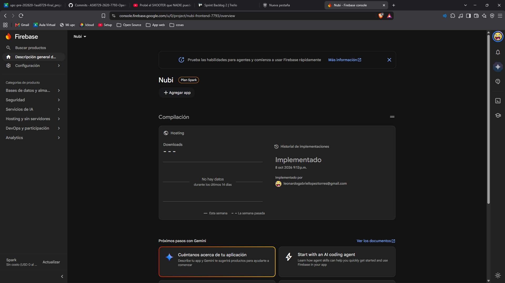
*Figura 13. Firebase Hosting.* Panel del proyecto `nubi-frontend-7793` con el dominio publicado y el historial de versiones desplegadas.

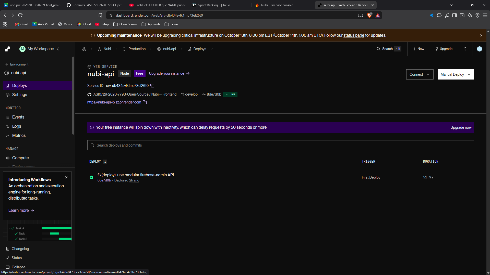

*Figura 14. Render.* Servicio web `nubi-api` con su último despliegue y la variable de entorno configurada.


*Figura 15. Landing Page en GitHub Pages.* Hero del Landing Page publicado, con la navegación a las secciones de valor (Profile, SOS Mode, Self-care, Plans, Communication y Support), el selector de idioma EN/ES y los botones Log in, Get started free y Get started now, que sirven de call-to-action hacia la Frontend Web Application.


#### 5.2.2.8. Team Collaboration Insights during Sprint

En el Sprint 2 la implementación se repartió por Bounded Context, como se acordó en la retrospectiva del Sprint 1: cada integrante lideró un contexto en su propia rama `feature/*` del repositorio [Nubi---Frontend](https://tinyurl.com/2cxsdvov) y lo integró en `develop`, mediante merges directos o pull requests ([#1](https://tinyurl.com/29q9en2o) y [#3](https://tinyurl.com/2462v5z9), de Red de Apoyo y Seguimiento). Los cinco integrantes registran commits en la Frontend Web Application, a diferencia del Sprint 1, en el que solo dos lo hicieron en el Landing Page.

La tabla resume los commits de cada integrante en la rama `develop` entre el 3 y el 8 de octubre de 2026. Las líneas no cuentan los merges ni el archivo `package-lock.json`.

| Cuenta de GitHub | Integrante | Aspecto liderado | Commits | Merges | Líneas |
|---|---|---|---|---|---|
| LeonardoLopez138 | Lopez Torres, Leonardo Gabriel | Comunicación Asistida (CAA) | 32 | 2 | +2719 / −163 |
| u20241a195-cmd | Diaz Yurivilca, Sofia | Gestión de Crisis (Modo SOS) e integración en `develop` | 13 | 4 | +2777 / −11 |
| joanfpp2-ai | Payano Puchuri, Joan Fabricio | Autorregulación y Shared | 10 | 0 | +8528 / −114 |
| nahiryn8 | Ruiz Villegas, Yngrid Nahir | Perfil y Personalización | 16 | 0 | +4228 / −44 |
| Dan-trax | Diaz Caruzo, Edgard Daniel | Red de Apoyo y Seguimiento | 7 | 3 | +586 / −1 |
| **Total** | | | **78** | **9** | |

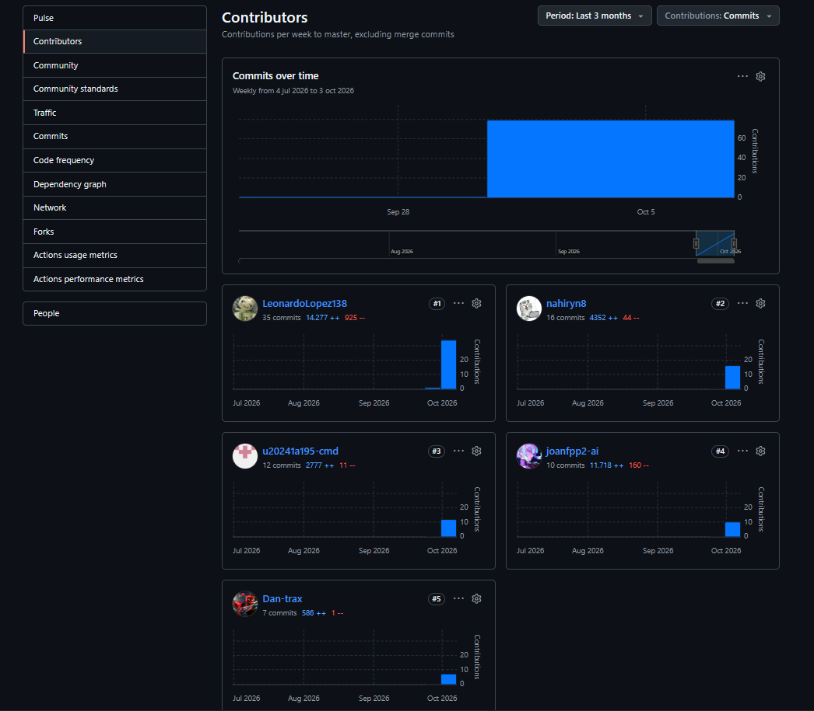

*Figura 16. Contributors del repositorio Nubi---Frontend (últimos 3 meses, sin contar merges).* Muestra que toda la actividad del repositorio se concentra en la semana del 5 de octubre de 2026 y que los cinco integrantes registran commits: LeonardoLopez138 (35), nahiryn8 (16), u20241a195-cmd (12), joanfpp2-ai (10) y Dan-trax (7).


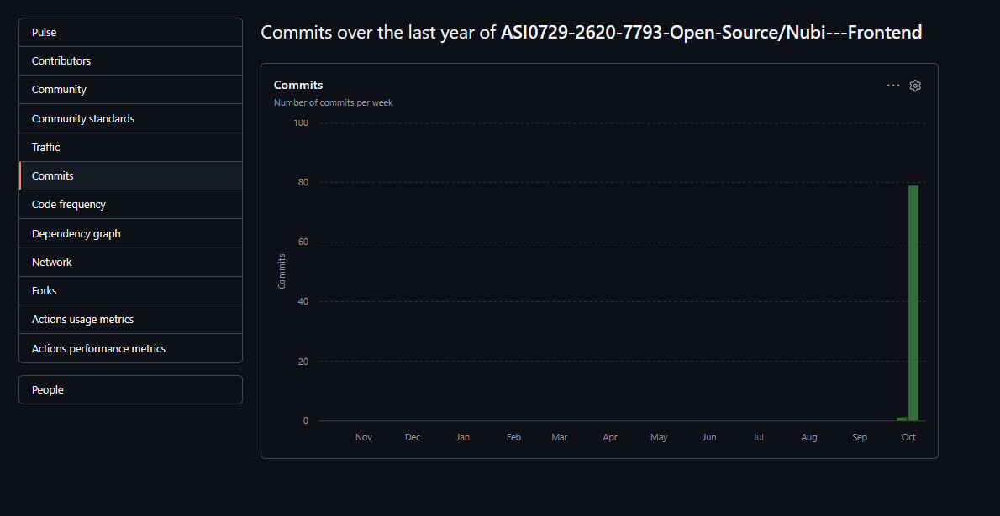

*Figura 17. Commits por semana del repositorio Nubi---Frontend.* Muestra el número de commits semanales durante el último año. El repositorio no tiene actividad hasta fines de septiembre de 2026 y registra cerca de 80 commits en la primera semana de octubre, que corresponde al Sprint 2.

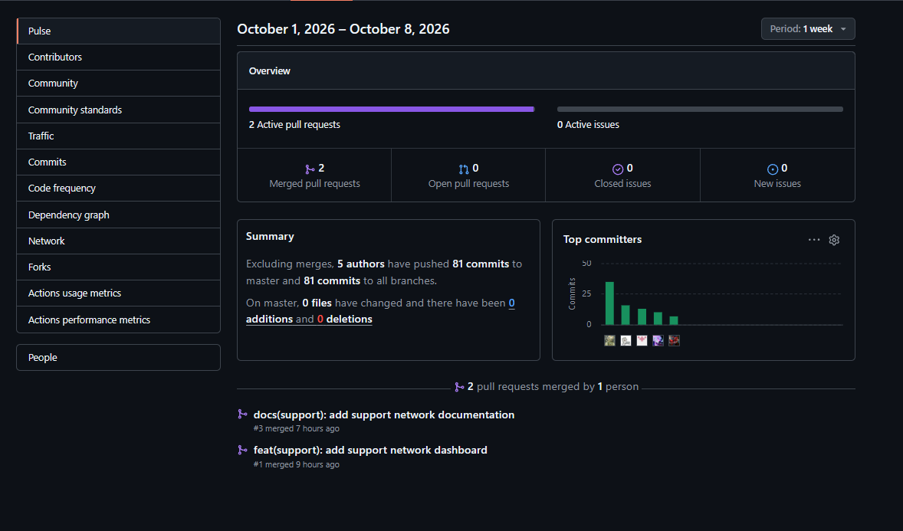

*Figura 18. Pulse del 1 al 8 de octubre de 2026.* Resume la semana del Sprint 2: 5 autores enviaron 81 commits sin contar merges, se integraron 2 pull requests (#1, `feat(support): add support network dashboard`, y #3, `docs(support): add support network documentation`), no hay pull requests abiertos ni issues, y el gráfico Top committers muestra el aporte de los cinco integrantes.

Como oportunidad de mejora, 81 de los 87 commits de `develop` se registraron el 8 de octubre de 2026, el último día del Sprint, por lo que la integración de las ramas se hizo con poco margen para revisar. Para el Sprint 3 el equipo integrará cada rama `feature/*` en `develop` conforme se complete cada User Story.

##### Repositorio del informe (Macally) durante el Sprint 2

Entre el 21 de septiembre y el 8 de octubre de 2026 los cinco integrantes registraron commits en la rama `develop` del repositorio [Macally](https://github.com/ASI0729-2620-7793-Open-Source/Macally), donde se redactaron las secciones del Sprint 2 (planning, aspect leaders, sprint backlog, evidencias, conclusiones y bibliografía). La tabla se obtuvo del historial de Git y no cuenta los merges.

| Cuenta de GitHub | Integrante | Commits | Líneas | Secciones del Sprint 2 |
|---|---|---|---|---|
| u20241a195-cmd | Diaz Yurivilca, Sofia | 5 | +115 / −59 | Sprint Planning 2, conclusiones y bibliografía |
| Deiko-138 / LeonardoLopez138 | Lopez Torres, Leonardo Gabriel | 3 | +399 / −120 | Imágenes y estructura del Sprint 2 |
| nahiryn8 | Ruiz Villegas, Yngrid Nahir | 3 | +101 / −1 | Development Evidence y Execution Evidence |
| Dan-trax | Diaz Caruzo, Edgard Daniel | 3 | +42 / −3 | Sprint Backlog 2 |
| joanfpp2-ai | Payano Puchuri, Joan Fabricio | 1 | +56 / −0 | Aspect Leaders and Collaborators 2 y bibliografía |
| **Total** | | **15** | | |

##### Repositorio del Landing Page durante el Sprint 2

Del 1 al 8 de octubre de 2026 el repositorio [landing-page](https://github.com/ASI0729-2620-7793-Open-Source/landing-page) registró 12 commits sin contar merges (los 13 de la tabla de la sección 5.2.2.4 incluyen un merge). A diferencia del Sprint 1, en el que solo participaron dos integrantes, en este Sprint se sumaron Nahir y Joan con las secciones de video About-the-Product y About-the-Team.

| Cuenta de GitHub | Integrante | Commits | Líneas | Aporte |
|---|---|---|---|---|
| Deiko-138 / LeonardoLopez138 | Lopez Torres, Leonardo Gabriel | 8 | +30 / −62 | Enlaces de inicio de sesión y registro, textos de planes y corrección de conflictos |
| nahiryn8 | Ruiz Villegas, Yngrid Nahir | 3 | +177 / −12 | Sección y video About-the-Product |
| joanfpp2-ai | Payano Puchuri, Joan Fabricio | 1 | +90 / −10 | Sección de video About-the-Team con i18n |
| u20241a195-cmd | Diaz Yurivilca, Sofia | 0 | — | Sin commits en este Sprint |
| Dan-trax | Diaz Caruzo, Edgard Daniel | 0 | — | Sin commits en este Sprint |

Como oportunidad de mejora, Sofia y Edgard no registran commits en el Landing Page durante el Sprint 2, aunque sí en la Frontend Web Application y en el informe. Para el Sprint 3 se les asignan tareas del Landing Page en el Sprint Backlog, de modo que los cinco integrantes participen en cada producto del Sprint.


### 5.2.3. Sprint 3

#### 5.2.3.1. Sprint Planning 3

El Sprint Planning 3 define el alcance de la primera versión de los RESTful Web Services de Nubi y de su conexión con la Frontend Web Application. Los servicios se implementan con Java y Spring Boot en el repositorio [Nubi.Platform.Backend](https://github.com/ASI0729-2620-7793-Open-Source/Nubi.Platform.Backend), con un Bounded Context por rama, y cubren las Technical Stories TS-01 a TS-05 del Product Backlog. El Sprint también retoma las User Stories que quedaron en proceso o pendientes en el Sprint 2 y las tareas T-04 y T-52.

| Campo | Detalle |
|---|---|
| Sprint # | Sprint 3 |
| **Sprint Planning Background** | |
| Date | 2026-10-29 |
| Time | 08:00 PM |
| Location | Virtual (WhatsApp) |
| Prepared By | Lopez Torres, Leonardo Gabriel |
| Attendees (to planning meeting) | Lopez Torres, Leonardo Gabriel / Diaz Yurivilca, Sofia / Payano Puchuri, Joan Fabricio / Ruiz Villegas, Yngrid Nahir / Diaz Caruzo, Edgard Daniel **[POR CONFIRMAR]** |
| Sprint 2 Review Summary | De las 29 User Stories comprometidas en el Sprint 2, 23 quedaron completas (62 de 77 Story Points). US-25, US-26 y US-29 quedaron en proceso porque el panel de Red de Apoyo y Seguimiento usaba datos de muestra, y US-22, US-24 y US-28 quedaron pendientes. La Frontend Web Application se desplegó en Firebase Hosting y la API simulada en Render. Las tareas T-04 (llamado a la acción del Landing Page hacia la aplicación) y T-52 (release a `master`) no se completaron. |
| Sprint 2 Retrospective Summary | Como aciertos se identifican el reparto del trabajo por Bounded Context en ramas `feature/*` propias, la participación de los cinco integrantes en la Frontend Web Application y el despliegue de la aplicación y de la API simulada. Como oportunidades de mejora se identifican que 81 de los 87 commits de `develop` se registraron el último día del Sprint y que Sofia y Edgard no registraron commits en el Landing Page. Para el Sprint 3 cada rama `feature/*` se integra en `develop` al completarse su User Story, y se asignan tareas del Landing Page a Sofia y a Edgard. |
| **Sprint Goal & User Stories** | |
| Sprint 3 Goal | *Our focus is on delivering a first version of the Nubi RESTful Web Services and connecting the Frontend Web Application to them. We believe it delivers to caregivers and autistic users data that persists between sessions and devices, instead of the simulated API that restarts with fixed sample data. This will be confirmed when a caregiver can complete the main flows of the five Bounded Contexts (profile, SOS Mode, self-regulation, AAC board and support network) from the deployed application, with the data stored by the deployed services, in Desktop and Mobile web browsers.* |
| Sprint 3 Velocity | 40 Story Points |
| Sum of Story Points | 40 |

La distribución del alcance es la siguiente:

| Bloque | Historias | Story Points |
|---|---|---|
| Technical Stories de los Web Services | TS-01 a TS-05 (5 por historia) | 25 |
| User Stories de Comunicación Asistida pendientes del Sprint 2 | US-22 (3) y US-24 (2) | 5 |
| User Stories de Red de Apoyo y Seguimiento pendientes del Sprint 2 | US-25 (3), US-26 (3), US-28 (2) y US-29 (2) | 10 |
| **Total** | **11 historias** | **40** |

No forman parte del compromiso del Sprint 3 las historias de seguimiento y recomendaciones de Red de Apoyo y Seguimiento que no estén cubiertas por TS-05 (US-30 a US-45 en la Frontend Web Application) ni las validaciones de los videos, que se documentan en las secciones 5.3 y 5.4.

#### 5.2.3.2. Aspect Leaders and Collaborators

En el Sprint 3 los aspectos son los cinco Bounded Contexts de los Web Services, los aspectos transversales y los entregables de validación. Cada integrante lidera el mismo Bounded Context que en el Sprint 2, ahora en el repositorio del backend, y lo conecta después con su módulo de la Frontend Web Application. La Leadership-and-Collaboration Matrix indica quién lidera (L) y quién colabora (C).

| Team Member (Last Name, First Name) | GitHub Username | Perfil y Personalización | Gestión de Crisis (Modo SOS) | Autorregulación | Comunicación Asistida (CAA) | Red de Apoyo y Seguimiento | Shared (núcleo del backend y OpenAPI) | Integración en `develop` | Deployment | Landing Page | Validation Interviews y videos |
|---|---|---|---|---|---|---|---|---|---|---|---|
| Lopez Torres, Leonardo Gabriel | [LeonardoLopez138](https://tinyurl.com/2a8ze8hx) | C | C | C | L | C | C | C | L | L | C |
| Diaz Yurivilca, Sofia | [u20241a195-cmd](https://tinyurl.com/299rz9v4) | C | L | C | C | C | C | L | C | C | C |
| Payano Puchuri, Joan Fabricio | [joanfpp2-ai](https://tinyurl.com/2ykyhlc3) | C | C | L | C | C | L | C | C | C | C |
| Ruiz Villegas, Yngrid Nahir | [nahiryn8](https://tinyurl.com/28m8gfas) | L | C | C | C | C | C | C | C | C | L |
| Diaz Caruzo, Edgard Daniel | [Dan-trax](https://tinyurl.com/24dl9dkr) | C | C | C | C | L | C | C | C | C | C |

Cada aspecto agrupa el siguiente trabajo:

- **Perfil y Personalización:** perfiles, perfil sensorial, diagnóstico, foto, cuidadores, contactos de confianza y suscripción (rama `profile-personalization`).
- **Gestión de Crisis (Modo SOS):** sesiones SOS, guía de acción, pasos completados u omitidos, técnicas alternativas y recomendaciones (rama `feature/crisis-management`).
- **Autorregulación:** recursos de calma, sesiones de calma con intensidad, baja estimulación y temporizador, y recursos favoritos (rama `feature/self-regulation`).
- **Comunicación Asistida (CAA):** tablero, categorías, pictogramas, selecciones de pictogramas y estado de ánimo (rama `feature/assistive-comunication`).
- **Red de Apoyo y Seguimiento:** registros y reportes de episodios, solicitudes de ayuda y recomendaciones (rama `feature/support-network`).
- **Autenticación (IAM) y Rutina Visual:** contextos que se agregaron al backend después de integrar los cinco primeros (alta de cuenta, inicio de sesión y rutina del día del niño), desarrollados por Leonardo en las ramas `feature/iam-authentication` y `feature/visual-routine`.
- **Shared:** proyecto base de Spring Boot, núcleo compartido (resultados y errores de dominio, auditoría, manejo global de excepciones) y documentación OpenAPI.
- **Integración en `develop`:** unión de las cinco ramas en `develop` del backend y de la Frontend Web Application.
- **Deployment:** publicación de los Web Services y de la base de datos, y release a `master` (sección 5.2.3.7).
- **Landing Page:** llamado a la acción hacia la aplicación, testimonios reales y revisión de accesibilidad y SEO.
- **Validation Interviews y videos:** diseño y registro de las entrevistas (sección 5.3) y video About-the-Product (sección 5.4).

#### 5.2.3.3. Sprint Backlog 3

El objetivo del Sprint 3 es entregar la primera versión de los Web Services con los cinco Bounded Contexts, conectar la Frontend Web Application a ellos, completar las User Stories pendientes del Sprint 2 y publicar la nueva versión del Landing Page. Las tareas continúan la numeración del Sprint Backlog 2 (T-53 en adelante), se estiman entre 4 y 8 horas y se asignan según la matriz de la sección 5.2.3.2.

**URL del Sprint Backlog 3 en Trello:** https://trello.com/b/HCIZ8lA6/sprint-3-nubi

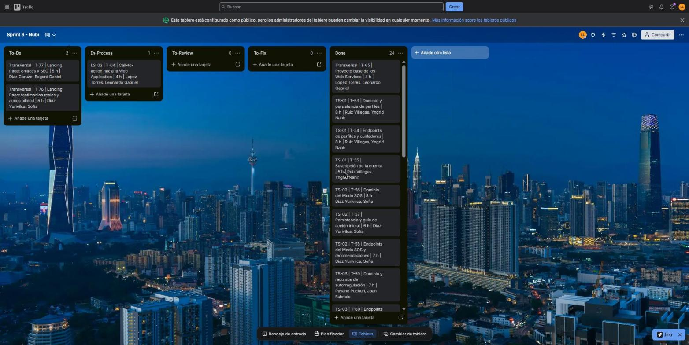

*Sprint Backlog 3 en Trello.* Tablero público del Sprint 3 con las listas To-Do, In-Process, To-Review, To-Fix y Done. Cada tarjeta lleva el identificador de la historia, el de la tarea, su título, la estimación en horas y el integrante asignado. En To-Do están 2 tareas (T-76 y T-77), en In-Process 1 (T-04), en To-Review y en To-Fix ninguna y en Done 24 (T-52 y T-53 a T-75).

El estado de cada tarea se verificó al 14 de noviembre de 2026 contra el código integrado en `develop` de cada repositorio, las 147 pruebas automáticas del backend (sin fallos), los Web Services y la Frontend Web Application publicados y las versiones etiquetadas, y el mismo estado se registró en el tablero de Trello. Las tareas T-04, T-76 y T-77 corresponden al Landing Page y siguen pendientes: su último commit es del 8 de octubre de 2026.

| Sprint # | Sprint 3 | | | | | | |
|---|---|---|---|---|---|---|---|
| **Story Id** | **Story Title** | **Task Id** | **Task Title** | **Task Description** | **Estimation (Hours)** | **Assigned To** | **Status** |
| TS-01 | Exponer API RESTful de gestión de perfiles | T-53 | Dominio y persistencia de perfiles | Implementar el agregado de perfil con perfil sensorial, diagnóstico declarado, cuidadores y contactos de confianza, y su persistencia JPA con las reglas de límite del plan. | 8 | Ruiz Villegas, Yngrid Nahir | Done |
| TS-01 | Exponer API RESTful de gestión de perfiles | T-54 | Endpoints de perfiles y cuidadores | Exponer los endpoints de perfiles, perfil sensorial, diagnóstico, foto, cuidadores y contactos de confianza, con errores en formato `application/problem+json` y pruebas de integración. | 8 | Ruiz Villegas, Yngrid Nahir | Done |
| TS-01 | Exponer API RESTful de gestión de perfiles | T-55 | Suscripción de la cuenta | Exponer la suscripción vigente de la cuenta y el cambio de plan, validando los límites de perfiles y de cuidadores por perfil. | 5 | Ruiz Villegas, Yngrid Nahir | Done |
| TS-02 | Exponer API RESTful del Modo SOS y episodios | T-56 | Dominio del Modo SOS | Implementar los agregados `SosSession` y `ActionGuide` con sus pasos, técnicas alternativas y reglas (omitir un paso obligatorio exige confirmación y una sesión cerrada no admite cambios), con pruebas unitarias. | 8 | Diaz Yurivilca, Sofia | Done |
| TS-02 | Exponer API RESTful del Modo SOS y episodios | T-57 | Persistencia y guía de acción inicial | Implementar las entidades JPA separadas del dominio, los repositorios y la siembra de la guía de seis pasos al iniciar la aplicación. | 6 | Diaz Yurivilca, Sofia | Done |
| TS-02 | Exponer API RESTful del Modo SOS y episodios | T-58 | Endpoints del Modo SOS y recomendaciones | Exponer la activación del Modo SOS, la guía ordenada según el detonante, completar, omitir y pedir una técnica alternativa de un paso, finalizar la sesión y consultar las sesiones y recomendaciones de un perfil. | 7 | Diaz Yurivilca, Sofia | Done |
| TS-03 | Exponer API RESTful de estímulos de autorregulación | T-59 | Dominio y recursos de autorregulación | Implementar los agregados de sesión de calma y recurso de calma, los recursos favoritos y la siembra del catálogo, con pruebas del dominio. | 7 | Payano Puchuri, Joan Fabricio | Done |
| TS-03 | Exponer API RESTful de estímulos de autorregulación | T-60 | Endpoints de sesiones de calma | Exponer el catálogo de recursos, las sesiones de calma (intensidad, baja estimulación, pausa, temporizador y cierre) y los recursos favoritos del perfil. | 7 | Payano Puchuri, Joan Fabricio | Done |
| TS-04 | Exponer API RESTful del tablero CAA | T-61 | Dominio del tablero CAA | Implementar el tablero con categorías, pictogramas, favoritos, selecciones de pictogramas y registros de estado de ánimo. | 7 | Lopez Torres, Leonardo Gabriel | Done |
| TS-04 | Exponer API RESTful del tablero CAA | T-62 | Endpoints del tablero, selecciones y estado de ánimo | Exponer el tablero del perfil, el acceso rápido, las categorías y pictogramas personalizados, las selecciones con su estado de entrega y comprensión, y el historial de estados de ánimo. | 7 | Lopez Torres, Leonardo Gabriel | Done |
| TS-05 | Exponer API RESTful de solicitudes de ayuda y recomendaciones | T-63 | Dominio de episodios, solicitudes y recomendaciones | Implementar los registros y reportes de episodios, las solicitudes de ayuda con su confirmación y cancelación, y las recomendaciones con su efectividad. | 8 | Diaz Caruzo, Edgard Daniel | Done |
| TS-05 | Exponer API RESTful de solicitudes de ayuda y recomendaciones | T-64 | Endpoints de Red de Apoyo y Seguimiento | Exponer los endpoints de registros y reportes de episodios, solicitudes de ayuda y recomendaciones, con validación de fechas y errores HTTP. | 8 | Diaz Caruzo, Edgard Daniel | Done |
| — | Tarea general | T-65 | Proyecto base de los Web Services | Crear el proyecto Spring Boot, la configuración de MySQL y la versión de Java del repositorio `Nubi.Platform.Backend`. | 4 | Lopez Torres, Leonardo Gabriel | Done |
| — | Tarea general | T-66 | Núcleo compartido del backend | Implementar el resultado de las operaciones, los errores de dominio, la auditoría de entidades JPA, el manejo global de excepciones y la configuración de OpenAPI. | 5 | Payano Puchuri, Joan Fabricio | Done |
| — | Tarea general | T-67 | Integración de los cinco contextos en `develop` | Unir las cinco ramas del backend en `develop`, resolver los conflictos del núcleo compartido, de los nombres de beans y de las rutas repetidas (por ejemplo `/api/v1/recommendations`) y ejecutar todas las pruebas. | 8 | Diaz Yurivilca, Sofia | Done |
| — | Tarea general | T-68 | Documentación OpenAPI | Verificar que Swagger UI liste todos los endpoints de los cinco contextos con su descripción, y exportar el contrato para la sección 5.2.3.6. | 4 | Payano Puchuri, Joan Fabricio | Done |
| — | Tarea general | T-69 | Despliegue de los Web Services | Publicar los Web Services en Render con variables de entorno y verificar los endpoints desde la URL pública. La base de datos de la demostración es H2 en memoria (perfil `render`); el script de MySQL queda documentado en `docs/deploy`. | 8 | Lopez Torres, Leonardo Gabriel | Done |
| — | Tarea general | T-70 | Conexión de Perfil y Personalización | Reemplazar en la Frontend Web Application los recursos `profiles`, `caregivers` y de suscripción de la API simulada por los Web Services. | 8 | Ruiz Villegas, Yngrid Nahir | Done |
| — | Tarea general | T-71 | Conexión de Gestión de Crisis | Reemplazar los recursos `actionGuides` y `sosSessions` por los endpoints del Modo SOS y adaptar el assembler al contrato (`caregiverAccountId`). | 6 | Diaz Yurivilca, Sofia | Done |
| — | Tarea general | T-72 | Conexión de Autorregulación | Reemplazar los recursos `calmingResources`, `favoriteResources` y `calmSessions` por los endpoints de autorregulación. | 6 | Payano Puchuri, Joan Fabricio | Done |
| US-22 / US-24 | Agregar pictograma personalizado / Reproducir audio asociado al pictograma | T-73 | Pictograma personalizado, audio y conexión del tablero CAA | Habilitar el pictograma con imagen propia y el audio al seleccionar un pictograma, y conectar el tablero y las selecciones a los Web Services. | 8 | Lopez Torres, Leonardo Gabriel | Done |
| US-25 / US-26 | Enviar solicitud de ayuda al cuidador / Recibir notificación de solicitud de ayuda | T-74 | Solicitud de ayuda y aviso al cuidador | Reemplazar los datos de muestra del panel por las solicitudes de ayuda de los Web Services. | 8 | Diaz Caruzo, Edgard Daniel | Done |
| US-28 / US-29 | Cancelar solicitud de ayuda / Consultar historial de solicitudes de ayuda | T-75 | Cancelar solicitud y actividad reciente | Permitir cancelar una solicitud enviada y mostrar el historial y la actividad reciente desde los Web Services. | 6 | Diaz Caruzo, Edgard Daniel | Done |
| LS-02 | Conocer el Modo SOS en la landing page | T-04 | Call-to-action hacia la Web Application | Tarea pendiente del Sprint 1: enlazar los botones del Landing Page con las vistas de registro e inicio de sesión de la aplicación desplegada y verificar la redirección en ambos idiomas. | 4 | Lopez Torres, Leonardo Gabriel | In-Process |
| — | Tarea general | T-76 | Landing Page: testimonios reales y accesibilidad | Reemplazar los testimonios de ejemplo por testimonios de las entrevistas de validación y revisar el contraste, el foco y los textos alternativos. | 5 | Diaz Yurivilca, Sofia | To-do |
| — | Tarea general | T-77 | Landing Page: enlaces y SEO | Actualizar los enlaces a la aplicación y a los Web Services desplegados, y revisar las etiquetas SEO de la sección 4.2.3. | 5 | Diaz Caruzo, Edgard Daniel | To-do |
| — | Tarea general | T-52 | Release a `master` | Crear la rama `release/v1.0.0`, integrar `develop` en `master` según GitFlow, etiquetar la versión y verificar que los productos desplegados correspondan a esa versión. | 4 | Diaz Caruzo, Edgard Daniel | Done |

De las 27 tareas del Sprint Backlog 3, 24 están en Done, 1 en In-Process (T-04) y 2 en To-do (T-76 y T-77). Las tareas T-04 y T-52 provienen de los Sprint Backlog 1 y 2. T-52 se cumplió en el repositorio de los Web Services (`release/1.0.0`, `1.1.0` y `1.2.0`, con las etiquetas `v1.0.0` a `v1.2.0`) y en el de la Frontend Web Application (`release/1.0.0` a `1.2.0`), cuya rama estable se llama `main` y no `master`.

#### 5.2.3.4. Development Evidence for Sprint Review

En el Sprint 3 se implementó la primera versión de los RESTful Web Services con Java, Spring Boot, Spring Data JPA y MySQL (H2 en memoria en el entorno desplegado), y su documentación con springdoc-openapi, en el repositorio [Nubi.Platform.Backend](https://github.com/ASI0729-2620-7793-Open-Source/Nubi.Platform.Backend). Cada Bounded Context se desarrolló en su propia rama y sigue la arquitectura del capítulo IV:

- `domain`: agregados, entidades, objetos de valor, eventos, comandos, consultas y puertos de repositorio, sin dependencias de JPA.
- `application`: servicios de comandos y de consultas, manejadores de eventos y una capa anticorrupción hacia los otros contextos.
- `infrastructure`: entidades de persistencia JPA separadas del dominio, repositorios de Spring Data, mappers y adaptadores.
- `interfaces`: controladores REST, recursos (DTO) y ensambladores.

Los avances por Bounded Context fueron:

- **Perfil y Personalización** (rama `profile-personalization`): perfiles con perfil sensorial, diagnóstico declarado, foto, cuidadores y contactos de confianza, suscripción con límites de plan, pruebas unitarias y de integración, un script de prueba rápida y el documento `docs/api-perfil-personalizacion.md`.
- **Gestión de Crisis** (rama `feature/crisis-management`): sesiones SOS y guía de acción, siembra de la guía de seis pasos, recomendaciones por perfil, pruebas de dominio y de la API REST, y eventos de dominio para el registro de episodios.
- **Autorregulación** (rama `feature/self-regulation`): catálogo de recursos de calma, sesiones de calma con intensidad, baja estimulación y temporizador, recursos favoritos y pruebas de dominio y de la API REST.
- **Comunicación Asistida** (rama `feature/assistive-comunication`): tablero por perfil, categorías, pictogramas personalizados y favoritos, selecciones de pictogramas con estado de entrega y comprensión, y estado de ánimo.
- **Red de Apoyo y Seguimiento** (rama `feature/support-network`): registros y reportes de episodios, solicitudes de ayuda con confirmación y cancelación, y recomendaciones con efectividad.

Una vez integradas las cinco ramas, el equipo agregó dos contextos que sustentan la experiencia de la aplicación y que no figuran en el Capítulo IV:

- **IAM** (rama `feature/iam-authentication`): alta de cuenta, inicio de sesión y consulta de la cuenta, con las contraseñas guardadas con hash PBKDF2.
- **Rutina Visual** (rama `feature/visual-routine`): rutina del día del niño con pasos que el cuidador ordena y el niño marca, sembrada al registrar al niño.

La tabla registra, por rama, los 112 commits del Sprint 3 sin contar merges, en orden cronológico. Los commits no tienen cuerpo de mensaje, por lo que esa columna se indica con «—». Los mensajes se transcriben tal como se registraron en Git.

| Repository | Branch | Commit Id | Commit Message | Commit Message Body | Committed on (Date) |
|---|---|---|---|---|---|
| ASI0729-2620-7793-Open-Source/Nubi.Platform.Backend | `profile-personalization` | [5c0bdce](https://github.com/ASI0729-2620-7793-Open-Source/Nubi.Platform.Backend/commit/5c0bdce) | chore: update Maven wrapper version and Java version; add new dependencies | — | 09/11/2026 |
| ASI0729-2620-7793-Open-Source/Nubi.Platform.Backend | `profile-personalization` | [6ca4f6e](https://github.com/ASI0729-2620-7793-Open-Source/Nubi.Platform.Backend/commit/6ca4f6e) | chore(config): update application properties and setup docs | — | 09/11/2026 |
| ASI0729-2620-7793-Open-Source/Nubi.Platform.Backend | `profile-personalization` | [3c0a8d0](https://github.com/ASI0729-2620-7793-Open-Source/Nubi.Platform.Backend/commit/3c0a8d0) | refactor(shared): add core domain and auditing abstractions | — | 09/11/2026 |
| ASI0729-2620-7793-Open-Source/Nubi.Platform.Backend | `profile-personalization` | [2bd5515](https://github.com/ASI0729-2620-7793-Open-Source/Nubi.Platform.Backend/commit/2bd5515) | refactor(shared): add shared infrastructure configurations and result wrappers | — | 09/11/2026 |
| ASI0729-2620-7793-Open-Source/Nubi.Platform.Backend | `profile-personalization` | [304f327](https://github.com/ASI0729-2620-7793-Open-Source/Nubi.Platform.Backend/commit/304f327) | feat(profile): define profile domain enums and value objects | — | 09/11/2026 |
| ASI0729-2620-7793-Open-Source/Nubi.Platform.Backend | `profile-personalization` | [c135751](https://github.com/ASI0729-2620-7793-Open-Source/Nubi.Platform.Backend/commit/c135751) | feat(profile): add profile domain entities and aggregates | — | 09/11/2026 |
| ASI0729-2620-7793-Open-Source/Nubi.Platform.Backend | `profile-personalization` | [db82da7](https://github.com/ASI0729-2620-7793-Open-Source/Nubi.Platform.Backend/commit/db82da7) | feat(profile): add domain exceptions and validation rules | — | 09/11/2026 |
| ASI0729-2620-7793-Open-Source/Nubi.Platform.Backend | `profile-personalization` | [20e1339](https://github.com/ASI0729-2620-7793-Open-Source/Nubi.Platform.Backend/commit/20e1339) | feat(profile): implement profile JPA entities and repositories | — | 09/11/2026 |
| ASI0729-2620-7793-Open-Source/Nubi.Platform.Backend | `profile-personalization` | [72d4b33](https://github.com/ASI0729-2620-7793-Open-Source/Nubi.Platform.Backend/commit/72d4b33) | feat(profile): implement profile repository adapters and mappers | — | 09/11/2026 |
| ASI0729-2620-7793-Open-Source/Nubi.Platform.Backend | `profile-personalization` | [d194e4b](https://github.com/ASI0729-2620-7793-Open-Source/Nubi.Platform.Backend/commit/d194e4b) | feat(profile): add profile DTOs and application service | — | 10/11/2026 |
| ASI0729-2620-7793-Open-Source/Nubi.Platform.Backend | `profile-personalization` | [32b3461](https://github.com/ASI0729-2620-7793-Open-Source/Nubi.Platform.Backend/commit/32b3461) | feat(profile): implement profile REST controller and exception handlers | — | 10/11/2026 |
| ASI0729-2620-7793-Open-Source/Nubi.Platform.Backend | `profile-personalization` | [4a70f5f](https://github.com/ASI0729-2620-7793-Open-Source/Nubi.Platform.Backend/commit/4a70f5f) | chore(profile): add database migration script and smoke test script | — | 10/11/2026 |
| ASI0729-2620-7793-Open-Source/Nubi.Platform.Backend | `profile-personalization` | [936d904](https://github.com/ASI0729-2620-7793-Open-Source/Nubi.Platform.Backend/commit/936d904) | feat(profile): add subscription status enum and domain entity | — | 10/11/2026 |
| ASI0729-2620-7793-Open-Source/Nubi.Platform.Backend | `profile-personalization` | [7e013d3](https://github.com/ASI0729-2620-7793-Open-Source/Nubi.Platform.Backend/commit/7e013d3) | feat(profile): define subscription repository interface | — | 10/11/2026 |
| ASI0729-2620-7793-Open-Source/Nubi.Platform.Backend | `profile-personalization` | [ee39baa](https://github.com/ASI0729-2620-7793-Open-Source/Nubi.Platform.Backend/commit/ee39baa) | feat(profile): add JPA persistence entities and repository for subscription | — | 10/11/2026 |
| ASI0729-2620-7793-Open-Source/Nubi.Platform.Backend | `profile-personalization` | [2d79cc4](https://github.com/ASI0729-2620-7793-Open-Source/Nubi.Platform.Backend/commit/2d79cc4) | feat(profile): implement subscription mappers and repository adapter | — | 10/11/2026 |
| ASI0729-2620-7793-Open-Source/Nubi.Platform.Backend | `profile-personalization` | [eebfcc0](https://github.com/ASI0729-2620-7793-Open-Source/Nubi.Platform.Backend/commit/eebfcc0) | feat(profile): add subscription DTOs and application service | — | 11/11/2026 |
| ASI0729-2620-7793-Open-Source/Nubi.Platform.Backend | `profile-personalization` | [88c4342](https://github.com/ASI0729-2620-7793-Open-Source/Nubi.Platform.Backend/commit/88c4342) | feat(profile): implement subscription REST controller | — | 11/11/2026 |
| ASI0729-2620-7793-Open-Source/Nubi.Platform.Backend | `profile-personalization` | [4150942](https://github.com/ASI0729-2620-7793-Open-Source/Nubi.Platform.Backend/commit/4150942) | feat(profile): add domain entities and domain events for trusted contact | — | 11/11/2026 |
| ASI0729-2620-7793-Open-Source/Nubi.Platform.Backend | `profile-personalization` | [5cf38ba](https://github.com/ASI0729-2620-7793-Open-Source/Nubi.Platform.Backend/commit/5cf38ba) | feat(profile): add trusted contact JPA persistence entity | — | 11/11/2026 |
| ASI0729-2620-7793-Open-Source/Nubi.Platform.Backend | `profile-personalization` | [1106649](https://github.com/ASI0729-2620-7793-Open-Source/Nubi.Platform.Backend/commit/1106649) | test(profile): add unit and integration test suite for profile context | — | 11/11/2026 |
| ASI0729-2620-7793-Open-Source/Nubi.Platform.Backend | `profile-personalization` | [80ebd94](https://github.com/ASI0729-2620-7793-Open-Source/Nubi.Platform.Backend/commit/80ebd94) | test(profile): add unit tests for subscription context | — | 11/11/2026 |
| ASI0729-2620-7793-Open-Source/Nubi.Platform.Backend | `profile-personalization` | [7ac0cab](https://github.com/ASI0729-2620-7793-Open-Source/Nubi.Platform.Backend/commit/7ac0cab) | chore(config): update main application properties for database and server configuration | — | 11/11/2026 |
| ASI0729-2620-7793-Open-Source/Nubi.Platform.Backend | `feature/crisis-management` | [52cc66c](https://github.com/ASI0729-2620-7793-Open-Source/Nubi.Platform.Backend/commit/52cc66c) | build: add springdoc openapi and h2 test dependencies | — | 12/11/2026 |
| ASI0729-2620-7793-Open-Source/Nubi.Platform.Backend | `feature/crisis-management` | [badb2b1](https://github.com/ASI0729-2620-7793-Open-Source/Nubi.Platform.Backend/commit/badb2b1) | chore(config): configure mysql datasource from environment variables | — | 12/11/2026 |
| ASI0729-2620-7793-Open-Source/Nubi.Platform.Backend | `feature/crisis-management` | [2abb5a4](https://github.com/ASI0729-2620-7793-Open-Source/Nubi.Platform.Backend/commit/2abb5a4) | test(config): use an in-memory h2 database for tests | — | 12/11/2026 |
| ASI0729-2620-7793-Open-Source/Nubi.Platform.Backend | `feature/crisis-management` | [2cd42d4](https://github.com/ASI0729-2620-7793-Open-Source/Nubi.Platform.Backend/commit/2cd42d4) | feat(shared): add result type for command service outcomes | — | 12/11/2026 |
| ASI0729-2620-7793-Open-Source/Nubi.Platform.Backend | `feature/crisis-management` | [ab49785](https://github.com/ASI0729-2620-7793-Open-Source/Nubi.Platform.Backend/commit/ab49785) | feat(shared): add domain error model | — | 12/11/2026 |
| ASI0729-2620-7793-Open-Source/Nubi.Platform.Backend | `feature/crisis-management` | [dbee9c6](https://github.com/ASI0729-2620-7793-Open-Source/Nubi.Platform.Backend/commit/dbee9c6) | feat(shared): add aggregate root base and domain event marker | — | 12/11/2026 |
| ASI0729-2620-7793-Open-Source/Nubi.Platform.Backend | `feature/crisis-management` | [023e8b0](https://github.com/ASI0729-2620-7793-Open-Source/Nubi.Platform.Backend/commit/023e8b0) | feat(shared): add generic crud repository contract | — | 12/11/2026 |
| ASI0729-2620-7793-Open-Source/Nubi.Platform.Backend | `feature/crisis-management` | [b7b0734](https://github.com/ASI0729-2620-7793-Open-Source/Nubi.Platform.Backend/commit/b7b0734) | feat(shared): add jpa auditing and auditable persistence entity | — | 12/11/2026 |
| ASI0729-2620-7793-Open-Source/Nubi.Platform.Backend | `feature/crisis-management` | [549c3b0](https://github.com/ASI0729-2620-7793-Open-Source/Nubi.Platform.Backend/commit/549c3b0) | feat(shared): add clock and openapi configuration | — | 12/11/2026 |
| ASI0729-2620-7793-Open-Source/Nubi.Platform.Backend | `feature/crisis-management` | [c9c825b](https://github.com/ASI0729-2620-7793-Open-Source/Nubi.Platform.Backend/commit/c9c825b) | feat(shared): add global exception handler and problem detail assembler | — | 12/11/2026 |
| ASI0729-2620-7793-Open-Source/Nubi.Platform.Backend | `feature/crisis-management` | [f3d1071](https://github.com/ASI0729-2620-7793-Open-Source/Nubi.Platform.Backend/commit/f3d1071) | feat(crisismanagement): add core domain value objects and enumerations | — | 05/11/2026 |
| ASI0729-2620-7793-Open-Source/Nubi.Platform.Backend | `feature/crisis-management` | [c2a6310](https://github.com/ASI0729-2620-7793-Open-Source/Nubi.Platform.Backend/commit/c2a6310) | feat(crisismanagement): add domain entities for step tracking | — | 05/11/2026 |
| ASI0729-2620-7793-Open-Source/Nubi.Platform.Backend | `feature/crisis-management` | [d8276e6](https://github.com/ASI0729-2620-7793-Open-Source/Nubi.Platform.Backend/commit/d8276e6) | feat(crisismanagement): implement ActionGuide aggregate root | — | 06/11/2026 |
| ASI0729-2620-7793-Open-Source/Nubi.Platform.Backend | `feature/crisis-management` | [4c4b0bc](https://github.com/ASI0729-2620-7793-Open-Source/Nubi.Platform.Backend/commit/4c4b0bc) | feat(crisismanagement): implement Recommendation aggregate root | — | 06/11/2026 |
| ASI0729-2620-7793-Open-Source/Nubi.Platform.Backend | `feature/crisis-management` | [9a91656](https://github.com/ASI0729-2620-7793-Open-Source/Nubi.Platform.Backend/commit/9a91656) | feat(crisismanagement): implement SosSession aggregate root | — | 06/11/2026 |
| ASI0729-2620-7793-Open-Source/Nubi.Platform.Backend | `feature/crisis-management` | [6af357d](https://github.com/ASI0729-2620-7793-Open-Source/Nubi.Platform.Backend/commit/6af357d) | feat(crisismanagement): add SOS session lifecycle commands | — | 07/11/2026 |
| ASI0729-2620-7793-Open-Source/Nubi.Platform.Backend | `feature/crisis-management` | [af73f6d](https://github.com/ASI0729-2620-7793-Open-Source/Nubi.Platform.Backend/commit/af73f6d) | feat(crisismanagement): add recommendation and preference commands | — | 07/11/2026 |
| ASI0729-2620-7793-Open-Source/Nubi.Platform.Backend | `feature/crisis-management` | [3a42d60](https://github.com/ASI0729-2620-7793-Open-Source/Nubi.Platform.Backend/commit/3a42d60) | feat(crisismanagement): define domain queries for guides, recommendations and sessions | — | 07/11/2026 |
| ASI0729-2620-7793-Open-Source/Nubi.Platform.Backend | `feature/crisis-management` | [60bb625](https://github.com/ASI0729-2620-7793-Open-Source/Nubi.Platform.Backend/commit/60bb625) | feat(crisismanagement): add domain events for crisis episodes and sessions | — | 08/11/2026 |
| ASI0729-2620-7793-Open-Source/Nubi.Platform.Backend | `feature/crisis-management` | [cff9c04](https://github.com/ASI0729-2620-7793-Open-Source/Nubi.Platform.Backend/commit/cff9c04) | feat(crisismanagement): define command and query domain service interfaces | — | 08/11/2026 |
| ASI0729-2620-7793-Open-Source/Nubi.Platform.Backend | `feature/crisis-management` | [eeb45a3](https://github.com/ASI0729-2620-7793-Open-Source/Nubi.Platform.Backend/commit/eeb45a3) | feat(crisismanagement): add JPA repositories for crisis management aggregates | — | 09/11/2026 |
| ASI0729-2620-7793-Open-Source/Nubi.Platform.Backend | `feature/crisis-management` | [600e772](https://github.com/ASI0729-2620-7793-Open-Source/Nubi.Platform.Backend/commit/600e772) | feat(crisismanagement): implement ExternalProfileService outbound ACL | — | 09/11/2026 |
| ASI0729-2620-7793-Open-Source/Nubi.Platform.Backend | `feature/crisis-management` | [65150c7](https://github.com/ASI0729-2620-7793-Open-Source/Nubi.Platform.Backend/commit/65150c7) | feat(crisismanagement): implement ActionGuideCommandServiceImpl | — | 10/11/2026 |
| ASI0729-2620-7793-Open-Source/Nubi.Platform.Backend | `feature/crisis-management` | [6a71555](https://github.com/ASI0729-2620-7793-Open-Source/Nubi.Platform.Backend/commit/6a71555) | feat(crisismanagement): implement RecommendationCommandServiceImpl | — | 10/11/2026 |
| ASI0729-2620-7793-Open-Source/Nubi.Platform.Backend | `feature/crisis-management` | [c769114](https://github.com/ASI0729-2620-7793-Open-Source/Nubi.Platform.Backend/commit/c769114) | feat(crisismanagement): implement SosSessionCommandServiceImpl | — | 10/11/2026 |
| ASI0729-2620-7793-Open-Source/Nubi.Platform.Backend | `feature/crisis-management` | [eca8a23](https://github.com/ASI0729-2620-7793-Open-Source/Nubi.Platform.Backend/commit/eca8a23) | feat(crisismanagement): implement ActionGuideQueryServiceImpl | — | 11/11/2026 |
| ASI0729-2620-7793-Open-Source/Nubi.Platform.Backend | `feature/crisis-management` | [c541d73](https://github.com/ASI0729-2620-7793-Open-Source/Nubi.Platform.Backend/commit/c541d73) | feat(crisismanagement): implement recommendation and SOS session query services | — | 11/11/2026 |
| ASI0729-2620-7793-Open-Source/Nubi.Platform.Backend | `feature/crisis-management` | [ed3a006](https://github.com/ASI0729-2620-7793-Open-Source/Nubi.Platform.Backend/commit/ed3a006) | feat(crisismanagement): add ApplicationReadyEventHandler for initial seeding | — | 11/11/2026 |
| ASI0729-2620-7793-Open-Source/Nubi.Platform.Backend | `feature/crisis-management` | [91b6b74](https://github.com/ASI0729-2620-7793-Open-Source/Nubi.Platform.Backend/commit/91b6b74) | feat(crisismanagement): add EpisodeRegisteredEventHandler for automated crisis response | — | 11/11/2026 |
| ASI0729-2620-7793-Open-Source/Nubi.Platform.Backend | `feature/crisis-management` | [253584c](https://github.com/ASI0729-2620-7793-Open-Source/Nubi.Platform.Backend/commit/253584c) | feat(crisismanagement): add REST request and response resources | — | 12/11/2026 |
| ASI0729-2620-7793-Open-Source/Nubi.Platform.Backend | `feature/crisis-management` | [84698e2](https://github.com/ASI0729-2620-7793-Open-Source/Nubi.Platform.Backend/commit/84698e2) | feat(crisismanagement): add command and resource assemblers | — | 12/11/2026 |
| ASI0729-2620-7793-Open-Source/Nubi.Platform.Backend | `feature/crisis-management` | [c86260d](https://github.com/ASI0729-2620-7793-Open-Source/Nubi.Platform.Backend/commit/c86260d) | feat(crisismanagement): expose REST controllers and remaining bounded context files | — | 12/11/2026 |
| ASI0729-2620-7793-Open-Source/Nubi.Platform.Backend | `feature/self-regulation` | [42cb99c](https://github.com/ASI0729-2620-7793-Open-Source/Nubi.Platform.Backend/commit/42cb99c) | fix(build): align java.version with installed JDK 25 and add test/db configuration | — | 04/11/2026 |
| ASI0729-2620-7793-Open-Source/Nubi.Platform.Backend | `feature/self-regulation` | [084eb12](https://github.com/ASI0729-2620-7793-Open-Source/Nubi.Platform.Backend/commit/084eb12) | chore(deps): add springdoc openapi and api documentation configuration | — | 10/11/2026 |
| ASI0729-2620-7793-Open-Source/Nubi.Platform.Backend | `feature/self-regulation` | [441e627](https://github.com/ASI0729-2620-7793-Open-Source/Nubi.Platform.Backend/commit/441e627) | feat(shared): add auditable persistence entity and jpa auditing | — | 10/11/2026 |
| ASI0729-2620-7793-Open-Source/Nubi.Platform.Backend | `feature/self-regulation` | [b659bc3](https://github.com/ASI0729-2620-7793-Open-Source/Nubi.Platform.Backend/commit/b659bc3) | feat(shared): add domain error model and crud repository contract | — | 10/11/2026 |
| ASI0729-2620-7793-Open-Source/Nubi.Platform.Backend | `feature/self-regulation` | [2895ce1](https://github.com/ASI0729-2620-7793-Open-Source/Nubi.Platform.Backend/commit/2895ce1) | feat(shared): map domain errors and invalid input to problem details | — | 10/11/2026 |
| ASI0729-2620-7793-Open-Source/Nubi.Platform.Backend | `feature/self-regulation` | [48b8c19](https://github.com/ASI0729-2620-7793-Open-Source/Nubi.Platform.Backend/commit/48b8c19) | feat(self-regulation): add value objects for calm sessions and calming resources | — | 10/11/2026 |
| ASI0729-2620-7793-Open-Source/Nubi.Platform.Backend | `feature/self-regulation` | [b7d3e00](https://github.com/ASI0729-2620-7793-Open-Source/Nubi.Platform.Backend/commit/b7d3e00) | feat(self-regulation): add calming resource and calm session aggregates | — | 10/11/2026 |
| ASI0729-2620-7793-Open-Source/Nubi.Platform.Backend | `feature/self-regulation` | [b9ff4d1](https://github.com/ASI0729-2620-7793-Open-Source/Nubi.Platform.Backend/commit/b9ff4d1) | feat(self-regulation): add commands, queries, repositories and domain services | — | 10/11/2026 |
| ASI0729-2620-7793-Open-Source/Nubi.Platform.Backend | `feature/self-regulation` | [9523b40](https://github.com/ASI0729-2620-7793-Open-Source/Nubi.Platform.Backend/commit/9523b40) | feat(self-regulation): add jpa persistence entities and repositories | — | 11/11/2026 |
| ASI0729-2620-7793-Open-Source/Nubi.Platform.Backend | `feature/self-regulation` | [5bc27cb](https://github.com/ASI0729-2620-7793-Open-Source/Nubi.Platform.Backend/commit/5bc27cb) | feat(self-regulation): add persistence mappers and repository adapters | — | 11/11/2026 |
| ASI0729-2620-7793-Open-Source/Nubi.Platform.Backend | `feature/self-regulation` | [bb5fb77](https://github.com/ASI0729-2620-7793-Open-Source/Nubi.Platform.Backend/commit/bb5fb77) | feat(self-regulation): implement command and query services with profile acl | — | 11/11/2026 |
| ASI0729-2620-7793-Open-Source/Nubi.Platform.Backend | `feature/self-regulation` | [46bb7ae](https://github.com/ASI0729-2620-7793-Open-Source/Nubi.Platform.Backend/commit/46bb7ae) | feat(self-regulation): seed calming resource catalog on application ready | — | 11/11/2026 |
| ASI0729-2620-7793-Open-Source/Nubi.Platform.Backend | `feature/self-regulation` | [dde1bc6](https://github.com/ASI0729-2620-7793-Open-Source/Nubi.Platform.Backend/commit/dde1bc6) | feat(self-regulation): expose calming resource and favorite endpoints | — | 11/11/2026 |
| ASI0729-2620-7793-Open-Source/Nubi.Platform.Backend | `feature/self-regulation` | [07a1ce2](https://github.com/ASI0729-2620-7793-Open-Source/Nubi.Platform.Backend/commit/07a1ce2) | feat(self-regulation): expose calm session and calm timer endpoints | — | 11/11/2026 |
| ASI0729-2620-7793-Open-Source/Nubi.Platform.Backend | `feature/self-regulation` | [b898c84](https://github.com/ASI0729-2620-7793-Open-Source/Nubi.Platform.Backend/commit/b898c84) | test(self-regulation): add domain and rest api tests | — | 11/11/2026 |
| ASI0729-2620-7793-Open-Source/Nubi.Platform.Backend | `feature/assistive-comunication` | [a47966c](https://github.com/ASI0729-2620-7793-Open-Source/Nubi.Platform.Backend/commit/a47966c) | chore(deps): update pom.xml dependencies for assistive communication | — | 05/11/2026 |
| ASI0729-2620-7793-Open-Source/Nubi.Platform.Backend | `feature/assistive-comunication` | [a83ce35](https://github.com/ASI0729-2620-7793-Open-Source/Nubi.Platform.Backend/commit/a83ce35) | feat(assistive): add core domain value objects | — | 05/11/2026 |
| ASI0729-2620-7793-Open-Source/Nubi.Platform.Backend | `feature/assistive-comunication` | [1ca277b](https://github.com/ASI0729-2620-7793-Open-Source/Nubi.Platform.Backend/commit/1ca277b) | feat(assistive): add default pictogram catalog and template value objects | — | 05/11/2026 |
| ASI0729-2620-7793-Open-Source/Nubi.Platform.Backend | `feature/assistive-comunication` | [24a5941](https://github.com/ASI0729-2620-7793-Open-Source/Nubi.Platform.Backend/commit/24a5941) | feat(assistive): add PictogramCategory and PictogramSelection entities | — | 05/11/2026 |
| ASI0729-2620-7793-Open-Source/Nubi.Platform.Backend | `feature/assistive-comunication` | [939a727](https://github.com/ASI0729-2620-7793-Open-Source/Nubi.Platform.Backend/commit/939a727) | feat(assistive): add MoodCheckIn entity | — | 06/11/2026 |
| ASI0729-2620-7793-Open-Source/Nubi.Platform.Backend | `feature/assistive-comunication` | [40cc7a3](https://github.com/ASI0729-2620-7793-Open-Source/Nubi.Platform.Backend/commit/40cc7a3) | feat(assistive): implement CommunicationBoard and Pictogram aggregates | — | 06/11/2026 |
| ASI0729-2620-7793-Open-Source/Nubi.Platform.Backend | `feature/assistive-comunication` | [693761f](https://github.com/ASI0729-2620-7793-Open-Source/Nubi.Platform.Backend/commit/693761f) | feat(assistive): add domain events for pictogram selection and understanding | — | 06/11/2026 |
| ASI0729-2620-7793-Open-Source/Nubi.Platform.Backend | `feature/assistive-comunication` | [f2478e0](https://github.com/ASI0729-2620-7793-Open-Source/Nubi.Platform.Backend/commit/f2478e0) | feat(assistive): add board and pictogram management commands | — | 06/11/2026 |
| ASI0729-2620-7793-Open-Source/Nubi.Platform.Backend | `feature/assistive-comunication` | [0855730](https://github.com/ASI0729-2620-7793-Open-Source/Nubi.Platform.Backend/commit/0855730) | feat(assistive): add selection, confirmation, and mood commands | — | 06/11/2026 |
| ASI0729-2620-7793-Open-Source/Nubi.Platform.Backend | `feature/assistive-comunication` | [40d273d](https://github.com/ASI0729-2620-7793-Open-Source/Nubi.Platform.Backend/commit/40d273d) | feat(assistive): add domain queries for boards, selections, and mood check-ins | — | 07/11/2026 |
| ASI0729-2620-7793-Open-Source/Nubi.Platform.Backend | `feature/assistive-comunication` | [ab64009](https://github.com/ASI0729-2620-7793-Open-Source/Nubi.Platform.Backend/commit/ab64009) | feat(assistive): define domain repository and service interfaces | — | 07/11/2026 |
| ASI0729-2620-7793-Open-Source/Nubi.Platform.Backend | `feature/assistive-comunication` | [1d22418](https://github.com/ASI0729-2620-7793-Open-Source/Nubi.Platform.Backend/commit/1d22418) | feat(assistive): implement DefaultBoardProvisioner for initial setup | — | 07/11/2026 |
| ASI0729-2620-7793-Open-Source/Nubi.Platform.Backend | `feature/assistive-comunication` | [16e1237](https://github.com/ASI0729-2620-7793-Open-Source/Nubi.Platform.Backend/commit/16e1237) | feat(assistive): implement CommunicationBoardCommandServiceImpl | — | 07/11/2026 |
| ASI0729-2620-7793-Open-Source/Nubi.Platform.Backend | `feature/assistive-comunication` | [ec79952](https://github.com/ASI0729-2620-7793-Open-Source/Nubi.Platform.Backend/commit/ec79952) | feat(assistive): implement CommunicationBoardQueryServiceImpl | — | 07/11/2026 |
| ASI0729-2620-7793-Open-Source/Nubi.Platform.Backend | `feature/assistive-comunication` | [93108fe](https://github.com/ASI0729-2620-7793-Open-Source/Nubi.Platform.Backend/commit/93108fe) | feat(assistive): add JPA persistence entities and ProfileId converter | — | 08/11/2026 |
| ASI0729-2620-7793-Open-Source/Nubi.Platform.Backend | `feature/assistive-comunication` | [52d504e](https://github.com/ASI0729-2620-7793-Open-Source/Nubi.Platform.Backend/commit/52d504e) | feat(assistive): add Spring Data JPA repositories and persistence mapper | — | 08/11/2026 |
| ASI0729-2620-7793-Open-Source/Nubi.Platform.Backend | `feature/assistive-comunication` | [bd5fe88](https://github.com/ASI0729-2620-7793-Open-Source/Nubi.Platform.Backend/commit/bd5fe88) | feat(assistive): implement JPA repository adapters | — | 08/11/2026 |
| ASI0729-2620-7793-Open-Source/Nubi.Platform.Backend | `feature/assistive-comunication` | [86a54dc](https://github.com/ASI0729-2620-7793-Open-Source/Nubi.Platform.Backend/commit/86a54dc) | feat(assistive): add REST request resources | — | 08/11/2026 |
| ASI0729-2620-7793-Open-Source/Nubi.Platform.Backend | `feature/assistive-comunication` | [0d4c576](https://github.com/ASI0729-2620-7793-Open-Source/Nubi.Platform.Backend/commit/0d4c576) | feat(assistive): add REST response resources | — | 09/11/2026 |
| ASI0729-2620-7793-Open-Source/Nubi.Platform.Backend | `feature/assistive-comunication` | [104b81c](https://github.com/ASI0729-2620-7793-Open-Source/Nubi.Platform.Backend/commit/104b81c) | feat(assistive): add REST resource and command assemblers | — | 09/11/2026 |
| ASI0729-2620-7793-Open-Source/Nubi.Platform.Backend | `feature/assistive-comunication` | [94d5556](https://github.com/ASI0729-2620-7793-Open-Source/Nubi.Platform.Backend/commit/94d5556) | feat(assistive): implement CommunicationBoardController endpoints | — | 09/11/2026 |
| ASI0729-2620-7793-Open-Source/Nubi.Platform.Backend | `feature/assistive-comunication` | [0f65f07](https://github.com/ASI0729-2620-7793-Open-Source/Nubi.Platform.Backend/commit/0f65f07) | feat(assistive): implement PictogramSelectionController endpoints | — | 09/11/2026 |
| ASI0729-2620-7793-Open-Source/Nubi.Platform.Backend | `feature/assistive-comunication` | [c1fd90f](https://github.com/ASI0729-2620-7793-Open-Source/Nubi.Platform.Backend/commit/c1fd90f) | feat(assistive): implement MoodCheckInController endpoints | — | 09/11/2026 |
| ASI0729-2620-7793-Open-Source/Nubi.Platform.Backend | `feature/support-network` | [0526696](https://github.com/ASI0729-2620-7793-Open-Source/Nubi.Platform.Backend/commit/0526696) | feat(support-network): add help request domain model | — | 13/11/2026 |
| ASI0729-2620-7793-Open-Source/Nubi.Platform.Backend | `feature/support-network` | [90c3212](https://github.com/ASI0729-2620-7793-Open-Source/Nubi.Platform.Backend/commit/90c3212) | feat(support-network): add help request application services | — | 13/11/2026 |
| ASI0729-2620-7793-Open-Source/Nubi.Platform.Backend | `feature/support-network` | [b9c2115](https://github.com/ASI0729-2620-7793-Open-Source/Nubi.Platform.Backend/commit/b9c2115) | feat(support-network): add help request rest endpoints | — | 13/11/2026 |
| ASI0729-2620-7793-Open-Source/Nubi.Platform.Backend | `feature/support-network` | [ab7db32](https://github.com/ASI0729-2620-7793-Open-Source/Nubi.Platform.Backend/commit/ab7db32) | feat(support-network): add episode record domain model | — | 13/11/2026 |
| ASI0729-2620-7793-Open-Source/Nubi.Platform.Backend | `feature/support-network` | [8df7f04](https://github.com/ASI0729-2620-7793-Open-Source/Nubi.Platform.Backend/commit/8df7f04) | feat(support-network): add episode record application services | — | 13/11/2026 |
| ASI0729-2620-7793-Open-Source/Nubi.Platform.Backend | `feature/support-network` | [fba306f](https://github.com/ASI0729-2620-7793-Open-Source/Nubi.Platform.Backend/commit/fba306f) | feat(support-network): add episode record rest endpoints | — | 13/11/2026 |
| ASI0729-2620-7793-Open-Source/Nubi.Platform.Backend | `feature/support-network` | [f1dcc2d](https://github.com/ASI0729-2620-7793-Open-Source/Nubi.Platform.Backend/commit/f1dcc2d) | feat(support-network): add recommendation domain model | — | 13/11/2026 |
| ASI0729-2620-7793-Open-Source/Nubi.Platform.Backend | `feature/support-network` | [3aee00f](https://github.com/ASI0729-2620-7793-Open-Source/Nubi.Platform.Backend/commit/3aee00f) | feat(support-network): add recommendation application services | — | 13/11/2026 |
| ASI0729-2620-7793-Open-Source/Nubi.Platform.Backend | `feature/support-network` | [e476645](https://github.com/ASI0729-2620-7793-Open-Source/Nubi.Platform.Backend/commit/e476645) | feat(support-network): add recommendation rest endpoints | — | 13/11/2026 |
| ASI0729-2620-7793-Open-Source/Nubi.Platform.Backend | `feature/support-network` | [5e14a51](https://github.com/ASI0729-2620-7793-Open-Source/Nubi.Platform.Backend/commit/5e14a51) | feat(support-network): add episode report domain model | — | 13/11/2026 |
| ASI0729-2620-7793-Open-Source/Nubi.Platform.Backend | `feature/support-network` | [beabbbc](https://github.com/ASI0729-2620-7793-Open-Source/Nubi.Platform.Backend/commit/beabbbc) | feat(support-network): add episode report application services | — | 13/11/2026 |
| ASI0729-2620-7793-Open-Source/Nubi.Platform.Backend | `feature/support-network` | [2917abb](https://github.com/ASI0729-2620-7793-Open-Source/Nubi.Platform.Backend/commit/2917abb) | feat(support-network): add episode report rest endpoints | — | 13/11/2026 |
| ASI0729-2620-7793-Open-Source/Nubi.Platform.Backend | `feature/support-network` | [6484f08](https://github.com/ASI0729-2620-7793-Open-Source/Nubi.Platform.Backend/commit/6484f08) | feat(support-network): add recent episode records query | — | 13/11/2026 |
| ASI0729-2620-7793-Open-Source/Nubi.Platform.Backend | `feature/support-network` | [daef3b4](https://github.com/ASI0729-2620-7793-Open-Source/Nubi.Platform.Backend/commit/daef3b4) | feat(support-network): add latest emotional state query | — | 13/11/2026 |
| ASI0729-2620-7793-Open-Source/Nubi.Platform.Backend | `feature/support-network` | [a2bd48c](https://github.com/ASI0729-2620-7793-Open-Source/Nubi.Platform.Backend/commit/a2bd48c) | feat(support-network): add alerts acl contract | — | 13/11/2026 |
| ASI0729-2620-7793-Open-Source/Nubi.Platform.Backend | `feature/support-network` | [5836f81](https://github.com/ASI0729-2620-7793-Open-Source/Nubi.Platform.Backend/commit/5836f81) | feat(support-network): add profiles acl contract | — | 13/11/2026 |
| ASI0729-2620-7793-Open-Source/Nubi.Platform.Backend | `feature/support-network` | [e005694](https://github.com/ASI0729-2620-7793-Open-Source/Nubi.Platform.Backend/commit/e005694) | fix(support-network): avoid reserved trigger column name | — | 13/11/2026 |
| ASI0729-2620-7793-Open-Source/Nubi.Platform.Backend | `feature/support-network` | [72a333d](https://github.com/ASI0729-2620-7793-Open-Source/Nubi.Platform.Backend/commit/72a333d) | fix(support-network): map domain exceptions to http responses | — | 13/11/2026 |
| ASI0729-2620-7793-Open-Source/Nubi.Platform.Backend | `feature/support-network` | [0a7dbfe](https://github.com/ASI0729-2620-7793-Open-Source/Nubi.Platform.Backend/commit/0a7dbfe) | fix(support-network): validate episode dates | — | 13/11/2026 |

El 13 de noviembre de 2026 Sofia integró en `develop` las cinco ramas de los Bounded Contexts (T-67) y el mismo día se integraron, en orden, las ramas `feature/maintenance-cleanup`, `feature/profile-context-facade`, `feature/single-autistic-child`, `feature/iam-authentication`, `feature/visual-routine`, `feature/calm-activities`, `feature/sos-episode-records` y `docs/api-updates`. Después se integraron `feature/render-deployment` (despliegue en Render) y `feature/rest-resource-routes` (rutas REST sin verbos: por ejemplo, el cambio de estado de una sesión SOS pasó a `PATCH /sos-sessions/{id}`). En total el repositorio acumula 136 commits sin merges desde el 4 de noviembre y 15 merges en `develop`, y publica las versiones `v1.0.0` (13 de noviembre), `v1.1.0` y `v1.2.0` (14 de noviembre). La suite de pruebas automáticas ejecuta 147 pruebas en 17 clases y pasa sin fallos.

Los 25 commits del backend posteriores a las ramas de la tabla anterior, ya en `develop`, son:

| Repository | Branch | Commit Id | Commit Message | Commit Message Body | Committed on (Date) |
|---|---|---|---|---|---|
| ASI0729-2620-7793-Open-Source/Nubi.Platform.Backend | `develop` | [b599d0b](https://github.com/ASI0729-2620-7793-Open-Source/Nubi.Platform.Backend/commit/b599d0b) | chore: ignore local config folder with credentials | — | 13/11/2026 |
| ASI0729-2620-7793-Open-Source/Nubi.Platform.Backend | `develop` | [359af87](https://github.com/ASI0729-2620-7793-Open-Source/Nubi.Platform.Backend/commit/359af87) | refactor(crisis-management): align recommendation adapter class name | — | 13/11/2026 |
| ASI0729-2620-7793-Open-Source/Nubi.Platform.Backend | `develop` | [75fddc5](https://github.com/ASI0729-2620-7793-Open-Source/Nubi.Platform.Backend/commit/75fddc5) | test: add assistive communication and support network api tests | — | 13/11/2026 |
| ASI0729-2620-7793-Open-Source/Nubi.Platform.Backend | `develop` | [5736eae](https://github.com/ASI0729-2620-7793-Open-Source/Nubi.Platform.Backend/commit/5736eae) | fix(shared): allow PATCH requests in CORS configuration | — | 13/11/2026 |
| ASI0729-2620-7793-Open-Source/Nubi.Platform.Backend | `develop` | [39f2e79](https://github.com/ASI0729-2620-7793-Open-Source/Nubi.Platform.Backend/commit/39f2e79) | feat(profile): expose profiles context facade for other bounded contexts | — | 13/11/2026 |
| ASI0729-2620-7793-Open-Source/Nubi.Platform.Backend | `develop` | [ca4a74a](https://github.com/ASI0729-2620-7793-Open-Source/Nubi.Platform.Backend/commit/ca4a74a) | feat(acl): read the real sensory profile in self-regulation and crisis management | — | 13/11/2026 |
| ASI0729-2620-7793-Open-Source/Nubi.Platform.Backend | `develop` | [cca2177](https://github.com/ASI0729-2620-7793-Open-Source/Nubi.Platform.Backend/commit/cca2177) | feat(profile): accept only autism (ASD) as declared diagnosis | — | 13/11/2026 |
| ASI0729-2620-7793-Open-Source/Nubi.Platform.Backend | `develop` | [c57e167](https://github.com/ASI0729-2620-7793-Open-Source/Nubi.Platform.Backend/commit/c57e167) | feat(profile): allow a single child per account and declare autism on creation | — | 13/11/2026 |
| ASI0729-2620-7793-Open-Source/Nubi.Platform.Backend | `develop` | [55bef78](https://github.com/ASI0729-2620-7793-Open-Source/Nubi.Platform.Backend/commit/55bef78) | test(profile): cover single child and autism-only rules | — | 13/11/2026 |
| ASI0729-2620-7793-Open-Source/Nubi.Platform.Backend | `develop` | [2169afb](https://github.com/ASI0729-2620-7793-Open-Source/Nubi.Platform.Backend/commit/2169afb) | feat(iam): add sign-up, sign-in and demo account seeding | — | 13/11/2026 |
| ASI0729-2620-7793-Open-Source/Nubi.Platform.Backend | `develop` | [f9027e1](https://github.com/ASI0729-2620-7793-Open-Source/Nubi.Platform.Backend/commit/f9027e1) | feat(visual-routine): add daily visual routine bounded context | — | 13/11/2026 |
| ASI0729-2620-7793-Open-Source/Nubi.Platform.Backend | `develop` | [10b4f74](https://github.com/ASI0729-2620-7793-Open-Source/Nubi.Platform.Backend/commit/10b4f74) | feat(self-regulation): add guided breathing and calm drawing resources | — | 13/11/2026 |
| ASI0729-2620-7793-Open-Source/Nubi.Platform.Backend | `develop` | [d415639](https://github.com/ASI0729-2620-7793-Open-Source/Nubi.Platform.Backend/commit/d415639) | feat(support-network): register episode records when an sos session finishes | — | 13/11/2026 |
| ASI0729-2620-7793-Open-Source/Nubi.Platform.Backend | `develop` | [8038e21](https://github.com/ASI0729-2620-7793-Open-Source/Nubi.Platform.Backend/commit/8038e21) | docs: document single child rule, iam and visual routine endpoints | — | 13/11/2026 |
| ASI0729-2620-7793-Open-Source/Nubi.Platform.Backend | `develop` | [23e676a](https://github.com/ASI0729-2620-7793-Open-Source/Nubi.Platform.Backend/commit/23e676a) | feat(config): read the http port from the PORT environment variable | — | 14/11/2026 |
| ASI0729-2620-7793-Open-Source/Nubi.Platform.Backend | `develop` | [09281fd](https://github.com/ASI0729-2620-7793-Open-Source/Nubi.Platform.Backend/commit/09281fd) | feat(config): add render profile with in-memory H2 database | — | 14/11/2026 |
| ASI0729-2620-7793-Open-Source/Nubi.Platform.Backend | `develop` | [aa6b720](https://github.com/ASI0729-2620-7793-Open-Source/Nubi.Platform.Backend/commit/aa6b720) | build: add Dockerfile and Render blueprint | — | 14/11/2026 |
| ASI0729-2620-7793-Open-Source/Nubi.Platform.Backend | `develop` | [a6bc377](https://github.com/ASI0729-2620-7793-Open-Source/Nubi.Platform.Backend/commit/a6bc377) | docs(deploy): document Render deployment and optional Azure MySQL | — | 14/11/2026 |
| ASI0729-2620-7793-Open-Source/Nubi.Platform.Backend | `develop` | [8ebbc84](https://github.com/ASI0729-2620-7793-Open-Source/Nubi.Platform.Backend/commit/8ebbc84) | refactor(crisis-management)!: use PATCH status updates and plural alternatives instead of verb routes | — | 14/11/2026 |
| ASI0729-2620-7793-Open-Source/Nubi.Platform.Backend | `develop` | [366d7cc](https://github.com/ASI0729-2620-7793-Open-Source/Nubi.Platform.Backend/commit/366d7cc) | refactor(assistive-communication)!: update selection status with a single PATCH | — | 14/11/2026 |
| ASI0729-2620-7793-Open-Source/Nubi.Platform.Backend | `develop` | [03f04fe](https://github.com/ASI0729-2620-7793-Open-Source/Nubi.Platform.Backend/commit/03f04fe) | refactor(profile)!: accept caregiver invitations with PATCH on the caregiver | — | 14/11/2026 |
| ASI0729-2620-7793-Open-Source/Nubi.Platform.Backend | `develop` | [ae9dc3f](https://github.com/ASI0729-2620-7793-Open-Source/Nubi.Platform.Backend/commit/ae9dc3f) | refactor(support-network)!: use shares, query params and PATCH status instead of verb routes | — | 14/11/2026 |
| ASI0729-2620-7793-Open-Source/Nubi.Platform.Backend | `develop` | [efc9472](https://github.com/ASI0729-2620-7793-Open-Source/Nubi.Platform.Backend/commit/efc9472) | refactor(self-regulation)!: update calm session and timer state with PATCH | — | 14/11/2026 |
| ASI0729-2620-7793-Open-Source/Nubi.Platform.Backend | `develop` | [4742552](https://github.com/ASI0729-2620-7793-Open-Source/Nubi.Platform.Backend/commit/4742552) | test: cover the REST routes without verbs | — | 14/11/2026 |
| ASI0729-2620-7793-Open-Source/Nubi.Platform.Backend | `develop` | [f2f3926](https://github.com/ASI0729-2620-7793-Open-Source/Nubi.Platform.Backend/commit/f2f3926) | docs: document the REST route conventions | — | 14/11/2026 |

La Frontend Web Application se reconstruyó en el Sprint 3 para consumir los Web Services en lugar de la API simulada (T-70 a T-75). Sus 26 commits sin merges desde el 4 de noviembre de 2026, todos en `develop`, son:

| Repository | Branch | Commit Id | Commit Message | Commit Message Body | Committed on (Date) |
|---|---|---|---|---|---|
| ASI0729-2620-7793-Open-Source/Nubi---Frontend | `develop` | [816567f](https://github.com/ASI0729-2620-7793-Open-Source/Nubi---Frontend/commit/816567f) | refactor!: remove the json-server based application and i18n files | — | 13/11/2026 |
| ASI0729-2620-7793-Open-Source/Nubi---Frontend | `develop` | [b065230](https://github.com/ASI0729-2620-7793-Open-Source/Nubi---Frontend/commit/b065230) | chore(build): proxy the dev server to the Spring backend api | — | 13/11/2026 |
| ASI0729-2620-7793-Open-Source/Nubi---Frontend | `develop` | [a68adf1](https://github.com/ASI0729-2620-7793-Open-Source/Nubi---Frontend/commit/a68adf1) | style: add calm design system with low-stimulation mode | — | 13/11/2026 |
| ASI0729-2620-7793-Open-Source/Nubi---Frontend | `develop` | [9ed569f](https://github.com/ASI0729-2620-7793-Open-Source/Nubi---Frontend/commit/9ed569f) | feat(shared): add api error handling, account header interceptor and shared ui | — | 13/11/2026 |
| ASI0729-2620-7793-Open-Source/Nubi---Frontend | `develop` | [b73447f](https://github.com/ASI0729-2620-7793-Open-Source/Nubi---Frontend/commit/b73447f) | feat(iam): add sign-in and sign-up against the backend authentication api | — | 13/11/2026 |
| ASI0729-2620-7793-Open-Source/Nubi---Frontend | `develop` | [b4df86a](https://github.com/ASI0729-2620-7793-Open-Source/Nubi---Frontend/commit/b4df86a) | feat(profile): add single child onboarding, child profile and plan views | — | 13/11/2026 |
| ASI0729-2620-7793-Open-Source/Nubi---Frontend | `develop` | [e6894e5](https://github.com/ASI0729-2620-7793-Open-Source/Nubi---Frontend/commit/e6894e5) | feat(self-regulation): add calm library and calm player with breathing and drawing | — | 13/11/2026 |
| ASI0729-2620-7793-Open-Source/Nubi---Frontend | `develop` | [6f5d3a9](https://github.com/ASI0729-2620-7793-Open-Source/Nubi---Frontend/commit/6f5d3a9) | feat(routine): add visual routine editor | — | 13/11/2026 |
| ASI0729-2620-7793-Open-Source/Nubi---Frontend | `develop` | [0f7a516](https://github.com/ASI0729-2620-7793-Open-Source/Nubi---Frontend/commit/0f7a516) | feat(communication): add pictogram board connected to the backend | — | 13/11/2026 |
| ASI0729-2620-7793-Open-Source/Nubi---Frontend | `develop` | [b784caa](https://github.com/ASI0729-2620-7793-Open-Source/Nubi---Frontend/commit/b784caa) | feat(crisis): add sos activation and step by step containment guide | — | 13/11/2026 |
| ASI0729-2620-7793-Open-Source/Nubi---Frontend | `develop` | [3797890](https://github.com/ASI0729-2620-7793-Open-Source/Nubi---Frontend/commit/3797890) | feat(support-network): add episodes, help requests, reports and recommendations | — | 13/11/2026 |
| ASI0729-2620-7793-Open-Source/Nubi---Frontend | `develop` | [8f8df7c](https://github.com/ASI0729-2620-7793-Open-Source/Nubi---Frontend/commit/8f8df7c) | feat(insights): add progress page with wellbeing insights | — | 13/11/2026 |
| ASI0729-2620-7793-Open-Source/Nubi---Frontend | `develop` | [60f9592](https://github.com/ASI0729-2620-7793-Open-Source/Nubi---Frontend/commit/60f9592) | feat(dashboard): add caregiver home with mood check-in and daily summary | — | 13/11/2026 |
| ASI0729-2620-7793-Open-Source/Nubi---Frontend | `develop` | [c2f2c1f](https://github.com/ASI0729-2620-7793-Open-Source/Nubi---Frontend/commit/c2f2c1f) | feat(kid-mode): add full screen kid mode with feelings, talk and my day | — | 13/11/2026 |
| ASI0729-2620-7793-Open-Source/Nubi---Frontend | `develop` | [52ba362](https://github.com/ASI0729-2620-7793-Open-Source/Nubi---Frontend/commit/52ba362) | feat(app): wire routes, guards and application config | — | 13/11/2026 |
| ASI0729-2620-7793-Open-Source/Nubi---Frontend | `develop` | [f7ccd8f](https://github.com/ASI0729-2620-7793-Open-Source/Nubi---Frontend/commit/f7ccd8f) | docs: describe the new Nubi frontend and how to run it | — | 13/11/2026 |
| ASI0729-2620-7793-Open-Source/Nubi---Frontend | `develop` | [d54be45](https://github.com/ASI0729-2620-7793-Open-Source/Nubi---Frontend/commit/d54be45) | feat(kid-mode): move navigation to a rounded left side bar | — | 13/11/2026 |
| ASI0729-2620-7793-Open-Source/Nubi---Frontend | `develop` | [8b9c6ec](https://github.com/ASI0729-2620-7793-Open-Source/Nubi---Frontend/commit/8b9c6ec) | style: use Bricolage Grotesque as the single brand typeface | — | 13/11/2026 |
| ASI0729-2620-7793-Open-Source/Nubi---Frontend | `develop` | [32fade4](https://github.com/ASI0729-2620-7793-Open-Source/Nubi---Frontend/commit/32fade4) | style(kid-mode): center all content and enlarge buttons | — | 13/11/2026 |
| ASI0729-2620-7793-Open-Source/Nubi---Frontend | `develop` | [5292816](https://github.com/ASI0729-2620-7793-Open-Source/Nubi---Frontend/commit/5292816) | feat(iam): use the caregiver and child photo in the sign-in hero | — | 14/11/2026 |
| ASI0729-2620-7793-Open-Source/Nubi---Frontend | `develop` | [61991bd](https://github.com/ASI0729-2620-7793-Open-Source/Nubi---Frontend/commit/61991bd) | fix(shared): keep content visible in low-stimulation mode | — | 14/11/2026 |
| ASI0729-2620-7793-Open-Source/Nubi---Frontend | `develop` | [9a9b6ba](https://github.com/ASI0729-2620-7793-Open-Source/Nubi---Frontend/commit/9a9b6ba) | fix(crisis): full width step actions, readable durations and return to the guide after breathing | — | 14/11/2026 |
| ASI0729-2620-7793-Open-Source/Nubi---Frontend | `develop` | [b6a34e0](https://github.com/ASI0729-2620-7793-Open-Source/Nubi---Frontend/commit/b6a34e0) | feat(config): point production to the Render backend and explain cold starts | — | 14/11/2026 |
| ASI0729-2620-7793-Open-Source/Nubi---Frontend | `develop` | [fef7c7d](https://github.com/ASI0729-2620-7793-Open-Source/Nubi---Frontend/commit/fef7c7d) | refactor(api): call the REST routes without verbs | — | 14/11/2026 |
| ASI0729-2620-7793-Open-Source/Nubi---Frontend | `develop` | [f1c26e6](https://github.com/ASI0729-2620-7793-Open-Source/Nubi---Frontend/commit/f1c26e6) | style(brand): use the white hands on teal logo and new app icons | — | 14/11/2026 |
| ASI0729-2620-7793-Open-Source/Nubi---Frontend | `develop` | [aaa4cd0](https://github.com/ASI0729-2620-7793-Open-Source/Nubi---Frontend/commit/aaa4cd0) | feat(i18n): add Spanish/English support and align plans with the landing page | — | 14/11/2026 |

Además de lo anterior, la Frontend Web Application se publica con las versiones `v1.0.1` a `v1.2.0` (14 de noviembre). La versión `v1.2.0` incorpora el soporte de español e inglés (ngx-translate) y los planes de suscripción con los mismos nombres, precios y beneficios del Landing Page, y es la que está desplegada en Firebase Hosting.

El repositorio del Landing Page no registra commits en `origin/master` después del Sprint 2 (último commit: 8 de octubre de 2026). Los cambios de las tareas T-04 y T-77 se prepararon el 15 de noviembre de 2026 en la rama `feature/web-app-cta-and-seo`, creada desde `master`, y se verificaron en un servidor local:

- **T-04, call-to-action hacia la Web Application:** los botones «Log in» y «Get started» (menú, menú móvil, sección principal, planes y cierre) y «Create an account and activate it» (Modo SOS) redirigen a las vistas de ingreso (`/ingresar`) y de registro (`/registro`) de la Web Application desplegada. `main.js` define la URL base y las rutas, y el HTML conserva el enlace correcto para quienes navegan sin JavaScript. La verificación local confirmó las nueve redirecciones y su funcionamiento en español e inglés, sin errores en la consola.
- **T-77, enlaces y SEO:** se agregan la URL canónica, `og:url`, `og:locale`, las etiquetas `twitter:card`, `twitter:title` y `twitter:description`, la regla `robots`, `robots.txt` y `sitemap.xml`; la imagen de `og:image` pasa a ser una URL absoluta. El footer incluye el enlace a la documentación de la API (Swagger UI de los Web Services desplegados), en inglés y en español.

La tarea T-76 (testimonios reales y accesibilidad) sigue pendiente porque depende de las entrevistas de validación de la sección 5.3. Los commits de la rama se subieron al repositorio el 15 de noviembre de 2026. Falta integrarla en `master` para desplegarla en GitHub Pages.

| Repository | Branch | Commit Id | Commit Message | Commited on (Date) |
|---|---|---|---|---|
| ASI0729-2620-7793-Open-Source/landing-page | `feature/web-app-cta-and-seo` | [bd2291e](https://github.com/ASI0729-2620-7793-Open-Source/landing-page/commit/bd2291e) | feat(landing): redirect call-to-action buttons to the web application | 15/11/2026 |
| ASI0729-2620-7793-Open-Source/landing-page | `feature/web-app-cta-and-seo` | [591a2e5](https://github.com/ASI0729-2620-7793-Open-Source/landing-page/commit/591a2e5) | feat(seo): add robots.txt and sitemap.xml | 15/11/2026 |

#### 5.2.3.5. Execution Evidence for Sprint Review

Los Web Services se ejecutan de dos maneras: en local con `./mvnw spring-boot:run`, conectados a MySQL mediante las variables de entorno `DB_URL`, `DB_USERNAME` y `DB_PASSWORD`; y desplegados en Render con el perfil `render` (H2 en memoria), en https://nubi-platform-backend.onrender.com. Al iniciar, el contexto de Gestión de Crisis registra la guía de acción de seis pasos, el de Autorregulación el catálogo de ocho recursos de calma, el de Comunicación Asistida el catálogo de pictogramas básicos y el de IAM la cuenta de demostración. Los endpoints se exploran desde Swagger UI; las pruebas automáticas usan H2 y ejecutan 147 pruebas sin fallos (`./mvnw test`).

Un recorrido del Modo SOS contra los Web Services desplegados, ejecutado el 14 de noviembre de 2026 con la cuenta de demostración, es el siguiente. Todas las operaciones envían la cabecera `X-Account-Id` con el `id` de la cuenta que devuelve `POST /authentication/sign-in`:

1. `POST /api/v1/sos-sessions` con `{"profileId": 1, "caregiverAccountId": 1, "trigger": "TACTILE", "initialIntensity": "ALTERED"}` abre la sesión (`201 Created`, estado `IN_PROGRESS`, seis pasos y el paso táctil como actual).
2. `GET /api/v1/sos-sessions/{id}/guide` devuelve los seis pasos con el paso táctil primero (`200 OK`).
3. `PATCH /api/v1/sos-sessions/{id}/steps/{stepId}` con `{"status": "COMPLETED"}` completa un paso (`200 OK`).
4. El mismo `PATCH` con `{"status": "SKIPPED"}` sobre un paso obligatorio responde `400 Bad Request` (`The step 1 is mandatory: skipping it requires explicit confirmation.`) y con `"confirmed": true` lo omite (`200 OK`).
5. `PATCH /api/v1/sos-sessions/{id}` con `{"status": "FINISHED", "observedState": "CALM", "finalIntensity": "CALM"}` cierra la sesión (`200 OK`, estado `FINISHED_EARLY` porque quedaron pasos sin completar) y publica el evento del episodio.
6. `GET /api/v1/episode-records` devuelve el episodio registrado automáticamente en Red de Apoyo y Seguimiento, con el detonante `TACTILE` y la nota «Registro automático. Intensidad inicial: ALTERED; intensidad final: CALM.» (`200 OK`).

El recorrido confirma la comunicación entre los contextos de Gestión de Crisis y de Red de Apoyo y Seguimiento por eventos de dominio sobre la rama integrada.

La siguiente captura muestra Swagger UI de los Web Services desplegados en Render (`https://nubi-platform-backend.onrender.com/swagger-ui/index.html`), con la documentación de los endpoints de Autenticación y de Comunicación Asistida. Las capturas de cada Bounded Context se presentan en la sección 5.2.3.6.

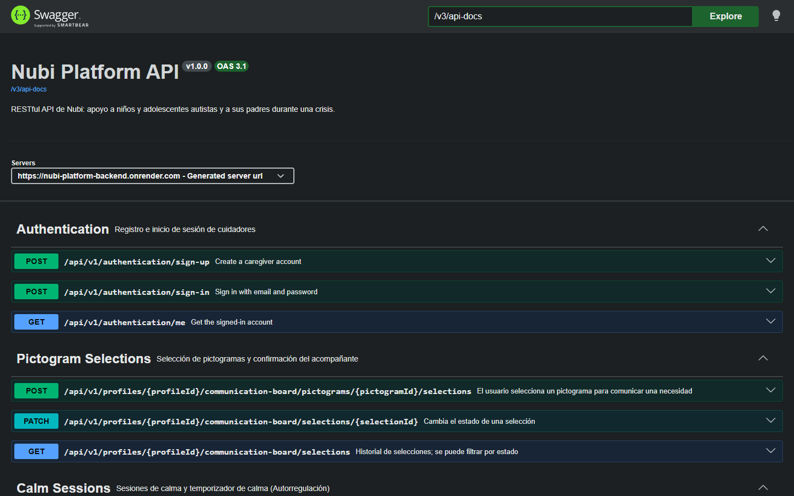

*Figura. Swagger UI de los Web Services de Nubi (`Nubi Platform API v1.0.0`, OpenAPI 3.1) desplegados en Render.*

La Frontend Web Application desplegada en Firebase Hosting (`https://nubi-frontend-7793.web.app`) consume estos Web Services. Las capturas siguientes se tomaron el 15 de noviembre de 2026 con la cuenta de demostración que ofrece la pantalla de ingreso y muestran las vistas de los Bounded Contexts, en la versión de escritorio.

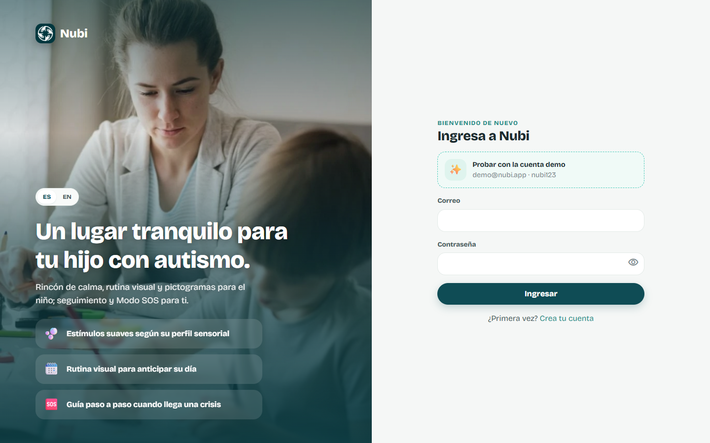

*Figura. Ingreso a la Frontend Web Application, con el selector de idioma (ES y EN) y el acceso a la cuenta de demostración.*

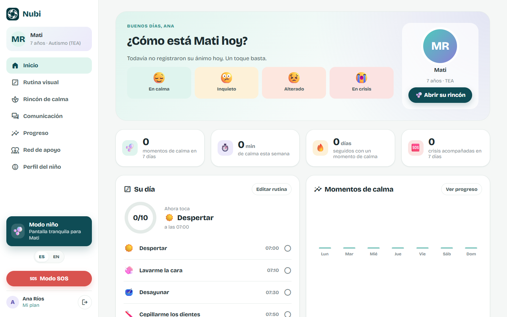

*Figura. Inicio: estado de ánimo del niño, resumen de calma, rutina del día y acceso al Modo SOS.*

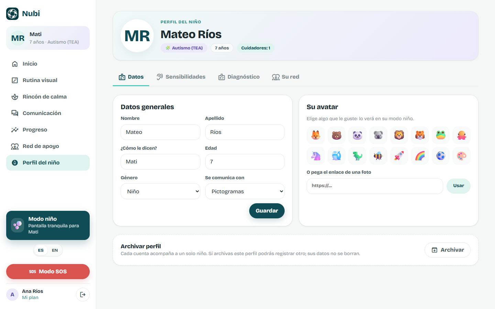

*Figura. Perfil y Personalización: perfil del niño con autismo, organizado en pestañas de datos, sensibilidades, diagnóstico y red de cuidadores.*

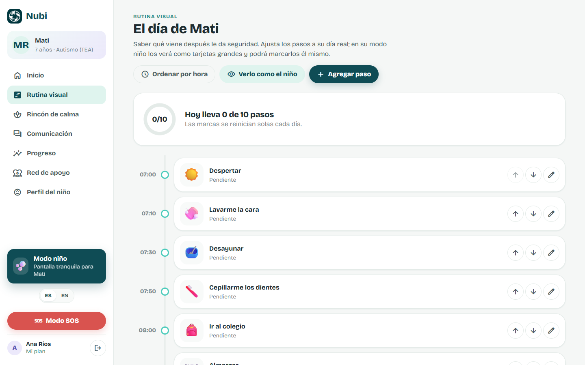

*Figura. Rutina visual: pasos del día que el cuidador ordena y el niño marca como completados.*

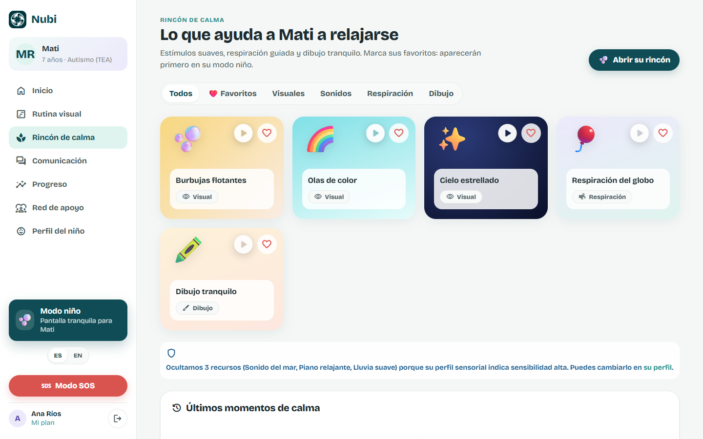

*Figura. Autorregulación: catálogo de recursos de calma por tipo, con favoritos. La aplicación oculta tres recursos de sonido porque el perfil sensorial indica sensibilidad alta.*

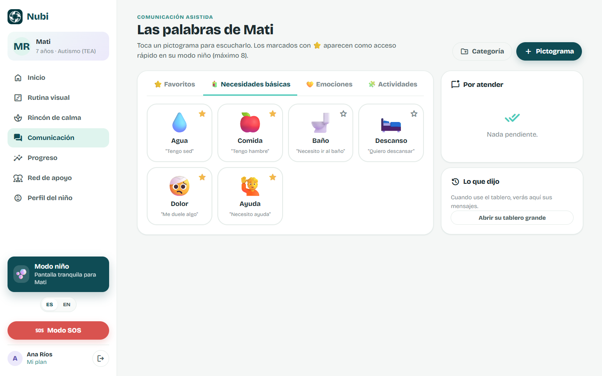

*Figura. Comunicación Asistida: tablero de pictogramas por categoría.*

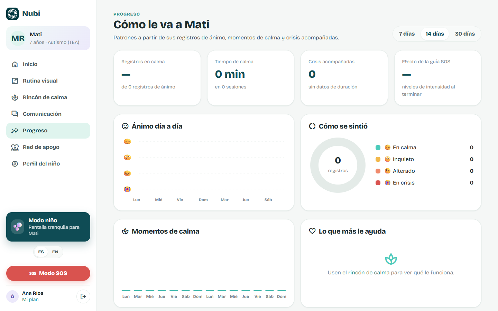

*Figura. Progreso: patrones a partir de los registros de ánimo, los momentos de calma y las crisis acompañadas (la cuenta de demostración todavía no tiene registros).*

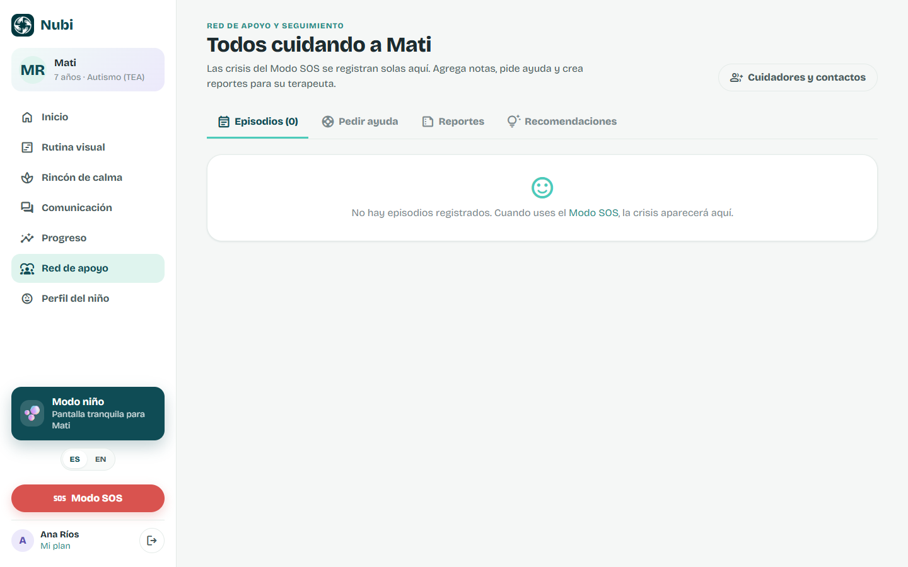

*Figura. Red de Apoyo y Seguimiento: episodios, solicitudes de ayuda, reportes y recomendaciones.*

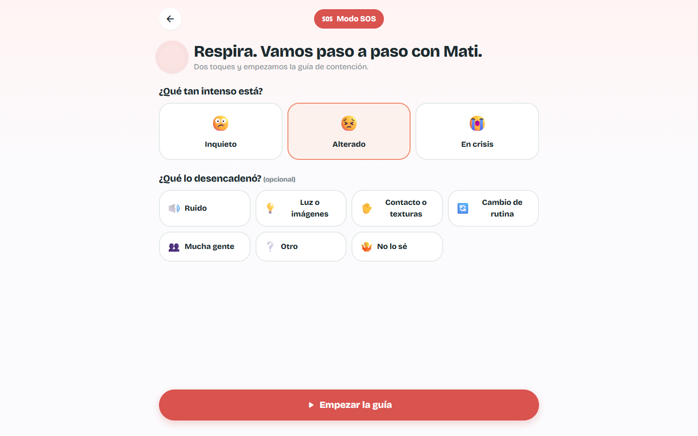

*Figura. Gestión de Crisis: selección de la intensidad y del detonante antes de empezar la guía del Modo SOS.*

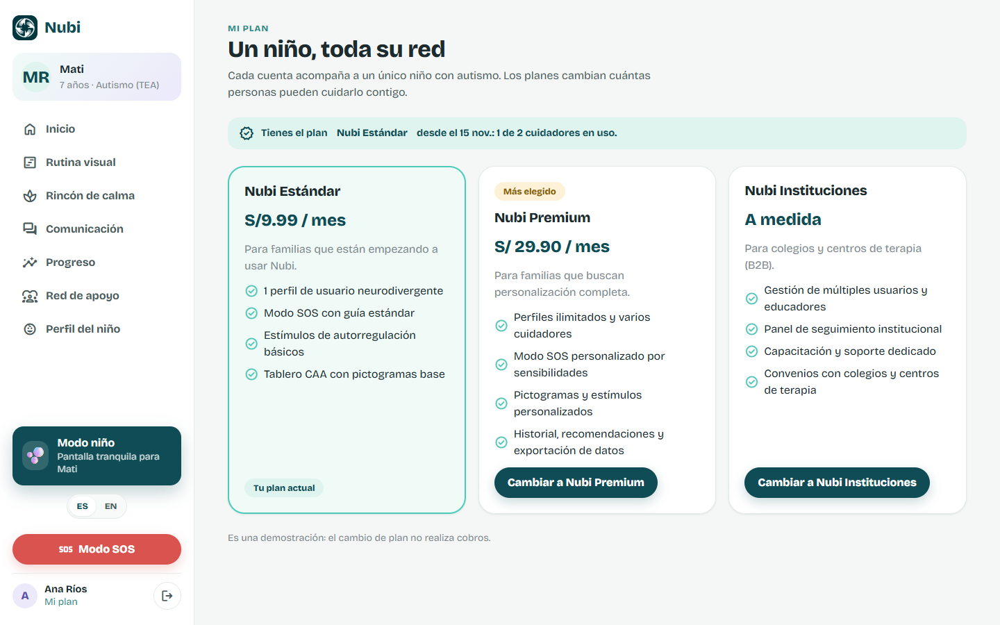

*Figura. Cuenta y plan: comparación de los planes Estándar, Premium e Instituciones. El cambio de plan es una demostración y no realiza cobros.*

En la versión móvil (390 px de ancho) la aplicación adapta el diseño:

<p align="center">
  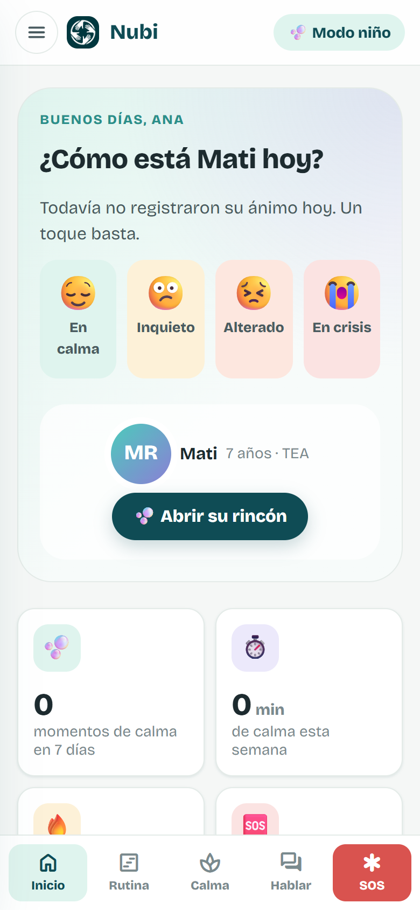
  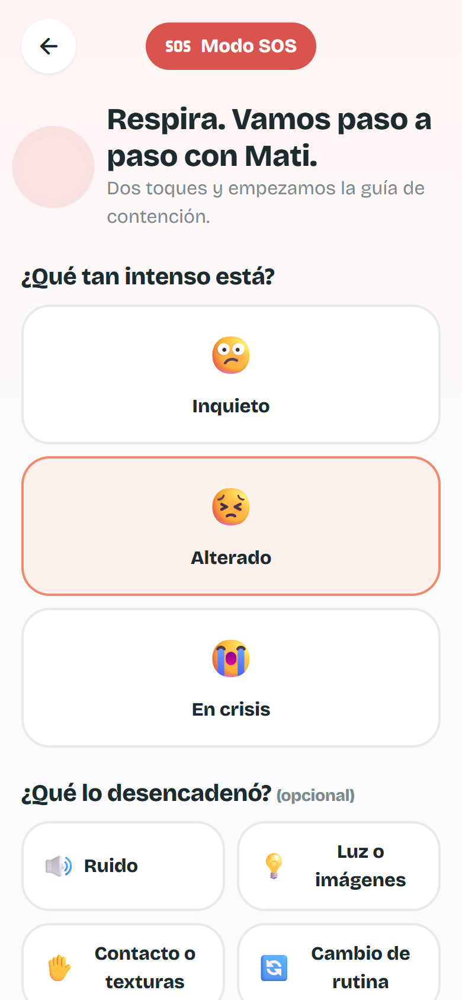
</p>

*Figura. Inicio y Modo SOS en un navegador móvil.*

Swagger UI también permite ejecutar las operaciones desde el navegador con la opción «Try it out». La siguiente captura, tomada el 15 de noviembre de 2026 en los Web Services desplegados, muestra la consulta de la guía de acción activa (`GET /api/v1/action-guides/active`): el servidor responde `200 OK` con la guía de seis pasos y sus técnicas alternativas, junto con el comando `curl` equivalente. Se ejecutó una operación de solo lectura para no modificar los datos de demostración.

<p align="center">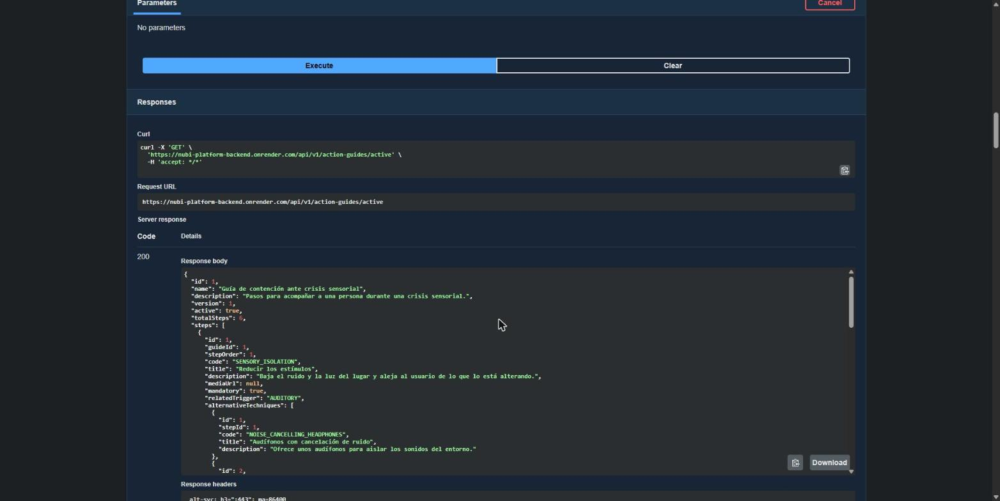</p>

*Figura. Swagger UI: operación `GET /api/v1/action-guides/active` ejecutada con «Try it out» en los Web Services desplegados en Render.*

El perfil `render` usa una base H2 en memoria y no expone su consola, por lo que los datos creados se verifican con los endpoints de consulta (por ejemplo, `GET /api/v1/episode-records` en el recorrido anterior) y no con una captura de la base de datos.

**[POR COMPLETAR]** Video de navegación del Sprint 3 con la Frontend Web Application conectada a los Web Services (URL en Microsoft Stream, nomenclatura `upc-pre-202620-1asi0729-7793-macally-product-navigation-sprint-3`).

#### 5.2.3.6. Services Documentation Evidence for Sprint Review

Los Web Services documentan sus endpoints con OpenAPI mediante springdoc. Swagger UI se publica en `/swagger-ui/index.html` y el contrato en `/v3/api-docs`. Todas las rutas cuelgan de `/api/v1`, se nombran con sustantivos (los cambios de estado usan `PATCH` sobre el recurso en lugar de verbos en la ruta), aceptan y devuelven JSON y responden los errores en formato `application/problem+json` (RFC 9457) con las propiedades `title`, `detail` y `code`. Los códigos HTTP comunes son `200 OK`, `201 Created`, `400 Bad Request` (dato inválido), `404 Not Found` (no existe) y `409 Conflict` (regla de negocio, por ejemplo un límite de plan o un segundo perfil en la misma cuenta).

**URL de Swagger UI:** https://nubi-platform-backend.onrender.com/swagger-ui/index.html

**URL del contrato OpenAPI:** https://nubi-platform-backend.onrender.com/v3/api-docs

**Repositorio de los Web Services:** https://github.com/ASI0729-2620-7793-Open-Source/Nubi.Platform.Backend

Las tablas siguientes resumen las 92 operaciones que publica Swagger UI en los siete Bounded Contexts. Las rutas son relativas a `/api/v1`. Al integrar las ramas se resolvió el conflicto de rutas de las recomendaciones: las de Gestión de Crisis cuelgan de `/profiles/{profileId}/recommendations` y `/recommendations/{recommendationId}`, y las de Red de Apoyo y Seguimiento de `/support-network/recommendations`.

**Autenticación (IAM).** Cuenta del cuidador. `sign-in` y `sign-up` devuelven el `id` de la cuenta, que la Frontend Web Application envía en la cabecera `X-Account-Id` del resto de operaciones.

| Verbo | Ruta | Descripción |
|---|---|---|
| `POST` | `/authentication/sign-up` | Crear la cuenta de un cuidador. |
| `POST` | `/authentication/sign-in` | Iniciar sesión con correo y contraseña. |
| `GET` | `/authentication/me` | Consultar la cuenta con la sesión iniciada. |

**Perfil y Personalización.** Las operaciones reciben la cuenta en la cabecera `X-Account-Id`. Nubi admite un solo perfil de niño con autismo por cuenta.

| Verbo | Ruta | Descripción |
|---|---|---|
| `POST` | `/profiles` | Crear el perfil del niño. |
| `GET` | `/profiles` | Listar los perfiles de la cuenta. |
| `GET` | `/profiles/accessible` | Listar los perfiles que la cuenta cuida, incluidos los ajenos. |
| `GET` | `/profiles/{profileId}` | Consultar un perfil. |
| `PUT` | `/profiles/{profileId}` | Actualizar los datos generales del perfil. |
| `DELETE` | `/profiles/{profileId}` | Archivar el perfil (sus datos no se borran). |
| `PUT` | `/profiles/{profileId}/photo` | Cambiar la foto o el avatar. |
| `GET` | `/profiles/{profileId}/sensory-profile` | Consultar el perfil sensorial. |
| `PUT` | `/profiles/{profileId}/sensory-profile` | Actualizar el perfil sensorial. |
| `GET` | `/profiles/{profileId}/diagnosis` | Consultar el diagnóstico declarado. |
| `PUT` | `/profiles/{profileId}/diagnosis` | Registrar o actualizar el diagnóstico declarado. |
| `GET` | `/profiles/{profileId}/caregivers` | Listar los cuidadores del perfil. |
| `POST` | `/profiles/{profileId}/caregivers` | Invitar a un cuidador o terapeuta. |
| `PATCH` | `/profiles/{profileId}/caregivers/{caregiverId}` | Cambiar el estado de un cuidador. |
| `DELETE` | `/profiles/{profileId}/caregivers/{caregiverId}` | Quitar el acceso de un cuidador. |
| `GET` | `/profiles/{profileId}/trusted-contacts` | Listar los contactos de confianza. |
| `POST` | `/profiles/{profileId}/trusted-contacts` | Agregar un contacto de confianza. |
| `PUT` | `/profiles/{profileId}/trusted-contacts/order` | Definir el orden en que se llama a los contactos. |
| `DELETE` | `/profiles/{profileId}/trusted-contacts/{contactId}` | Quitar un contacto de confianza. |
| `GET` | `/subscriptions/current` | Consultar la suscripción vigente de la cuenta. |
| `PUT` | `/subscriptions/current/plan` | Cambiar el plan de la cuenta. |

**Gestión de Crisis (Modo SOS).**

| Verbo | Ruta | Descripción |
|---|---|---|
| `GET` | `/action-guides/active` | Consultar la guía de acción activa. |
| `GET` | `/action-guides/{actionGuideId}` | Consultar una guía de acción. |
| `POST` | `/sos-sessions` | Activar el Modo SOS (abre la sesión con el detonante y la intensidad inicial). |
| `GET` | `/sos-sessions/{sosSessionId}` | Consultar una sesión SOS. |
| `PATCH` | `/sos-sessions/{sosSessionId}` | Cambiar el estado de la sesión (finalizarla con estado observado e intensidad final). |
| `GET` | `/sos-sessions/{sosSessionId}/guide` | Consultar la guía de la sesión, ordenada según el detonante. |
| `PATCH` | `/sos-sessions/{sosSessionId}/steps/{stepId}` | Completar u omitir un paso (omitir uno obligatorio exige `confirmed: true`). |
| `POST` | `/sos-sessions/{sosSessionId}/steps/{stepId}/alternatives` | Pedir una técnica alternativa para un paso. |
| `GET` | `/profiles/{profileId}/sos-sessions` | Listar las sesiones SOS del perfil. |
| `GET` | `/profiles/{profileId}/sos-sessions/in-progress` | Consultar la sesión SOS en curso del perfil. |
| `GET` | `/profiles/{profileId}/recommendations` | Listar las recomendaciones del perfil. |
| `POST` | `/profiles/{profileId}/recommendations` | Generar las recomendaciones del perfil. |
| `GET` | `/recommendations/{recommendationId}` | Consultar una recomendación. |
| `PUT` | `/recommendations/{recommendationId}/preferences` | Valorar una recomendación. |

**Autorregulación.**

| Verbo | Ruta | Descripción |
|---|---|---|
| `GET` | `/calming-resources` | Listar el catálogo de recursos de calma. |
| `GET` | `/calming-resources/{calmingResourceId}` | Consultar un recurso de calma. |
| `GET` | `/profiles/{profileId}/favorite-resources` | Listar los recursos favoritos del perfil. |
| `POST` | `/profiles/{profileId}/favorite-resources` | Marcar un recurso como favorito. |
| `DELETE` | `/profiles/{profileId}/favorite-resources/{resourceId}` | Quitar un recurso de los favoritos. |
| `POST` | `/calm-sessions` | Iniciar una sesión de calma. |
| `GET` | `/calm-sessions/{calmSessionId}` | Consultar una sesión de calma. |
| `PATCH` | `/calm-sessions/{calmSessionId}` | Cambiar el estado de la sesión (por ejemplo, terminarla). |
| `PUT` | `/calm-sessions/{calmSessionId}/resource` | Elegir el recurso de calma de la sesión. |
| `PUT` | `/calm-sessions/{calmSessionId}/intensity` | Ajustar la intensidad del estímulo. |
| `PUT` | `/calm-sessions/{calmSessionId}/low-stimulation` | Activar o desactivar la baja estimulación. |
| `POST` | `/calm-sessions/{calmSessionId}/timer` | Iniciar el temporizador. |
| `PATCH` | `/calm-sessions/{calmSessionId}/timer` | Pausar o reanudar el temporizador. |
| `POST` | `/calm-sessions/{calmSessionId}/timer/ticks` | Avanzar el temporizador. |
| `GET` | `/profiles/{profileId}/calm-sessions` | Listar las sesiones de calma del perfil. |
| `GET` | `/profiles/{profileId}/calm-sessions/latest` | Consultar la última sesión de calma del perfil. |

**Comunicación Asistida (CAA).** Todas las rutas cuelgan de `/profiles/{profileId}/communication-board`; en la tabla se abrevian como `…`.

| Verbo | Ruta | Descripción |
|---|---|---|
| `GET` | `/profiles/{profileId}/communication-board` | Obtener el tablero del perfil; si no existe, se crea con los pictogramas básicos. |
| `GET` | `/profiles/{profileId}/communication-board/quick-access` | Listar los pictogramas del acceso rápido. |
| `POST` | `/profiles/{profileId}/communication-board/categories` | Crear una categoría personalizada. |
| `POST` | `/profiles/{profileId}/communication-board/pictograms` | Agregar un pictograma personalizado a una categoría. |
| `PUT` | `/profiles/{profileId}/communication-board/pictograms/{pictogramId}/category` | Mover un pictograma a otra categoría. |
| `PUT` | `/profiles/{profileId}/communication-board/pictograms/{pictogramId}/favorite` | Marcar un pictograma como favorito. |
| `DELETE` | `/profiles/{profileId}/communication-board/pictograms/{pictogramId}/favorite` | Quitar un pictograma de los favoritos. |
| `POST` | `/profiles/{profileId}/communication-board/pictograms/{pictogramId}/selections` | Registrar que el niño seleccionó un pictograma. |
| `GET` | `/profiles/{profileId}/communication-board/selections` | Listar las selecciones, con filtro por estado. |
| `PATCH` | `/profiles/{profileId}/communication-board/selections/{selectionId}` | Cambiar el estado de una selección (entendido o no entendido). |
| `POST` | `/profiles/{profileId}/communication-board/mood-check-ins` | Registrar el estado de ánimo. |
| `GET` | `/profiles/{profileId}/communication-board/mood-check-ins` | Consultar el historial de estados de ánimo. |

**Red de Apoyo y Seguimiento.**

| Verbo | Ruta | Descripción |
|---|---|---|
| `POST` | `/episode-records` | Registrar un episodio. |
| `GET` | `/episode-records` | Listar los registros de episodios. |
| `GET` | `/episode-records/recent` | Consultar los episodios recientes. |
| `GET` | `/episode-records/latest` | Consultar el último estado emocional registrado. |
| `GET` | `/episode-records/{episodeRecordId}` | Consultar un registro de episodio. |
| `PUT` | `/episode-records/{episodeRecordId}/notes` | Agregar o cambiar las notas de un episodio. |
| `POST` | `/episode-reports` | Crear un reporte de episodios de un periodo. |
| `GET` | `/episode-reports` | Listar los reportes. |
| `GET` | `/episode-reports/{episodeReportId}` | Consultar un reporte. |
| `POST` | `/episode-reports/{episodeReportId}/shares` | Compartir un reporte con un terapeuta o docente. |
| `POST` | `/help-requests` | Enviar una solicitud de ayuda a la red de apoyo. |
| `GET` | `/help-requests` | Listar las solicitudes de ayuda. |
| `GET` | `/help-requests/{helpRequestId}` | Consultar una solicitud de ayuda. |
| `PATCH` | `/help-requests/{helpRequestId}` | Cambiar el estado de la solicitud (atendida o cancelada). |
| `POST` | `/support-network/recommendations` | Crear una recomendación para la red de apoyo. |
| `GET` | `/support-network/recommendations` | Listar las recomendaciones. |
| `GET` | `/support-network/recommendations/active` | Listar las recomendaciones activas. |
| `GET` | `/support-network/recommendations/{recommendationId}` | Consultar una recomendación. |
| `PATCH` | `/support-network/recommendations/{recommendationId}` | Marcar la efectividad de una recomendación. |

**Rutina Visual.** Contexto agregado en este Sprint (no figura en el Capítulo IV): la rutina del día del niño con pasos que el cuidador ordena y el niño marca.

| Verbo | Ruta | Descripción |
|---|---|---|
| `GET` | `/profiles/{profileId}/routine-steps` | Consultar la rutina del día. |
| `POST` | `/profiles/{profileId}/routine-steps` | Agregar un paso a la rutina. |
| `PUT` | `/profiles/{profileId}/routine-steps/order` | Reordenar la rutina. |
| `PUT` | `/profiles/{profileId}/routine-steps/{stepId}` | Editar un paso. |
| `DELETE` | `/profiles/{profileId}/routine-steps/{stepId}` | Quitar un paso. |
| `POST` | `/profiles/{profileId}/routine-steps/{stepId}/completion` | Marcar un paso como hecho hoy. |
| `DELETE` | `/profiles/{profileId}/routine-steps/{stepId}/completion` | Deshacer la marca de hoy de un paso. |

Las siguientes capturas de Swagger UI, tomadas el 15 de noviembre de 2026 en los Web Services desplegados, muestran los endpoints de cada Bounded Context agrupados por etiqueta (`tag`). Cada etiqueta lista el verbo HTTP, la ruta y una descripción breve; al expandir una operación, Swagger UI muestra sus parámetros, el cuerpo de la solicitud y los ejemplos de respuesta.

**Autenticación (IAM)**

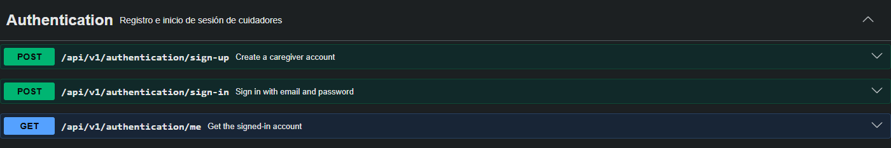

**Perfil y Personalización**

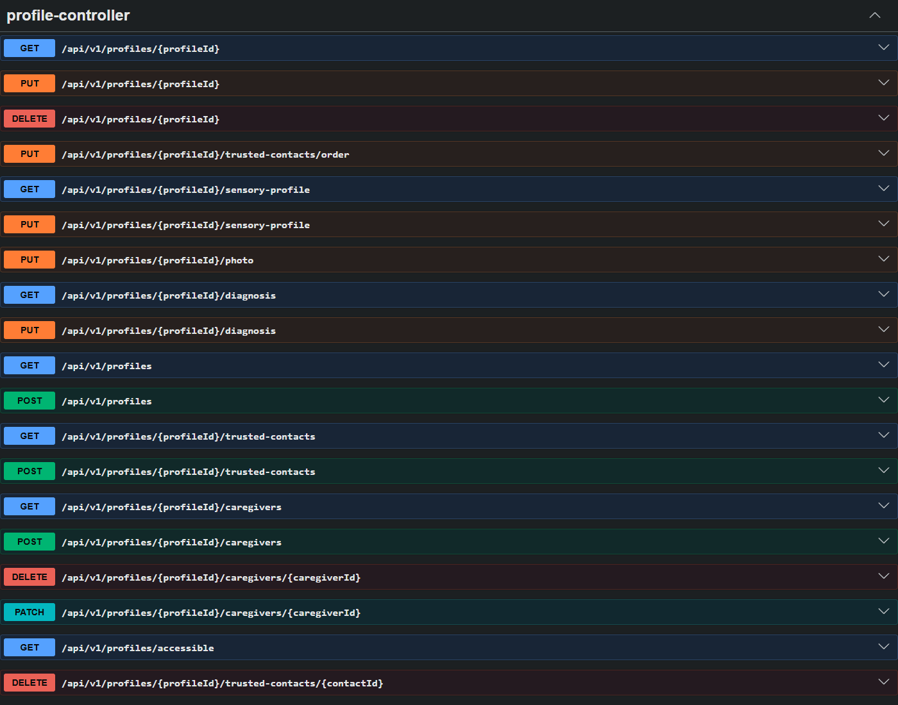

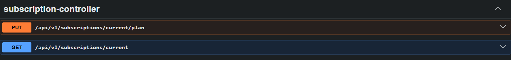

**Gestión de Crisis (Modo SOS)**

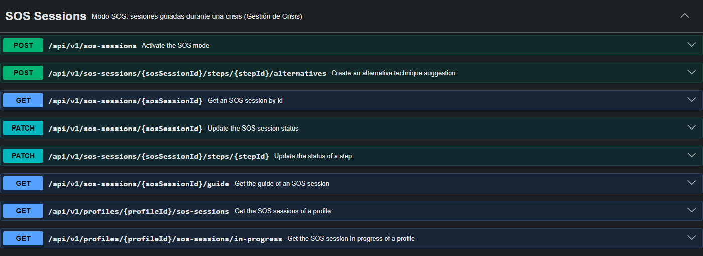

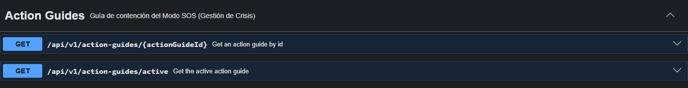

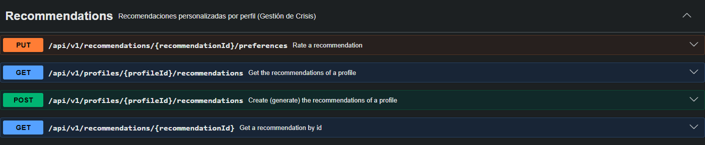

**Autorregulación**

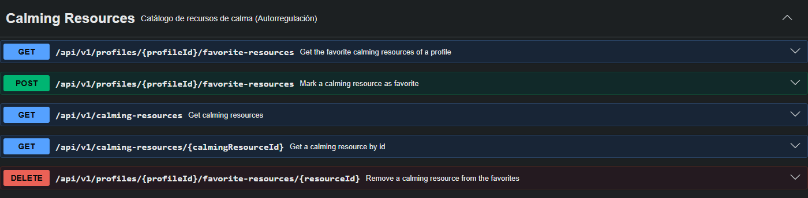

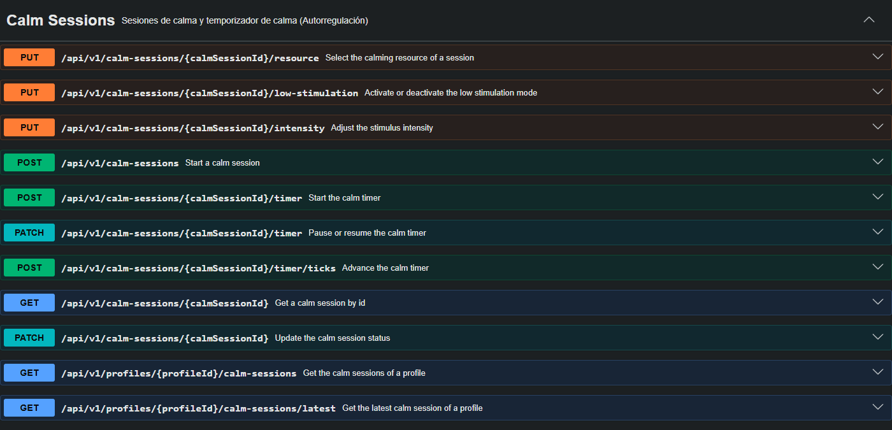

**Comunicación Asistida (CAA)**

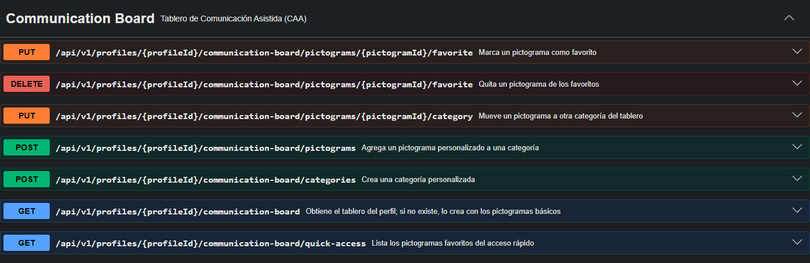

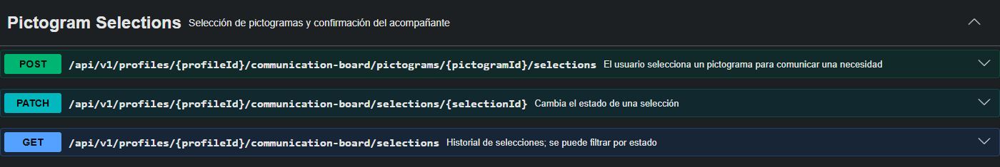

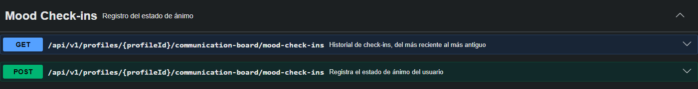

**Red de Apoyo y Seguimiento**

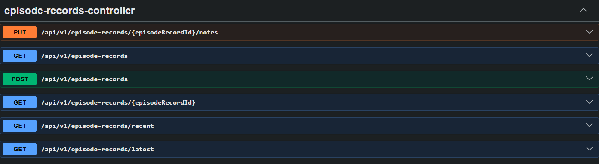

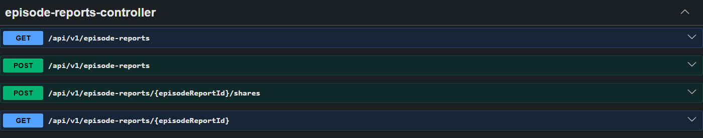

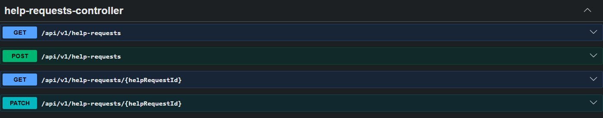

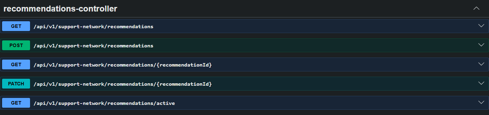

**Rutina Visual**

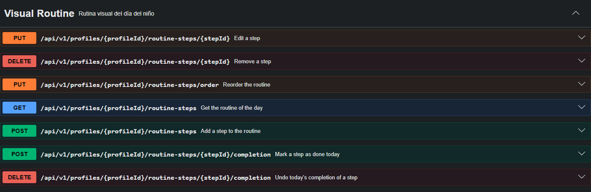

En total Swagger UI documenta 92 operaciones en 16 etiquetas.

#### 5.2.3.7. Software Deployment Evidence for Sprint Review

En el Sprint 3 se desplegaron los Web Services y se actualizó la Frontend Web Application para consumirlos. Los productos y plataformas son:

| Producto | Plataforma | URL |
|---|---|---|
| Landing Page | GitHub Pages | https://tinyurl.com/27e6ugke |
| Frontend Web Application | Firebase Hosting (proyecto `nubi-frontend-7793`) | https://nubi-frontend-7793.web.app |
| RESTful Web Services (Spring Boot, Docker) | Render, plan gratuito (`nubi-platform-backend`) | https://nubi-platform-backend.onrender.com |
| Base de datos | H2 en memoria en modo MySQL (perfil `render`) | No se publica |
| Swagger UI | Los Web Services desplegados | https://nubi-platform-backend.onrender.com/swagger-ui/index.html |

Los pasos ejecutados para los Web Services fueron:

1. Integrar las ramas en `develop` (T-67), ejecutar las 147 pruebas con `./mvnw test` y publicar la versión estable en `main` con las etiquetas `v1.0.0` a `v1.2.0`.
2. Construir la imagen con el `Dockerfile` del repositorio, que genera el archivo ejecutable con Maven.
3. Crear en Render un servicio web Docker a partir del espejo del repositorio (`LeonardoLopez138/nubi-platform-backend`) y registrar `SPRING_PROFILES_ACTIVE=render` y las variables de la plataforma, sin guardar credenciales en el repositorio.
4. Verificar `GET /api/v1/action-guides/active` y `GET /api/v1/calming-resources` en la URL pública y abrir Swagger UI.
5. Apuntar `environment.ts` de la Frontend Web Application a `https://nubi-platform-backend.onrender.com/api/v1`, retirar la API simulada y publicar con `firebase deploy`.

**Limitaciones del despliegue.** Como el plan gratuito de Render no incluye base de datos y para la demostración se optó por no gestionar una base externa, los datos se guardan en H2 en memoria: se reinician cuando el servicio se reinicia, y el servicio tarda cerca de un minuto en despertar tras un periodo sin uso (la Frontend Web Application lo avisa con la pantalla «No pudimos conectar con Nubi»). La persistencia entre reinicios se logra con MySQL, para lo que el repositorio incluye `docs/deploy/azure-mysql-setup.sql` y las variables `DB_URL`, `DB_USERNAME` y `DB_PASSWORD`. El Landing Page no se redesplegó en este Sprint.

Las siguientes capturas se tomaron el 15 de noviembre de 2026 en los paneles de las plataformas. En Render, el proyecto `Nubi` agrupa el servicio `nubi-platform-backend` (Docker, región Oregon, estado Deployed) y el servicio `nubi-api` de la API simulada del Sprint 2:

<p align="center">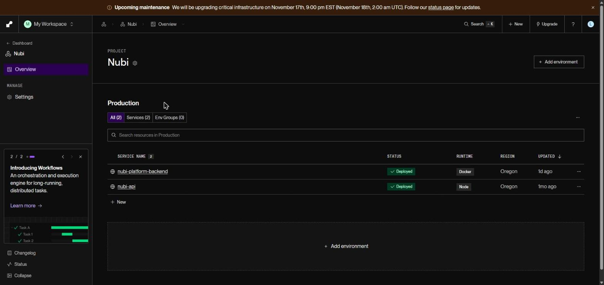</p>

*Figura. Render: proyecto `Nubi` con los servicios `nubi-platform-backend` y `nubi-api`.*

El servicio de los Web Services está publicado en https://nubi-platform-backend.onrender.com, se despliega desde la rama `main` y su despliegue activo corresponde al commit `e9d7d36` (`merge release/1.2.0 into main`). El panel advierte que la instancia gratuita se apaga por inactividad y que las solicitudes pueden demorar 50 segundos o más:

<p align="center">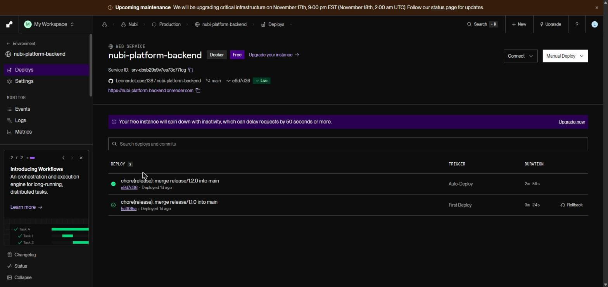</p>

*Figura. Render: servicio `nubi-platform-backend` en estado Live, con los despliegues de las versiones 1.2.0 y 1.1.0.*

En Firebase Hosting, el proyecto `nubi-frontend-7793` publica la Frontend Web Application en `nubi-frontend-7793.web.app` y `nubi-frontend-7793.firebaseapp.com`. El panel muestra la versión actual y las versiones anteriores publicadas el 14 de noviembre de 2026 (se ocultaron las cuentas de correo de quienes publicaron):

<p align="center">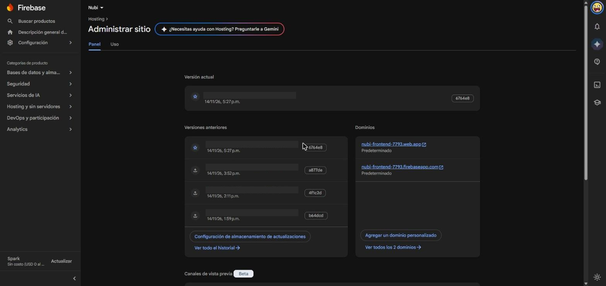</p>

*Figura. Firebase Hosting: versión actual, versiones anteriores y dominios del sitio.*

#### 5.2.3.8. Team Collaboration Insights during Sprint

La colaboración del Sprint 3 se evidencia con el historial de Git de los repositorios del proyecto. Las cifras se obtuvieron de la rama `develop` de cada repositorio al 14 de noviembre de 2026, sin contar merges.

##### Repositorio de los Web Services (Nubi.Platform.Backend)

Los cinco integrantes registran commits en el repositorio. Cuatro de ellos trabajaron cada uno en la rama de un Bounded Context; Leonardo creó el commit inicial, el proyecto base y la rama de Comunicación Asistida, y después, con los demás contextos integrados, los contextos de IAM y Rutina Visual, el perfil único por cuenta, el despliegue y el rediseño de las rutas REST. Sofia integró las cinco ramas en `develop` el 13 de noviembre. La rama de Gestión de Crisis acumula 13 de sus 32 commits el 12 de noviembre y la de Red de Apoyo y Seguimiento registra sus 19 commits el 13 de noviembre.

| Cuenta de GitHub | Integrante | Aporte principal | Commits | Líneas | Días con commits (noviembre) |
|---|---|---|---|---|---|
| LeonardoLopez138 | Lopez Torres, Leonardo Gabriel | Comunicación Asistida, IAM, Rutina Visual, despliegue en Render, rutas REST | 48 | +4523 / −268 | 5 al 9, 13 y 14 |
| u20241a195-cmd | Diaz Yurivilca, Sofia | Gestión de Crisis e integración en `develop` | 32 | +4366 / −1 | 5 al 12 |
| nahiryn8 (Nahir Ruiz) | Ruiz Villegas, Yngrid Nahir | Perfil y Personalización | 23 | +4868 / −2 | 9 al 11 |
| Dan-trax | Diaz Caruzo, Edgard Daniel | Red de Apoyo y Seguimiento | 19 | +1824 / −0 | 13 |
| joanfpp2-ai (Pocho) | Payano Puchuri, Joan Fabricio | Autorregulación | 14 | +2755 / −0 | 10 y 11 |
| **Total** | | | **136** | | |

Las vistas Contributors, Commits y Pulse de GitHub Insights no están disponibles para este repositorio: el repositorio `Nubi.Platform.Backend` es privado y GitHub las habilita en organizaciones con plan gratuito solo para repositorios públicos. Por eso la evidencia de colaboración de los Web Services es el historial de Git: la tabla de commits de la sección 5.2.3.4 y las cifras por integrante de esta sección.

##### Repositorio de la Frontend Web Application y del Landing Page

La Frontend Web Application registra 26 commits sin merges desde el 4 de noviembre de 2026 (19 el 13 de noviembre y 7 el 14 de noviembre; +12974 / −18817 líneas, porque la aplicación se reconstruyó), todos de la cuenta LeonardoLopez138. Las tareas de conexión T-70 a T-75 estaban asignadas a Ruiz Villegas, Yngrid Nahir (T-70), Diaz Yurivilca, Sofia (T-71), Payano Puchuri, Joan Fabricio (T-72), Lopez Torres, Leonardo Gabriel (T-73) y Diaz Caruzo, Edgard Daniel (T-74 y T-75); en la práctica la conexión de los seis módulos con los Web Services la implementó Leonardo en una sola reconstrucción de la aplicación, de modo que las tarjetas T-70 a T-72, T-74 y T-75 conservan a sus responsables asignados pero su commit es de Leonardo. El repositorio del Landing Page (https://github.com/ASI0729-2620-7793-Open-Source/landing-page) no registra commits posteriores al 8 de octubre de 2026.

##### Repositorio del informe (Macally)

Entre el 28 de octubre y el 15 de noviembre de 2026 el informe recibió 28 commits sin contar merges en la rama `develop`: las correcciones de alineación con el segmento de personas autistas, la actualización de la evidencia del Sprint 3, las entrevistas de validación y los capítulos de la entrega AV2.

| Cuenta de GitHub | Integrante | Commits | Líneas | Aporte |
|---|---|---|---|---|
| u20241a195-cmd | Diaz Yurivilca, Sofia | 12 | +1312 / −117 | Alineación de los Capítulos I y II con el segmento de personas autistas, Sprint 3, entrevistas de validación, Conclusiones, Bibliografía y Anexos |
| LeonardoLopez138 | Lopez Torres, Leonardo Gabriel | 8 | +837 / −372 | Alineación del Capítulo II y actualización de la evidencia del Sprint 3 (Sprint Backlog, backend y frontend) |
| joanfpp2-ai | Payano Puchuri, Joan Fabricio | 7 | +31 / −31 | Alineación del Capítulo IV con el segmento de personas autistas |
| nahiryn8 | Ruiz Villegas, Yngrid Nahir | 1 | +20 / −26 | Herramientas y URL de despliegue del Capítulo V |
| Dan-trax | Diaz Caruzo, Edgard Daniel | 0 | — | Sin commits en este período |
| **Total** | | **28** | | |

Como oportunidades de mejora del Sprint 3, el trabajo de la Frontend Web Application quedó concentrado en un integrante y en los dos últimos días del Sprint, y las ramas de Red de Apoyo y Seguimiento y de Autorregulación concentraron sus commits en uno o dos días, lo mismo que ocurrió en el Sprint 2. Quedan sin cerrar las tareas del Landing Page (T-04, T-76 y T-77) y la persistencia de la base de datos en el despliegue. Para la versión final el equipo reparte la conexión de los módulos entre sus responsables, integra cada rama al completarse y registra los commits del informe entre los cinco integrantes.

## 5.3. Validation Interviews

En esta sección el equipo diseña, registra y evalúa las entrevistas de validación. A diferencia de las entrevistas de needfinding del capítulo II, en las de validación los usuarios de los dos segmentos objetivo interactúan con el Landing Page y con la Frontend Web Application mientras el equipo observa sus dificultades. Los resultados se contrastan con las hipótesis y los criterios de éxito del Lean UX Canvas (sección 1.2.2.4) y alimentan las Conclusiones.

### 5.3.1. Diseño de Entrevistas

Antes de iniciar cada sesión de validación se brinda un saludo cordial y una breve presentación del entrevistador, explicando que el propósito de la sesión es evaluar la facilidad de uso y la utilidad del producto Nubi, y no evaluar al participante. Se aclara que la información será utilizada únicamente con fines académicos y se mantendrá en estricta confidencialidad. Como primer paso se solicita al participante su nombre completo, edad y distrito de residencia para fines de registro. Luego se le invita a interactuar libremente con el Landing Page y la Frontend Web Application, ejecutando las tareas propuestas y expresando en voz alta sus impresiones (técnica de thinking aloud), destacando que no existen respuestas correctas o incorrectas.

Como las sesiones del Segmento 1 involucran a niños y adolescentes, el equipo obtiene el consentimiento informado de su padre o tutor antes de grabar, que acompaña al participante durante la sesión. Las sesiones son individuales, duran entre 15 y 25 minutos y se graban en video (mp4) con autorización.

El proceso de validación para cada segmento se compone de tres momentos: (1) la exploración del Landing Page, (2) la ejecución de tareas guiadas sobre la Frontend Web Application siguiendo los User Flows correspondientes y (3) un cuestionario de validación de diez preguntas. Se realizan entre tres y cinco entrevistas por segmento objetivo. Los segmentos son los definidos en la sección 1.3. Como las entrevistas de needfinding (capítulo II) incluyeron cuidadores que eran hermanos mayores y ninguna persona menor de 15 años, la selección de participantes de la validación corrige esos vacíos, como se detalla en cada segmento. A continuación se detallan los elementos a incluir en la sesión de validación para cada segmento objetivo.

**Preguntas introductorias (ambos segmentos)**

1. ¿Cuál es su nombre y apellidos?
2. ¿Cuántos años tiene?
3. ¿En qué distrito vive?

#### Segmento objetivo 1: Personas autistas

**Perfil de los participantes** (sección 1.3): niños y adolescentes con trastorno del espectro autista (TEA) de 6 a 17 años, de ambos géneros, que cursan primaria o secundaria, residen en Lima Metropolitana y tienen acceso a un teléfono móvil. Se incluyen solo personas con diagnóstico de autismo, y se procura que al menos una entrevista sea con un niño de 6 a 12 años. Durante la sesión los acompaña un padre o tutor.

**Elementos a validar:** Landing Page y Frontend Web Application (módulos de Autorregulación y Comunicación Asistida).

**User Flows a validar** (sección 4.4.4, User Flow del usuario autista):

- User Flow 1 (UF-1): Autorregulación. Abrir la galería de estímulos, filtrar por tipo, elegir un estímulo, ajustar la intensidad, activar el modo de baja estimulación, usar el temporizador de calma (3, 5 o 10 minutos) y terminar la sesión.
- User Flow 2 (UF-2): Comunicación asistida. Abrir el tablero, filtrar por categoría, seleccionar un pictograma y confirmar el envío.

**Tareas asignadas:**

1. Explorar el Landing Page e identificar qué ofrece Nubi y cómo se activa la ayuda en una crisis.
2. Elegir un estímulo visual o auditivo para calmarse y abrirlo en la sesión.
3. Cambiar la intensidad del estímulo y activar el modo de baja estimulación.
4. Iniciar el temporizador de calma, pausarlo y terminar la sesión.
5. Usar el tablero de pictogramas para comunicar una necesidad, por ejemplo pedir agua.
6. Marcar un pictograma como favorito y filtrar el tablero por categoría.

**Preguntas de validación:**

1. Después de explorar el Landing Page, ¿entendiste para qué sirve Nubi?
2. Al elegir algo para calmarte, ¿te resultó fácil encontrar y abrir el estímulo que querías?
3. ¿Los colores, las animaciones y los sonidos te parecieron tranquilos o te molestaron?
4. Al cambiar la intensidad o activar la baja estimulación, ¿sentiste que la pantalla se adaptaba a lo que necesitas?
5. ¿El temporizador te ayudó a saber cuánto tiempo llevabas calmándote sin ponerte nervioso/a?
6. Al usar el tablero de pictogramas, ¿encontraste fácilmente lo que querías decir y se entendieron los dibujos?
7. Cuando enviaste lo que querías decir, ¿supiste que el mensaje se había enviado?
8. Durante el uso de la aplicación, ¿encontraste alguna pantalla, botón o paso que te resultara confuso o difícil?
9. En una escala del 1 al 5, ¿qué tan probable es que uses Nubi cuando te sientas mal? ¿Por qué?
10. ¿Qué cambiarías, quitarías o agregarías para que Nubi se ajuste mejor a lo que necesitas?

#### Segmento objetivo 2: Padres de niños y adolescentes con autismo

**Perfil de los participantes** (sección 1.3): padres o madres de niños y adolescentes con autismo, de 18 a 60 años, de ambos géneros, que residen en Lima Metropolitana, y usan teléfono inteligente. Como en el needfinding los cuidadores entrevistados fueron dos hermanos mayores y una sola madre, la validación incluye solo padres o madres de niños o adolescentes con autismo.

**Elementos a validar:** Landing Page y Frontend Web Application (módulos de Perfil y Personalización, Gestión de Crisis, Comunicación Asistida y Red de Apoyo y Seguimiento).

**User Flows a validar** (sección 4.4.4, User Flow del cuidador):

- User Flow 3 (UF-3): Perfil y Personalización. Crear el perfil del niño o adolescente (datos básicos, diagnóstico y sensibilidades) y cambiar de perfil.
- User Flow 4 (UF-4): Modo SOS. Activar el Modo SOS, seguir la guía paso a paso, completar u omitir pasos y revisar el resumen del episodio.
- User Flow 5 (UF-5): Comunicación asistida. Configurar el tablero de pictogramas: marcar favoritos, filtrar por categoría y reordenar.
- User Flow 6 (UF-6): Red de Apoyo y Seguimiento. Ver la última necesidad comunicada, confirmar su recepción y revisar la actividad reciente.
- User Flow 7 (UF-7): Cuenta y plan. Registrarse, iniciar sesión y comparar los planes.

**Tareas asignadas:**

1. Explorar el Landing Page e identificar qué ofrece Nubi y los planes disponibles.
2. Crear una cuenta e iniciar sesión.
3. Crear el perfil de un niño o adolescente y registrar al menos una sensibilidad sensorial.
4. Activar el Modo SOS desde cualquier pantalla de la aplicación.
5. Seguir la guía paso a paso, completando y omitiendo pasos, y finalizar el episodio.
6. Revisar el resumen del episodio.
7. Configurar el tablero de pictogramas: marcar favoritos, filtrar por categoría y reordenar.
8. Ver la última necesidad que comunicó el usuario y confirmar su recepción.
9. Comparar el plan Standard con el plan Premium.

**Preguntas de validación:**

1. Después de explorar el Landing Page, ¿quedó claro qué hace Nubi y cómo le ayudaría a acompañar a su hijo o hija en una crisis?
2. Al crear el perfil y registrar las sensibilidades, ¿le resultó sencillo y sintió que los datos pedidos eran los necesarios?
3. Al activar el Modo SOS, ¿le fue fácil encontrar el botón y cree que lo ubicaría rápido en una crisis real?
4. Al seguir la guía paso a paso, ¿le resultó claro que se muestre un paso a la vez, le pareció adecuada la cantidad de pasos y le da más confianza que se adapte a las sensibilidades del perfil?
5. Al finalizar el episodio, ¿el resumen le resultó útil para entender lo ocurrido y registrarlo sin tener que anotarlo a mano?
6. Al configurar el tablero de pictogramas, ¿cree que su hijo o hija podría usarlo para comunicarse durante una crisis?
7. Al ver la última necesidad que comunicó su hijo o hija y confirmar su recepción, ¿le resultó claro lo que ocurre después de confirmar?
8. ¿Confiaría en usar Nubi durante un momento de alta tensión? ¿Qué le daría más seguridad (por ejemplo, el respaldo de un profesional de la salud)?
9. En una escala del 1 al 5, ¿qué tan probable es que utilice Nubi con su hijo o hija? ¿Por qué? ¿Pagaría por el plan Premium?
10. Durante el uso de la aplicación, ¿encontró alguna pantalla, botón o paso confuso o difícil? ¿Qué funcionalidad agregaría, quitaría o mejoraría para que Nubi se ajuste mejor a su forma de acompañar a su hijo o hija?

**Registro de la sesión.** Por cada tarea se anota si el participante la completó solo, con ayuda o no la completó, el tiempo, los errores y sus comentarios textuales. Al terminar cada User Flow, el participante califica su facilidad de 1 (muy difícil) a 5 (muy fácil). Estos datos alimentan la tabla de resultados por flujo de la sección 5.3.2 y las métricas del Lean UX Canvas, como el porcentaje de cuidadores que completa la guía del Modo SOS (meta de 80 %).

### 5.3.2. Registro de Entrevistas

**Validation Interviews Link:** https://l1nq.com/j0ayo4q

A continuación se registran las entrevistas de validación realizadas por segmento. Para cada entrevista se consigna el nombre y apellidos del participante, su edad, su distrito de residencia, un screenshot de un cuadro del video, el enlace al video alojado en Microsoft Stream, indicando el timing donde inicia la entrevista y su duración, y un resumen descriptivo de las principales apreciaciones del entrevistado respecto a las tareas asignadas. De acuerdo con lo planificado por el equipo, se realizan 3 entrevistas por segmento.

**Segmento 1: Personas autistas**

- Primera entrevista:

<div align="center">
<div style="font-family: 'Segoe UI', sans-serif; max-width: 680px; margin: 24px auto; border: 1.5px solid #b0bec5; border-radius: 4px; overflow: hidden; box-shadow: 0 2px 8px rgba(0,0,0,0.12);">

  <!-- Encabezado -->
  <div style="background-color: #00373E; color: white; padding: 10px 16px; font-weight: 700; font-size: 1.1em; letter-spacing: 0.05em;">
  Entrevista de Validación
  </div>

  <!-- Imagen de la captura de pantalla -->
  <div style="background-color: #00373E; padding: 12px 16px 16px;">
    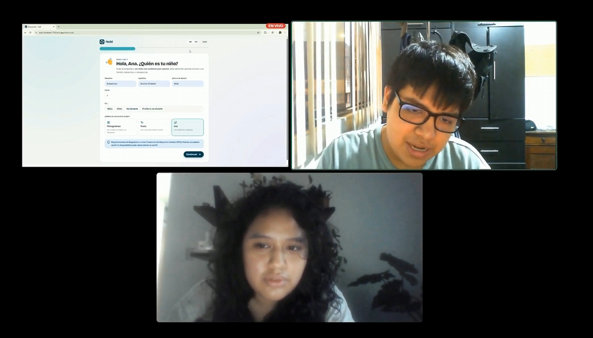
  </div>

  <!-- Datos en dos columnas -->
  <table style="width: 100%; border-collapse: collapse; font-size: 0.88em;">
    <tr>
      <td style="padding: 7px 14px; border: 1px solid #cfd8dc; width: 50%;">
        <strong>Entrevistado(a):</strong> Sebastián Moisés Suárez Simeón
      </td>
      <td style="padding: 7px 14px; border: 1px solid #cfd8dc; width: 50%;">
        <strong>Edad:</strong> 17 años
      </td>
    </tr>
    <tr>
      <td style="padding: 7px 14px; border: 1px solid #cfd8dc;">
        <strong>Entrevistador(a):</strong> Sofía Díaz Yurvilca
      </td>
      <td style="padding: 7px 14px; border: 1px solid #cfd8dc;">
        <strong>Distrito:</strong> San Martín de Porres
      </td>
    </tr>
    <tr>
      <td style="padding: 7px 14px; border: 1px solid #cfd8dc;">
        <strong>Inicio de la entrevista:</strong> 00:08 (video consolidado)
      </td>
      <td style="padding: 7px 14px; border: 1px solid #cfd8dc;">
        <strong>Duración:</strong> 28:55 (de 00:08 a 29:03)
      </td>
    </tr>
  </table>

  <!-- Link -->
  <table style="width: 100%; border-collapse: collapse; font-size: 0.88em;">
    <tr>
      <td style="padding: 7px 14px; border: 1px solid #cfd8dc;">
        <strong>Link de la entrevista:</strong>
        <a href="https://sl1nk.com/essxvtz">https://sl1nk.com/essxvtz</a>
      </td>
    </tr>
  </table>

  <!-- Descripción -->
  <table style="width: 100%; border-collapse: collapse; font-size: 0.88em;">
    <tr>
      <td style="padding: 10px 14px; border: 1px solid #cfd8dc; line-height: 1.6;">
        <p>Entendió que Nubi es una red de apoyo emocional para cuidadores y personas neurodivergentes. En UF-1 usó las burbujas flotantes y los sonidos, y dijo que se sintió mejor al terminar la sesión de calma. En UF-2 probó el tablero de pictogramas y entendió para qué sirve, aunque preguntó qué significaban las opciones "entendí" y "no entendí". Le parecieron bien los sonidos, pero consideró que los colores son demasiado fluorescentes para momentos de sobreestimulación, y que la burbuja y el globo de respiración son muy pequeños. Como dificultades señaló que el acceso al área de adultos es muy fácil para un niño, que editar una rutina lo lleva directo al perfil del niño y que no entendió qué significa archivar un perfil. Probabilidad de uso: 3 en una escala de 1 a 5.</p>
      </td>
    </tr>
  </table>

</div>

</div>

---

- Segunda entrevista:

<div align="center">
<div style="font-family: 'Segoe UI', sans-serif; max-width: 680px; margin: 24px auto; border: 1.5px solid #b0bec5; border-radius: 4px; overflow: hidden; box-shadow: 0 2px 8px rgba(0,0,0,0.12);">

  <!-- Encabezado -->
  <div style="background-color: #00373E; color: white; padding: 10px 16px; font-weight: 700; font-size: 1.1em; letter-spacing: 0.05em;">
  Entrevista de Validación
  </div>

  <!-- Imagen de la captura de pantalla -->
  <div style="background-color: #00373E; padding: 12px 16px 16px;">
    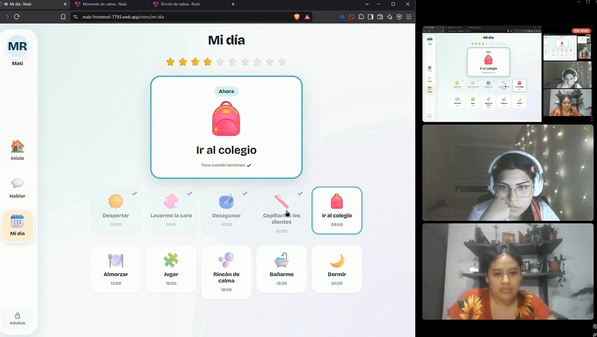
  </div>

  <!-- Datos en dos columnas -->
  <table style="width: 100%; border-collapse: collapse; font-size: 0.88em;">
    <tr>
      <td style="padding: 7px 14px; border: 1px solid #cfd8dc; width: 50%;">
        <strong>Entrevistado(a):</strong> Diana López
      </td>
      <td style="padding: 7px 14px; border: 1px solid #cfd8dc; width: 50%;">
        <strong>Edad:</strong> 15 años
      </td>
    </tr>
    <tr>
      <td style="padding: 7px 14px; border: 1px solid #cfd8dc;">
        <strong>Entrevistador(a):</strong> Sofía Díaz Yurvilca
      </td>
      <td style="padding: 7px 14px; border: 1px solid #cfd8dc;">
        <strong>Distrito:</strong> San Miguel
      </td>
    </tr>
    <tr>
      <td style="padding: 7px 14px; border: 1px solid #cfd8dc;">
        <strong>Inicio de la entrevista:</strong> 29:47 (video consolidado)
      </td>
      <td style="padding: 7px 14px; border: 1px solid #cfd8dc;">
        <strong>Duración:</strong> 18:51 (de 29:47 a 48:38)
      </td>
    </tr>
  </table>

  <!-- Link -->
  <table style="width: 100%; border-collapse: collapse; font-size: 0.88em;">
    <tr>
      <td style="padding: 7px 14px; border: 1px solid #cfd8dc;">
        <strong>Link de la entrevista:</strong>
        <a href="https://l1nq.com/ygh85ih">https://l1nq.com/ygh85ih</a>
      </td>
    </tr>
  </table>

  <!-- Descripción -->
  <table style="width: 100%; border-collapse: collapse; font-size: 0.88em;">
    <tr>
      <td style="padding: 10px 14px; border: 1px solid #cfd8dc; line-height: 1.6;">
        <p>Entendió que Nubi ayuda a niños con neurodivergencias a manejar las crisis, controlar su estado de ánimo y seguir su rutina, y lo considera útil para la terapia. En UF-1 encontró el rincón de calma y las burbujas flotantes, y consideró que la pantalla se adapta bien a su estado. En UF-2 probó la sección Hablar con frases como "Quiero descansar" y "Necesito ayuda", y lo considera muy útil cuando alguien está abrumado y no puede hablar. Consideró que los colores son tranquilos y no abrumadores; no comentó sobre las animaciones ni los sonidos. No encontró pantallas ni pasos confusos, aunque hubo preguntas sobre el Modo SOS y la red de apoyo que se aclararon. Probabilidad de uso: 4 en una escala de 1 a 5, porque en una crisis es difícil pensar en usar una aplicación, pero en algún momento sí la usaría. Sugiere más ejercicios y una herramienta que mida qué tan efectivos son.</p>
      </td>
    </tr>
  </table>

</div>

</div>

---

- Tercera entrevista:

<div align="center">
<div style="font-family: 'Segoe UI', sans-serif; max-width: 680px; margin: 24px auto; border: 1.5px solid #b0bec5; border-radius: 4px; overflow: hidden; box-shadow: 0 2px 8px rgba(0,0,0,0.12);">

  <!-- Encabezado -->
  <div style="background-color: #00373E; color: white; padding: 10px 16px; font-weight: 700; font-size: 1.1em; letter-spacing: 0.05em;">
  Entrevista de Validación
  </div>

  <!-- Imagen de la captura de pantalla -->
  <div style="background-color: #00373E; padding: 12px 16px 16px;">
    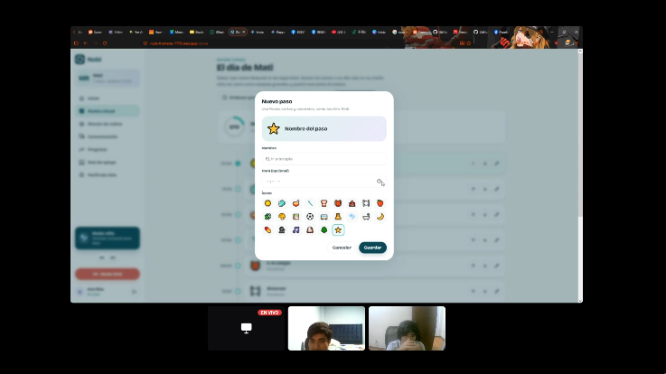
  </div>

  <!-- Datos en dos columnas -->
  <table style="width: 100%; border-collapse: collapse; font-size: 0.88em;">
    <tr>
      <td style="padding: 7px 14px; border: 1px solid #cfd8dc; width: 50%;">
        <strong>Entrevistado(a):</strong> Aguirre Campos, Owen
      </td>
      <td style="padding: 7px 14px; border: 1px solid #cfd8dc; width: 50%;">
        <strong>Edad:</strong> 17 años
      </td>
    </tr>
    <tr>
      <td style="padding: 7px 14px; border: 1px solid #cfd8dc;">
        <strong>Entrevistador(a):</strong> Leonardo López Torres
      </td>
      <td style="padding: 7px 14px; border: 1px solid #cfd8dc;">
        <strong>Distrito:</strong> San Martín de Porres
      </td>
    </tr>
    <tr>
      <td style="padding: 7px 14px; border: 1px solid #cfd8dc;">
        <strong>Inicio de la entrevista:</strong> 48:43 (video consolidado)
      </td>
      <td style="padding: 7px 14px; border: 1px solid #cfd8dc;">
        <strong>Duración:</strong> 13:03 (de 48:43 a 1:01:46)
      </td>
    </tr>
  </table>

  <!-- Link -->
  <table style="width: 100%; border-collapse: collapse; font-size: 0.88em;">
    <tr>
      <td style="padding: 7px 14px; border: 1px solid #cfd8dc;">
        <strong>Link de la entrevista:</strong>
        <a href="https://l1nq.com/j0ayo4q">https://l1nq.com/j0ayo4q</a>
      </td>
    </tr>
  </table>

  <!-- Descripción -->
  <table style="width: 100%; border-collapse: collapse; font-size: 0.88em;">
    <tr>
      <td style="padding: 10px 14px; border: 1px solid #cfd8dc; line-height: 1.6;">
        Owen Aguirre Campos, de 17 años y residente de San Martín de Porres, cuenta que a veces le cuesta mantenerse tranquilo y que se inquieta con los ruidos fuertes, como los ladridos de los perros, los gritos de la gente en la calle y los cohetes o fuegos artificiales. <br><br><strong>Landing Page.</strong> Entendió que Nubi es una página que puede ayudar a personas con este tipo de dificultades. La vio clara, con iconos llamativos, útil y con un diseño muy acertado. <br><br><strong>UF-1, Autorregulación.</strong> Eligió el estímulo de burbujas y dijo sentirse tranquilo con ellas. Valoró que el botón es grande y que las burbujas se ven sin problema, por lo que lo consideró muy fácil de acceder. Describió la paleta de colores como tranquila: sin colores saturantes o brillantes, que no molestan ni incomodan la vista. Al cambiar la intensidad de 8 a 10 observó que la animación cambia y se vuelve un poco más rápida. Al elegir un tiempo de 2 minutos comprobó que el cronómetro empieza a correr, y notó que el cuadro le indica respirar, lo que le hizo sentir algo mejor. <br><br><strong>Rutina visual y perfil.</strong> Agregó un paso a la rutina, configuró la hora y la actividad, y lo consideró sencillo, con el botón bien ubicado y grande, además de iconos para elegir. También cambió un elemento a favoritos con el corazón y agregó una nota. Le pareció una vista completa, en la que puede visualizar bien qué le puede pasar a Mati. <br><br><strong>Dificultades.</strong> No encontró ninguna pantalla, botón o paso confuso; la aplicación le pareció muy accesible y sencilla. <br><br><strong>Probabilidad de uso y sugerencias.</strong> Dijo que podría usarla cuando se siente triste o angustiado, y la calificó con un 4 de 5 por su tranquilidad y facilidad de uso. Sugirió que en el perfil del niño se puedan guardar sus dibujos o las imágenes que le gustan y le llaman la atención, aprovechando la opción de dibujo.
      </td>
    </tr>
  </table>

</div>

</div>

---

**Segmento 2: Padres de niños y adolescentes con autismo**

- Primera entrevista:

<div align="center">
<div style="font-family: 'Segoe UI', sans-serif; max-width: 680px; margin: 24px auto; border: 1.5px solid #b0bec5; border-radius: 4px; overflow: hidden; box-shadow: 0 2px 8px rgba(0,0,0,0.12);">

  <!-- Encabezado -->
  <div style="background-color: #00373E; color: white; padding: 10px 16px; font-weight: 700; font-size: 1.1em; letter-spacing: 0.05em;">
  Entrevista de Validación
  </div>

  <!-- Imagen de la captura de pantalla -->
  <div style="background-color: #00373E; padding: 12px 16px 16px;">
    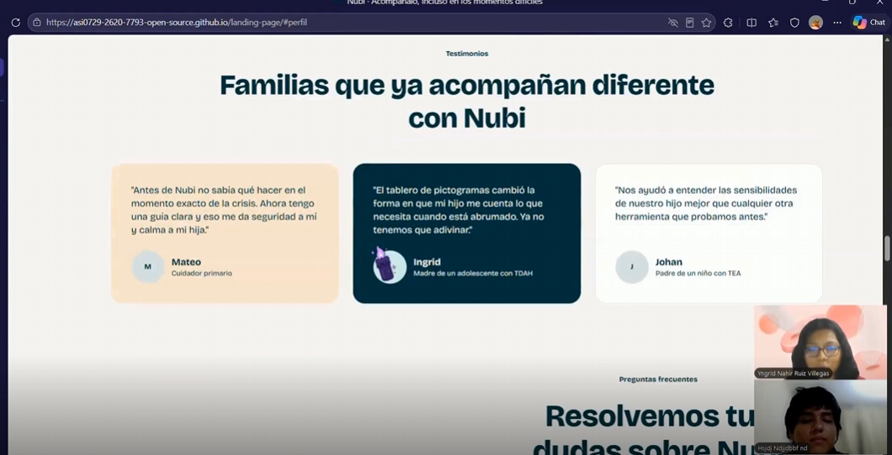
  </div>

  <!-- Datos en dos columnas -->
  <table style="width: 100%; border-collapse: collapse; font-size: 0.88em;">
    <tr>
      <td style="padding: 7px 14px; border: 1px solid #cfd8dc; width: 50%;">
        <strong>Entrevistado(a):</strong> Johan Friabusmante
      </td>
      <td style="padding: 7px 14px; border: 1px solid #cfd8dc; width: 50%;">
        <strong>Edad:</strong> 20 años
      </td>
    </tr>
    <tr>
      <td style="padding: 7px 14px; border: 1px solid #cfd8dc;">
        <strong>Entrevistador(a):</strong> Ingrid Nahir Ruiz Villegas
      </td>
      <td style="padding: 7px 14px; border: 1px solid #cfd8dc;">
        <strong>Distrito:</strong> Miraflores
      </td>
    </tr>
    <tr>
      <td style="padding: 7px 14px; border: 1px solid #cfd8dc;">
        <strong>Inicio de la entrevista:</strong> 1:01:49 (video consolidado)
      </td>
      <td style="padding: 7px 14px; border: 1px solid #cfd8dc;">
        <strong>Duración:</strong> 9:47 (de 1:01:49 a 1:11:36)
      </td>
    </tr>
  </table>

  <!-- Link -->
  <table style="width: 100%; border-collapse: collapse; font-size: 0.88em;">
    <tr>
      <td style="padding: 7px 14px; border: 1px solid #cfd8dc;">
        <strong>Link de la entrevista:</strong>
        <a href="https://l1nq.com/sx84u06">https://l1nq.com/sx84u06</a>
      </td>
    </tr>
  </table>

  <!-- Descripción -->
  <table style="width: 100%; border-collapse: collapse; font-size: 0.88em;">
    <tr>
      <td style="padding: 10px 14px; border: 1px solid #cfd8dc; line-height: 1.6;">
        <p>Indicó que su familiar tiene autismo leve. Entendió qué hace Nubi y le gustó que la aplicación pueda avisarle en tiempo real lo que ocurre con su familiar. Creó el perfil sin dificultad y consideró necesarios los datos solicitados. Por lo que vio, el botón SOS se ubica fácilmente. La guía paso a paso le pareció clara, con un paso a la vez y una cantidad de pasos adecuada, y le parece bien que se adapte a la condición de la persona. Dijo que el resumen al finalizar el episodio le permitió comprender todo lo ocurrido. Cree que el tablero de pictogramas podría usarse para comunicarse durante una crisis, y le resultó muy útil lo que ocurre después de confirmar una necesidad. Para usar Nubi en una situación de alta tensión, por ahora le parece bien, aunque considera que sería bueno contar con un profesional de la salud. No señaló pantallas ni pasos confusos y, por ahora, no sabría qué agregar. Probabilidad de uso: 5 en una escala de 1 a 5. Considera que el plan Premium le conviene más porque tiene más funciones.</p>
      </td>
    </tr>
  </table>

</div>

</div>

---

- Segunda entrevista:

<div align="center">
<div style="font-family: 'Segoe UI', sans-serif; max-width: 680px; margin: 24px auto; border: 1.5px solid #b0bec5; border-radius: 4px; overflow: hidden; box-shadow: 0 2px 8px rgba(0,0,0,0.12);">

  <!-- Encabezado -->
  <div style="background-color: #00373E; color: white; padding: 10px 16px; font-weight: 700; font-size: 1.1em; letter-spacing: 0.05em;">
  Entrevista de Validación
  </div>

  <!-- Imagen de la captura de pantalla -->
  <div style="background-color: #00373E; padding: 12px 16px 16px;">
    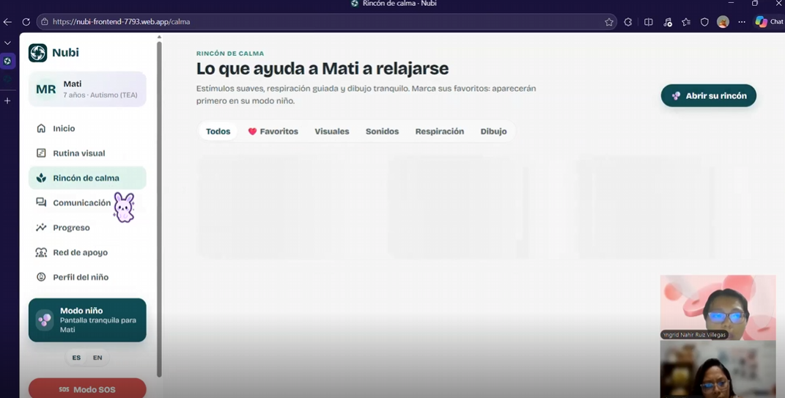
  </div>

  <!-- Datos en dos columnas -->
  <table style="width: 100%; border-collapse: collapse; font-size: 0.88em;">
    <tr>
      <td style="padding: 7px 14px; border: 1px solid #cfd8dc; width: 50%;">
        <strong>Entrevistado(a):</strong> Lizeth Villanueva
      </td>
      <td style="padding: 7px 14px; border: 1px solid #cfd8dc; width: 50%;">
        <strong>Edad:</strong> 25 años
      </td>
    </tr>
    <tr>
      <td style="padding: 7px 14px; border: 1px solid #cfd8dc;">
        <strong>Entrevistador(a):</strong> Ingrid Nahir Ruiz Villegas
      </td>
      <td style="padding: 7px 14px; border: 1px solid #cfd8dc;">
        <strong>Distrito:</strong> Pueblo Libre
      </td>
    </tr>
    <tr>
      <td style="padding: 7px 14px; border: 1px solid #cfd8dc;">
        <strong>Inicio de la entrevista:</strong> 1:11:39 (video consolidado)
      </td>
      <td style="padding: 7px 14px; border: 1px solid #cfd8dc;">
        <strong>Duración:</strong> 8:59 (de 1:11:39 a 1:20:38)
      </td>
    </tr>
  </table>

  <!-- Link -->
  <table style="width: 100%; border-collapse: collapse; font-size: 0.88em;">
    <tr>
      <td style="padding: 7px 14px; border: 1px solid #cfd8dc;">
        <strong>Link de la entrevista:</strong>
        <a href="https://sl1nk.com/2y1bdn9">https://sl1nk.com/2y1bdn9</a>
      </td>
    </tr>
  </table>

  <!-- Descripción -->
  <table style="width: 100%; border-collapse: collapse; font-size: 0.88em;">
    <tr>
      <td style="padding: 10px 14px; border: 1px solid #cfd8dc; line-height: 1.6;">
        <p>Entendió qué hace Nubi y la considera una plataforma interesante para entender mejor el tema. Su hermano tiene autismo, así que participa como familiar y no como madre o padre. Creó el perfil sin dificultad y consideró necesarios los datos solicitados. Encontró el botón SOS con facilidad y cree que lo ubicaría rápido en una crisis real. La guía paso a paso le pareció clara, con una cantidad de pasos adecuada, y le dio confianza de que se adapta al perfil. Consideró bastante útil el resumen al finalizar el episodio y cree que el tablero de pictogramas sería una herramienta muy útil durante una crisis. Entendió qué ocurre después de confirmar una necesidad de comunicación. Para usar Nubi en un momento de alta tensión, le daría más seguridad saber cómo tratar ciertos aspectos del tema neurológico, con respaldo de un médico especialista. Probabilidad de uso: no asignó un valor en la escala de 1 a 5; dijo que aún lo evaluaría, porque no le queda claro el objetivo real de Nubi ni qué nivel de acompañamiento ofrece. No respondió si pagaría por el plan Premium. Sugiere accesos más rápidos, por ejemplo a la atención o a la orientación con un especialista, para no tener que entrar a tantas pestañas.</p>
      </td>
    </tr>
  </table>

</div>

</div>

---

- Tercera entrevista:

<div align="center">
<div style="font-family: 'Segoe UI', sans-serif; max-width: 680px; margin: 24px auto; border: 1.5px solid #b0bec5; border-radius: 4px; overflow: hidden; box-shadow: 0 2px 8px rgba(0,0,0,0.12);">

  <!-- Encabezado -->
  <div style="background-color: #00373E; color: white; padding: 10px 16px; font-weight: 700; font-size: 1.1em; letter-spacing: 0.05em;">
  Entrevista de Validación
  </div>

  <!-- Imagen de la captura de pantalla -->
  <div style="background-color: #00373E; padding: 12px 16px 16px;">
    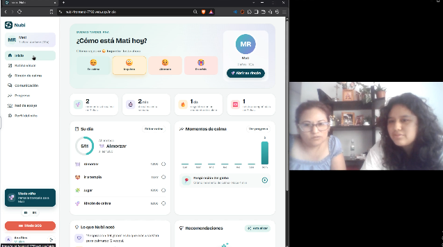
  </div>

  <!-- Datos en dos columnas -->
  <table style="width: 100%; border-collapse: collapse; font-size: 0.88em;">
    <tr>
      <td style="padding: 7px 14px; border: 1px solid #cfd8dc; width: 50%;">
        <strong>Entrevistado(a):</strong> Carmen Romero
      </td>
      <td style="padding: 7px 14px; border: 1px solid #cfd8dc; width: 50%;">
        <strong>Edad:</strong> 47 años
      </td>
    </tr>
    <tr>
      <td style="padding: 7px 14px; border: 1px solid #cfd8dc;">
        <strong>Entrevistador(a):</strong> Sofía Díaz Yurvilca
      </td>
      <td style="padding: 7px 14px; border: 1px solid #cfd8dc;">
        <strong>Distrito:</strong> El Callao
      </td>
    </tr>
    <tr>
      <td style="padding: 7px 14px; border: 1px solid #cfd8dc;">
        <strong>Inicio de la entrevista:</strong> 1:20:42 (video consolidado)
      </td>
      <td style="padding: 7px 14px; border: 1px solid #cfd8dc;">
        <strong>Duración:</strong> 16:51 (de 1:20:42 a 1:37:33)
      </td>
    </tr>
  </table>

  <!-- Link -->
  <table style="width: 100%; border-collapse: collapse; font-size: 0.88em;">
    <tr>
      <td style="padding: 7px 14px; border: 1px solid #cfd8dc;">
        <strong>Link de la entrevista:</strong>
        <a href="https://l1nq.com/j0ayo4q">https://l1nq.com/j0ayo4q</a>
      </td>
    </tr>
  </table>

  <!-- Descripción -->
  <table style="width: 100%; border-collapse: collapse; font-size: 0.88em;">
    <tr>
      <td style="padding: 10px 14px; border: 1px solid #cfd8dc; line-height: 1.6;">
        <p>Tiene un hijo con autismo y entendió que Nubi está dirigido a personas con autismo. Dijo que ayuda a completar las actividades programadas durante el día y que, en un problema mayor, se puede contar con contactos que indiquen qué hacer. Creó el perfil sin dificultad y consideró necesarios los datos solicitados, que se completan paso por paso. No había visto bien el Modo SOS, por lo que no pudo confirmar si ubicaría el botón rápido en una crisis real. La guía paso a paso le pareció bien, con una cantidad de pasos muy adecuada, y dijo que el resumen al finalizar el episodio es más ligero y rápido que anotar a mano. Cree que el tablero de pictogramas le servirá bastante a su hijo para comunicarse en una crisis, y le resultó claro lo que ocurre después de confirmar una necesidad. Para usar Nubi en una situación de alta tensión, confiaría sobre todo en el SOS, porque su hijo tendría la seguridad de que habrá contacto con su terapeuta y con la familia. También aprendió una estrategia de respiración con globo que no conocía. Probabilidad de uso: no dio un número en la escala de 1 a 5. Sí pagaría por el plan Premium, porque quiere que su hijo sea más independiente y pueda realizar sus actividades normales. No encontró pantallas ni pasos confusos. Sugirió que el niño pueda tener a mano los contactos durante una crisis, y estrategias para que se serene hasta que llegue la ayuda pertinente.</p>
      </td>
    </tr>
  </table>

</div>

</div>

---

#### Resultados por flujo

La tabla resume cuántos participantes de cada segmento completaron cada flujo, según los resúmenes de las entrevistas. «Sin dato» indica que el resumen no permite saber si el participante realizó el flujo. Los resúmenes no registran que el entrevistador haya ayudado en algún flujo, salvo el caso de Carmen en UF-4, a quien se le mostró el Modo SOS; la columna «Completó con ayuda» se contrasta con los videos.

| Flujo | Segmento | Completó solo | Completó con ayuda | No completó | Sin dato | Facilidad promedio (1 a 5) |
|---|---|---|---|---|---|---|
| UF-1 Autorregulación | 1 | 3 | 0 | 0 | 0 | **[POR CONFIRMAR]** |
| UF-2 Comunicación asistida | 1 | 2 | 0 | 0 | 1 | **[POR CONFIRMAR]** |
| UF-3 Perfil y Personalización | 2 | 3 | 0 | 0 | 0 | **[POR CONFIRMAR]** |
| UF-4 Modo SOS | 2 | 2 | 1 | 0 | 0 | **[POR CONFIRMAR]** |
| UF-5 Comunicación asistida | 2 | 2 | 0 | 0 | 1 | **[POR CONFIRMAR]** |
| UF-6 Red de Apoyo y Seguimiento | 2 | 3 | 0 | 0 | 0 | **[POR CONFIRMAR]** |
| UF-7 Cuenta y plan | 2 | 2 | 0 | 0 | 1 | **[POR CONFIRMAR]** |

**Facilidad promedio.** Los resúmenes no registran la calificación de facilidad de 1 a 5 de cada flujo, por lo que esa columna se completa con los videos. Lo que sí se registró en todas las entrevistas es la probabilidad de uso (pregunta 9).

**Observaciones por flujo:**

- **UF-1.** Los tres participantes usaron las burbujas flotantes; Sebastián dijo sentirse mejor al terminar y Owen, tranquilo. Diana consideró que la pantalla se adapta bien a su estado y Owen también probó la intensidad y el temporizador de 2 minutos. Sebastián consideró fluorescentes los colores y muy pequeños la burbuja y el globo de respiración.
- **UF-2.** Sebastián y Diana usaron el tablero de pictogramas. Sebastián preguntó qué significaban las opciones «entendí» y «no entendí». El resumen de Owen no menciona el tablero.
- **UF-3.** Los tres padres o familiares crearon el perfil sin dificultad y consideraron necesarios los datos solicitados.
- **UF-4.** Johan y Lizeth encontraron el botón SOS y valoraron la guía y el resumen del episodio. A Carmen se le mostró el Modo SOS y valoró la guía y el resumen, pero olvidó dónde estaba el botón y no pudo confirmar si lo ubicaría en una crisis real.
- **UF-5.** Los tres opinaron que el tablero de pictogramas serviría para comunicarse en una crisis. La mayoría lo configuró; el resumen de uno de ellos no indica si lo hizo.
- **UF-6.** Los tres entendieron lo que ocurre después de confirmar una necesidad; Johan destacó el aviso en tiempo real.
- **UF-7.** Johan y Carmen compararon los planes y opinaron sobre el Premium (Johan lo considera más conveniente y Carmen sí pagaría). Lizeth no respondió si pagaría y el resumen no indica si comparó los planes. Ningún resumen menciona el registro o el inicio de sesión.

**Probabilidad de uso (escala de 1 a 5).**

| Segmento | Respuestas registradas | Sin respuesta |
|---|---|---|
| 1. Personas autistas | Sebastián: 3; Diana: 4; Owen: 4 (promedio 3.7) | 0 |
| 2. Padres de niños y adolescentes con autismo | Johan: 5 | Lizeth y Carmen no asignaron un valor |


### 5.3.3. Evaluaciones según heurísticas

Después de las sesiones de validación, el equipo evalúa la experiencia de Nubi con el formato **UX Heuristics & Principles Evaluation** del Anexo D del enunciado, que revisa la usabilidad, el diseño inclusivo y la arquitectura de información. Se llena un formato por cada sesión de evaluación, a partir de las observaciones de todas las entrevistas de la sección 5.3.2. El formato tiene cinco partes: los datos de la sesión, el sitio o la aplicación a evaluar con sus tareas, la escala de severidad, la tabla resumen de problemas y la descripción de cada problema con su captura de pantalla y su recomendación.

#### Datos de la sesión de evaluación

| Dato | Detalle |
|---|---|
| Carrera | Ingeniería de Software |
| Curso | Desarrollo de Aplicaciones Open Source (1ASI0729) |
| Sección | NRC 7793 |
| Profesores | Todos |
| Auditor | Macally (grupo que ejecuta la sesión de evaluación) |
| Cliente(s) | Sebastián Moisés Suárez Simeón, Diana López, Owen Aguirre Campos (Segmento 1); Johan Friabusmante, Lizeth Villanueva, Carmen Romero (Segmento 2) |

#### Sitio o aplicación a evaluar

| Producto | Enlace |
|---|---|
| Nubi, Landing Page | https://asi0729-2620-7793-open-source.github.io/landing-page/ |
| Nubi, Frontend Web Application | https://nubi-frontend-7793.web.app |

#### Tareas a evaluar

El alcance de la evaluación incluye la revisión de la usabilidad de las tareas asignadas en la sección 5.3.1 a los dos segmentos objetivo:

1. Explorar el Landing Page e identificar qué ofrece Nubi y los planes disponibles.
2. Crear una cuenta e iniciar sesión.
3. Crear el perfil de un niño o adolescente y registrar una sensibilidad sensorial.
4. Elegir un estímulo visual o auditivo y abrirlo en una sesión de calma.
5. Cambiar la intensidad del estímulo y activar el modo de baja estimulación.
6. Iniciar el temporizador de calma, pausarlo y terminar la sesión.
7. Usar el tablero de pictogramas para comunicar una necesidad.
8. Marcar pictogramas como favoritos, filtrar el tablero por categoría y reordenarlo.
9. Activar el Modo SOS desde cualquier pantalla.
10. Seguir la guía paso a paso del Modo SOS, completando y omitiendo pasos, y finalizar el episodio.
11. Revisar el resumen del episodio.
12. Ver la última necesidad comunicada y confirmar su recepción.
13. Comparar el plan Standard con el plan Premium.

No están incluidas en esta versión de la evaluación las siguientes tareas, porque no forman parte de los User Flows UF-1 a UF-7 validados: las historias de seguimiento y recomendaciones de la Red de Apoyo y Seguimiento (US-30 a US-45), el pictograma personalizado y el audio de los pictogramas (US-22 y US-24) y cancelar una solicitud de ayuda (US-28), que no están disponibles en esta versión de la aplicación.

#### Escala de severidad

Los problemas se puntúan con la siguiente escala.

| Nivel | Descripción |
|:---:|---|
| 1 | Problema superficial: el usuario lo supera con facilidad o casi nunca ocurre. No se corrige salvo que haya tiempo disponible. |
| 2 | Problema menor: ocurre con algo más de frecuencia o al usuario le cuesta un poco más superarlo. Se le asigna prioridad baja de cara al siguiente release. |
| 3 | Problema mayor: ocurre con frecuencia o los usuarios no logran resolverlo. Es importante corregirlo y se le asigna prioridad alta. |
| 4 | Problema muy grave: tiene un impacto grande e impide que el usuario continúe con la aplicación. Es imperativo corregirlo antes del lanzamiento. |

#### Criterios de referencia

Para detectar los problemas, el equipo contrasta lo observado en cada sesión con tres grupos de criterios. Al registrar un problema se nombra la heurística o el principio violado con el prefijo de su grupo, como en el Anexo D: `Usability: <heurística>`, `Information Architecture: <criterio>` o `Inclusive Design: <principio>`.

**A. Usability (heurísticas de Nielsen)**

| # | Heurística | Qué se verifica en Nubi | Problemas asociados (# de la tabla resumen) |
|---|---|---|---|
| H1 | Visibilidad del estado del sistema | El usuario sabe en qué paso de la guía del Modo SOS va y si el envío de una necesidad o una solicitud se confirmó. | Ninguno registrado |
| H2 | Correspondencia entre el sistema y el mundo real | Los textos y pictogramas usan el lenguaje del usuario, sin términos clínicos. | 3, 6 |
| H3 | Control y libertad del usuario | Puede cancelar una solicitud de ayuda, salir del Modo SOS y deshacer un cambio del perfil. | Ninguno registrado |
| H4 | Consistencia y estándares | Los botones, colores y etiquetas se comportan igual en todos los módulos. | Ninguno registrado |
| H5 | Prevención de errores | Omitir un paso obligatorio del Modo SOS exige confirmación y el formulario del perfil valida los datos. | 4 |
| H6 | Reconocer en lugar de recordar | Las opciones y pictogramas están a la vista, sin obligar a recordar pasos previos. | 10 |
| H7 | Flexibilidad y eficiencia de uso | El botón SOS es accesible desde cualquier pantalla y los favoritos aceleran las tareas repetidas. | 8 |
| H8 | Diseño estético y minimalista | Cada pantalla muestra solo lo necesario, sin saturar durante una crisis. | Ninguno registrado |
| H9 | Ayuda para reconocer, diagnosticar y recuperarse de errores | Los mensajes de error explican qué ocurrió y cómo resolverlo. | Ninguno registrado |
| H10 | Ayuda y documentación | El usuario encuentra explicaciones breves, preguntas frecuentes o textos de apoyo cuando los necesita. | 7, 11 |

**B. Information Architecture**

Se evalúan los sistemas definidos en la sección 4.2.

| # | Criterio | Qué se verifica en Nubi | Problemas asociados (# de la tabla resumen) |
|---|---|---|---|
| AI1 | Sistema de organización | Los contenidos se agrupan por los cinco Bounded Contexts y el usuario entiende dónde está cada herramienta. | Ninguno registrado |
| AI2 | Sistema de etiquetado | Las etiquetas del menú y de los botones son comprensibles y coinciden con lo que el usuario espera. | Ninguno registrado |
| AI3 | Sistema de navegación | El usuario llega a cada módulo en pocos pasos y puede volver al inicio. | 5 |
| AI4 | Sistema de búsqueda y descubrimiento | El usuario encuentra sin buscar el Modo SOS, los planes y las preguntas frecuentes. | Ninguno registrado |
| AI5 | Jerarquía de contenido | Lo más importante (Modo SOS, tablero) destaca sobre lo secundario. | 9 |

**C. Inclusive Design**

Se evalúan los criterios de accesibilidad y de baja carga sensorial de las Style Guidelines (sección 4.1).

| # | Principio | Qué se verifica en Nubi | Problemas asociados (# de la tabla resumen) |
|---|---|---|---|
| IN1 | Baja carga sensorial | Los colores, animaciones y sonidos no abruman; el modo de baja estimulación reduce los estímulos. | 1 |
| IN2 | Previsibilidad | Las pantallas se comportan de forma predecible y avisan antes de cambiar. | Ninguno registrado |
| IN3 | Proporciona experiencias comparables (comunicación sin depender del habla) | El usuario puede expresarse con pictogramas e imágenes cuando no puede hablar. | Ninguno registrado |
| IN4 | Lenguaje claro | Las instrucciones son cortas, concretas y sin metáforas. | Ninguno registrado |
| IN5 | Contraste, tamaño y foco | Los textos son legibles, los controles táctiles son grandes y el foco del teclado es visible. | 2 |
| IN6 | Idioma y personalización | El usuario puede cambiar de idioma y ajustar la experiencia a sus sensibilidades. | Ninguno registrado |

#### Tabla resumen

La tabla resume los problemas observados en las seis entrevistas de la sección 5.3.2, a partir de lo que cada participante dijo o hizo en sus resúmenes. Las severidades, los responsables y los Sprint de corrección son una propuesta del equipo que se contrasta con los videos de las entrevistas.

| # | Problema | Escala de severidad | Heurística/Principio violada(o) |
|:---:|---|:---:|---|
| 1 | Los colores de la galería de estímulos resultan fluorescentes en momentos de sobreestimulación | 2 | `Inclusive Design: Baja carga sensorial` |
| 2 | La burbuja y el globo de respiración son muy pequeños | 2 | `Inclusive Design: Contraste, tamaño y foco` |
| 3 | Las opciones «entendí» y «no entendí» del tablero no se entienden | 2 | `Usability: Correspondencia entre el sistema y el mundo real` |
| 4 | El acceso al área de adultos es demasiado fácil para un niño | 3 | `Usability: Prevención de errores` |
| 5 | Editar una rutina lleva directo al perfil del niño | 2 | `Information Architecture: Sistema de navegación` |
| 6 | El término «archivar un perfil» no se entiende | 2 | `Usability: Correspondencia entre el sistema y el mundo real` |
| 7 | Hay dudas sobre el Modo SOS y la Red de Apoyo que necesitan aclaración | 2 | `Usability: Ayuda y documentación` |
| 8 | Hay que entrar a muchas pestañas para llegar a la atención o a la orientación | 2 | `Usability: Flexibilidad y eficiencia de uso` |
| 9 | El objetivo de Nubi y el nivel de acompañamiento que ofrece no quedan claros | 2 | `Information Architecture: Jerarquía de contenido` |
| 10 | El botón SOS es difícil de recordar después de verlo | 2 | `Usability: Reconocer en lugar de recordar` |
| 11 | Los padres condicionan su confianza al respaldo de un profesional de la salud | 3 | `Usability: Ayuda y documentación` |

#### Descripción de problemas

Cada ficha describe un problema de la tabla resumen, con su captura de pantalla y su recomendación.

**PROBLEMA #1:** Los colores de la galería de estímulos resultan fluorescentes en momentos de sobreestimulación

**Severidad:** 2

**Heurística violada:** `Inclusive Design: Baja carga sensorial`

**Problema:** Sebastián consideró que los colores son demasiado fluorescentes para un momento de sobreestimulación. Ocurrió en la tarea de elegir un estímulo de calma (UF-1). Diana y Owen describieron la paleta como tranquila, por lo que el problema se observó en 1 de 3 entrevistas del Segmento 1.

**Captura de pantalla:**

<p align="center">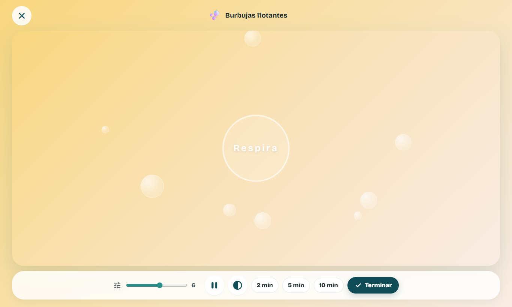</p>

*Escena de burbujas flotantes del Rincón de calma (versión del 14 de noviembre de 2026, que usa tonos suaves).*

**Recomendación:** Revisar la paleta de los estímulos con las Style Guidelines (sección 4.1) y bajar la saturación, o aplicar la baja estimulación como opción predeterminada. **Responsable:** Payano Puchuri, Joan Fabricio (Autorregulación). **Sprint en que se corrige:** Sprint 4.

**PROBLEMA #2:** La burbuja y el globo de respiración son muy pequeños

**Severidad:** 2

**Heurística violada:** `Inclusive Design: Contraste, tamaño y foco`

**Problema:** Sebastián indicó que la burbuja y el globo de respiración se ven muy pequeños durante la sesión de calma (UF-1). Se observó en 1 de 3 entrevistas del Segmento 1.

**Captura de pantalla:**

<p align="center">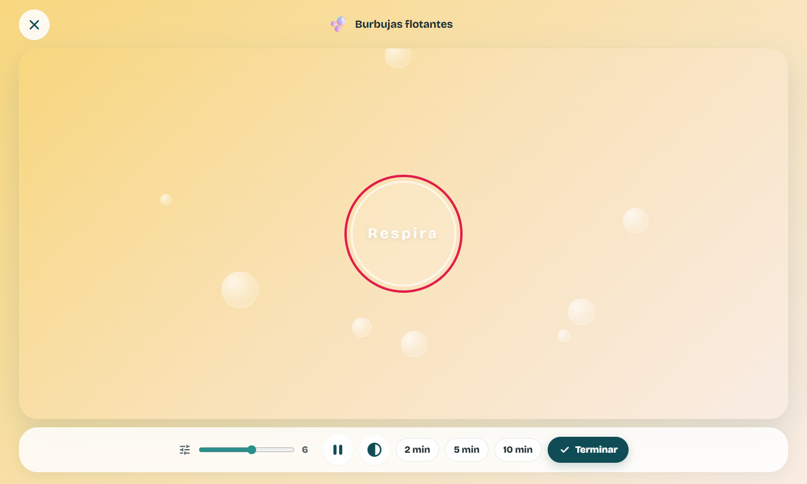</p>

*Sesión de burbujas flotantes, con el círculo «Respira» marcado.*

<p align="center"></p>

*Sesión «Respiración del globo» para comparar el tamaño del globo.*

**Recomendación:** Aumentar el tamaño de la burbuja y del globo de respiración, o permitir ajustarlo desde la sesión. **Responsable:** Payano Puchuri, Joan Fabricio (Autorregulación). **Sprint en que se corrige:** Sprint 4.

**PROBLEMA #3:** Las opciones «entendí» y «no entendí» del tablero no se entienden

**Severidad:** 2

**Heurística violada:** `Usability: Correspondencia entre el sistema y el mundo real`

**Problema:** Sebastián entendió para qué sirve el tablero de pictogramas, pero preguntó qué significaban las opciones «entendí» y «no entendí» (UF-2). Se observó en 1 de 3 entrevistas del Segmento 1.

**Captura de pantalla:**

<p align="center"></p>

*Panel «Por atender» de Comunicación, con los botones «Entendí» y «No entendí» marcados.*

**Recomendación:** Acompañar las opciones con un ícono y una explicación breve que indique que son para que el acompañante confirme si comprendió el mensaje. **Responsable:** Lopez Torres, Leonardo Gabriel (Comunicación Asistida). **Sprint en que se corrige:** Sprint 4.

**PROBLEMA #4:** El acceso al área de adultos es demasiado fácil para un niño

**Severidad:** 3

**Heurística violada:** `Usability: Prevención de errores`

**Problema:** Sebastián señaló que desde la aplicación se llega con mucha facilidad al área de adultos, lo que permite que un niño entre a configuraciones del cuidador. Se observó en 1 de 3 entrevistas del Segmento 1. Se le asigna severidad 3 porque las consecuencias, como modificar datos del perfil, afectan al cuidador.

**Captura de pantalla:**

<p align="center"></p>

*Modo niño, con el botón «Adultos» marcado.*

**Recomendación:** Pedir una confirmación o un paso adicional, por ejemplo un PIN, para entrar al área del cuidador. **Responsable:** Lopez Torres, Leonardo Gabriel (modo niño). **Sprint en que se corrige:** Sprint 4.

**PROBLEMA #5:** Editar una rutina lleva directo al perfil del niño

**Severidad:** 2

**Heurística violada:** `Information Architecture: Sistema de navegación`

**Problema:** Sebastián observó que al editar una rutina la aplicación lo lleva directo al perfil del niño y no al editor de la rutina. Se observó en 1 de 3 entrevistas del Segmento 1.

**Captura de pantalla:**

<p align="center"></p>

*Rutina visual, con el botón de editar un paso marcado. En la versión del 14 de noviembre este botón abre el diálogo «Editar paso» en la misma pantalla, por lo que no se reprodujo el salto al perfil del niño.*

**Recomendación:** Hacer que el botón de editar abra el editor de la rutina y avisar si se cambia de pantalla. **Responsable:** Lopez Torres, Leonardo Gabriel (Rutina Visual); primero se verifica si el problema se reproduce en la versión 1.2.0. **Sprint en que se corrige:** Sprint 4.

**PROBLEMA #6:** El término «archivar un perfil» no se entiende

**Severidad:** 2

**Heurística violada:** `Usability: Correspondencia entre el sistema y el mundo real`

**Problema:** Sebastián no entendió qué significa archivar un perfil. Se observó en 1 de 3 entrevistas del Segmento 1.

**Captura de pantalla:**

<p align="center"></p>

*Perfil del niño, con la opción «Archivar» marcada.*

**Recomendación:** Explicar en el mensaje de confirmación qué ocurre al archivar o usar un término más claro para el cuidador. **Responsable:** Ruiz Villegas, Yngrid Nahir (Perfil y Personalización). **Sprint en que se corrige:** Sprint 4.

**PROBLEMA #7:** Hay dudas sobre el Modo SOS y la Red de Apoyo que necesitan aclaración

**Severidad:** 2

**Heurística violada:** `Usability: Ayuda y documentación`

**Problema:** Durante la sesión de Diana surgieron preguntas sobre el Modo SOS y la red de apoyo que el entrevistador tuvo que aclarar. Se observó en 1 de 3 entrevistas del Segmento 1.

**Captura de pantalla:**

<p align="center"></p>

*Pantalla del Modo SOS.*

<p align="center"></p>

*Pantalla de Red de Apoyo y Seguimiento.*

**Recomendación:** Agregar una descripción breve en el Modo SOS y en la Red de Apoyo y Seguimiento que explique para qué sirven. **Responsable:** Diaz Yurivilca, Sofia (Modo SOS) y Diaz Caruzo, Edgard Daniel (Red de Apoyo y Seguimiento). **Sprint en que se corrige:** Sprint 4.

**PROBLEMA #8:** Hay que entrar a muchas pestañas para llegar a la atención o a la orientación

**Severidad:** 2

**Heurística violada:** `Usability: Flexibilidad y eficiencia de uso`

**Problema:** Lizeth sugirió accesos más rápidos, por ejemplo a la atención o a la orientación con un especialista, para no tener que entrar a tantas pestañas. Se observó en 1 de 3 entrevistas del Segmento 2.

**Captura de pantalla:**

<p align="center"></p>

*Inicio, con el menú lateral de navegación marcado.*

**Recomendación:** Agregar accesos directos a los contactos y a la orientación en el panel de Inicio. **Responsable:** Lopez Torres, Leonardo Gabriel (Inicio y navegación). **Sprint en que se corrige:** Sprint 4.

**PROBLEMA #9:** El objetivo de Nubi y el nivel de acompañamiento que ofrece no quedan claros

**Severidad:** 2

**Heurística violada:** `Information Architecture: Jerarquía de contenido`

**Problema:** Lizeth no asignó una probabilidad de uso porque no le quedó claro el objetivo real de Nubi ni qué nivel de acompañamiento ofrece. Se observó en 1 de 3 entrevistas del Segmento 2.

**Captura de pantalla:**

<p align="center"></p>

*Hero del Landing Page.*

**Recomendación:** Explicar al inicio, con una frase breve, el objetivo de Nubi y el alcance de su acompañamiento, aclarando que no reemplaza a un profesional. **Responsable:** Lopez Torres, Leonardo Gabriel (Landing Page e Inicio). **Sprint en que se corrige:** Sprint 4.

**PROBLEMA #10:** El botón SOS es difícil de recordar después de verlo

**Severidad:** 2

**Heurística violada:** `Usability: Reconocer en lugar de recordar`

**Problema:** A Carmen se le mostró el Modo SOS, pero olvidó dónde estaba el botón y no pudo confirmar si lo ubicaría en una crisis real (UF-4). Johan y Lizeth lo encontraron con facilidad. Se observó en 1 de 3 entrevistas del Segmento 2.

**Captura de pantalla:**

<p align="center"></p>

*Inicio, con el botón «Modo SOS» del menú lateral marcado.*

**Recomendación:** Reforzar la visibilidad del botón SOS (color y etiqueta) y mostrar una guía breve la primera vez que se usa la aplicación. **Responsable:** Diaz Yurivilca, Sofia (Modo SOS). **Sprint en que se corrige:** Sprint 4.

**PROBLEMA #11:** Los padres condicionan su confianza al respaldo de un profesional de la salud

**Severidad:** 3

**Heurística violada:** `Usability: Ayuda y documentación`

**Problema:** Los tres participantes del Segmento 2 indicaron que usarían Nubi en una situación de alta tensión con más seguridad si cuentan con un profesional de la salud: Johan lo considera conveniente, Lizeth pide el respaldo de un médico especialista y Carmen se apoya en el contacto con su terapeuta. Se observó en 3 de 3 entrevistas del Segmento 2. Se le asigna severidad 3 porque la confianza condiciona la adopción del producto.

**Captura de pantalla:**

<p align="center"></p>

*Red de Apoyo y Seguimiento, con el texto sobre reportes para el terapeuta y el acceso a cuidadores y contactos marcados.*

**Recomendación:** Mostrar de forma visible que Nubi complementa la atención de profesionales y permitir vincular al terapeuta como contacto de confianza. **Responsable:** Diaz Caruzo, Edgard Daniel (Red de Apoyo y Seguimiento). **Sprint en que se corrige:** Sprint 4.

## 5.4. Video About-the-Product

El video About-the-Product presenta Nubi a los visitantes del Landing Page, que quieren conocer el modelo de negocio y las características del producto, y a los cuidadores y usuarios de la Frontend Web Application, que quieren saber qué pueden hacer con ella. El tono es el del producto: cercano, calmado, con lenguaje claro y no clínico, y sin prometer reemplazar la atención de un profesional de la salud.

#### Estructura propuesta

| Escena | Contenido | Duración aproximada |
|---|---|---|
| 1. Problema | Una crisis sensorial y la dificultad de actuar sin herramientas inmediatas. | 15 s |
| 2. Propuesta | Qué es Nubi y para quién: personas autistas y sus padres. | 15 s |
| 3. Modo SOS | Activación con un solo toque y guía paso a paso adaptada al perfil. | 25 s |
| 4. Autorregulación y CAA | Elegir un estímulo, ajustar la intensidad, usar el tablero de pictogramas. | 25 s |
| 5. Red de apoyo | Solicitud de ayuda, aviso al cuidador y seguimiento de episodios. | 15 s |
| 6. Testimonio | Opinión positiva de un participante de las entrevistas de validación de cada segmento. | 30 s |
| 7. Planes y cierre | Planes Standard, Premium e Instituciones y llamado a crear la cuenta. | 15 s |

El video publicado dura 3 minutos y 53 segundos.

#### Datos del video

| Dato | Detalle |
|---|---|
| Título | `upc-pre-202620-1asi0729-7793-macally-about-the-product-sprint-3` |
| Formato | mp4 |
| Duración | 3:53 |
| URL en Microsoft Stream | https://sl1nk.com/o8ai3x0 |
| Testimonio incluido | **[POR COMPLETAR]** Nombre del participante, segmento y entrevista de la sección 5.3.2 |
| Responsable | Ruiz Villegas, Yngrid Nahir **[POR CONFIRMAR]** |

**[POR COMPLETAR]** Captura de pantalla del video (`images/Chapter-V/about-the-product.png`).
